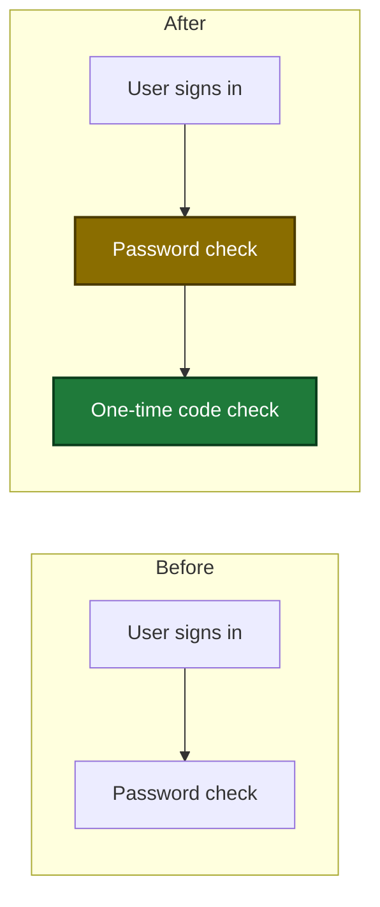

# Topic file

Read this page when you want to know where `/sdlc:preplan` keeps its state,
what each section of the file holds, or why the tool refused a section. The
topic file is the only state of the skill, and [`/sdlc:plan`](../plan.md)
reads it as its requirements file.

## Example

On 2026-10-12 (UTC), `/sdlc:preplan auth flow` creates
`.sdlc-v2/preplan/2026-10-12-auth-flow.md`. A new file holds the heading, the
status, the start time and seven empty sections:

```markdown
# Preplan: auth flow

**Status:** in progress

**Started:** 2026-10-12T21:30:00Z

## Goal

## Problem and benefit

## Users and effect

## Risk if wrong

## Non-goals

## Flows

## Decisions
```

Each answer of the dialogue fills one of these sections (see
[Dialogue and handoff](./dialogue.md)).

## Topic name

The topic must be on one line. It must have 1 to 50 characters and at least
one ASCII letter or digit. If the topic is not valid, the skill prints the
error and stops. It creates no file.

## File name

The skill keeps all its state in one Markdown file:
`.sdlc-v2/preplan/<date>-<name>.md`. `<date>` is the UTC date of the first
run, as `YYYY-MM-DD`. The name comes from the topic in four steps:

1. The skill changes the topic to lowercase.
2. The skill keeps only the ASCII letters `a-z` and the digits `0-9`. It
   changes every other character to a hyphen. This includes letters that are
   not ASCII, such as `é`.
3. Each run of hyphens becomes one hyphen.
4. The skill removes the hyphens at the start and at the end.

On 2026-10-12 the topic `Auth flow` gives `.sdlc-v2/preplan/2026-10-12-auth-flow.md`.
The topic `Café login` gives `.sdlc-v2/preplan/2026-10-12-caf-login.md`.

A later run with the same topic continues the file named exactly
`<name>.md` or `YYYY-MM-DD-<name>.md`. A file with no date, from before
this rule, keeps its name. If two files match, the skill stops and names
them. Rename or delete one of them, then run the skill again. If the
folder holds more than 10000 names, the skill stops. Move old topic files
out of the folder, then run the skill again.

The topic file is in the main worktree, so every worktree of the repo sees
the same file.

## Sections

The skill asks the `plan_support` tool to create the file once, with these
sections in this order. `Open questions` is not in a new file. The tool adds
that section, after `Decisions`, when the skill sends the first open question,
and deletes it with the last one.

| Section | Content |
|---|---|
| `Goal` | One or two sentences: the result you want. |
| `Problem and benefit` | The root problem in one sentence, who gains, the measure with its baseline, and the cost of no change. |
| `Users and effect` | Who uses the change, what changes for them, and what fails today. |
| `Risk if wrong` | Who or what fails if the change has a defect. |
| `Non-goals` | What the change does not build, one bullet for each. A scope option that you did not pick is a bullet `Offered, not picked: <option>.` If you say that the change excludes nothing, the line `None stated.` |
| `Flows` | A before and after diagram for each flow that a proposal changes, with the same steps as a numbered list. If no flow changes, the line `No flow change.` |
| `Decisions` | A table with one row for each proposal. The number of a row never changes, and the skill never uses it again. Under the table, one line holds your answer to the cut question (see [The cut question](./dialogue.md#the-cut-question)), for example `Smallest cut: #1, #3.`, `Smallest cut: #2.` or `Smallest cut: all.`. The numbers are in ascending order. The line is not a row. |
| `Open questions` | One bullet for each question that has no answer yet. After the skill converts an older file, the section exists only when at least one question is open. |

### Example of a Flows entry

Each diagram shows the before state and the after state of one flow. A new
step has the mark `:::new`, and a changed step has the mark `:::changed`.
The numbered list below the diagram holds the same steps, for a reader who
cannot render the diagram.



Before:

1. The user signs in.
2. The system checks the password.

After:

1. The user signs in.
2. The system checks the password (changed: it no longer ends the sign-in).
3. The system checks a one-time code (new).

## Status and time lines

The file has a status line. It shows where the topic stands:

| Status | Meaning |
|---|---|
| `in progress` | The dialogue is running. This is the status of a new file. |
| `ready for plan` | You finished the dialogue. The file can go to `/sdlc:plan`. |
| `paused` | The skill stopped before the end of the dialogue and kept the file. |

The skill sets `paused` in these cases:

- You cancelled during the dialogue, at a guardrail question or at the
  empty-section question.
- The guardrail check stopped with an error (see
  [Errors that stop the check](./guardrail-check.md#errors-that-stop-the-check)).
- The tool refused the write of one answer, or of one guardrail check, three
  times.
- A write of the topic file failed after the first question (see
  [When a write fails](./dialogue.md#when-a-write-fails)).

The skill sets a status only at these events. You can also set any of the
three statuses on the Preplans tab of the dashboard, with no dialogue event
(see [Change a preplan status](../../dashboard.md#change-a-preplan-status)).
For example, a topic can be `paused` with no cancel, or `ready for plan`
with no finished dialogue. The skill treats such a status the same as its
own.

A new topic file has a `**Started:**` line after the `**Status:**` line.
It holds the UTC time of the first run in RFC 3339 form, for example
`**Started:** 2026-10-12T21:30:00Z`. The dashboard shows the time from
this line to the last change of the file as the duration. A file with no
Started line shows a dash.

After the first check, one `**Guardrail check:**` line under the Started line
shows the number of guardrails, the proposal counts and the UTC time of the
last check (see [Guardrail check](./guardrail-check.md)).

## Continue an existing file

Run `/sdlc:preplan` again with the same topic to continue from the file. The
skill never replaces an existing file. The status becomes `in progress`, and
the skill shows you the open questions, if any.

The tool adds each section heading that the file does not have. Each added
section is empty, so the skill asks for it in the dialogue. That step does not
add `Open questions`.

An older file loses its `Guardrail check` table and an empty `Open questions`
section. The skill keeps each kept or dropped result as a note in the
`Decisions` table. A conversion that stops half way is safe to repeat. Each
conversion write removes the condition that caused it, so the next run sends
only the writes that are still needed. The `Decisions` write skips a note that
the `Reason` cell already holds, so the cell never gets a second kept note
(rule P6), and a repeat gives the same file.

## How the skill writes the file

The skill changes the file only through `plan_support` tool calls, never
with a file edit. Plan mode permits these calls. The tool checks each
section body against the format rules. It refuses a body over 64 KiB
(65536 bytes) or a body that breaks a rule, and the error names the rule.

## Format rules

`preplan_write` checks the new body of one section before it writes. First it
changes each CR LF to LF and removes the final line ends. A body that breaks
a rule is refused, and the file does not change. The error names the section
and the rule, for example:

```text
preplan_write: Section "Decisions" breaks rule P5: row 2 has 2 cells, want 3
```

The dashboard uses the same check: a section that breaks a rule is unread
(see the `repos[].preplans[]` row of the
[Snapshot contract](../../dashboard.md#snapshot-contract)).

| Rule | Section | Accepted form |
|---|---|---|
| P1 | all | The body is 65536 bytes or less. |
| P2 | all | No line outside a code fence starts with `# ` or `## `. |
| P3 | all | Each code fence closes. |
| P4 | `Decisions` | A body that is not blank starts with the two header lines `\| # \| Decision \| Reason \|` and `\|---\|---\|---\|`. |
| P5 | `Decisions` | Each row has 3 cells. The `#` value is a positive whole number, written with digits only, and no other row has it. |
| P6 | `Decisions` | A `Reason` cell holds one `Kept with warning:` note at most. A row whose `Decision` cell starts with `Dropped:` has `Dropped by:` in its `Reason` cell. |
| P7 | `Decisions` | After the table, only blank lines and at most one line `Smallest cut: all.` or `Smallest cut: #1, #3.`. The numbers are in ascending order, and each one is a row that is not dropped or moved. |
| P8 | `Non-goals` | The body is `None stated.`, or each line that is not blank starts with `- `. |
| P9 | `Open questions` | Each line that is not blank starts with `- `. |
| P10 | `Flows` | The body is `No flow change.`, or it holds a `mermaid` code fence. Each `classDef` line is one of the two `classDef` lines that the skill copies into each diagram (`classDef new ...` and `classDef changed ...`), with no change except leading spaces. |
| P11 | `Guardrail check` | Only an empty body. It deletes this older section. A body of spaces is not empty. |

A section with no rule of its own, for example `Goal`, has rules P1 to P3
only.

## Errors at the start

The first step of the skill loads the guardrails and the topic file. An error
there stops the skill before the first question. The skill prints the error and
stops. The status does not change, and the skill writes no `Guardrail check`
line. The first step stops in these cases:

- The topic is not valid (see [Topic name](#topic-name)).
- Two files match the topic, or the folder holds more than 10000 names (see
  [File name](#file-name)).
- The folder cannot be listed, or the tool cannot create the topic file. Fix
  the folder or its permission as the printed error says, then run the skill
  again.
- The topic file is a link, a folder, or another file that is not a regular
  file. The first step refuses a link too, even a link to a regular file.
  Replace the link with a copy of the file that it points to, then run the
  skill again.
- The topic file is larger than 8 MiB, or the added section headings would
  make it larger than 8 MiB. The tool refuses a larger file before it reads
  it, and it changes nothing. Make the file smaller, then run the skill again.
- A read of the topic file fails, or the write of the added section headings
  fails. The file stays as it was. Fix the cause that the printed error names,
  for example the file or folder permission, then run the skill again.

An error at the status write or at the conversion of an older file, before
the first question, also stops the skill and does not set `paused`.

A tool error can also stop the skill during the dialogue: see
[When a write fails](./dialogue.md#when-a-write-fails) and
[Errors that stop the check](./guardrail-check.md#errors-that-stop-the-check).
