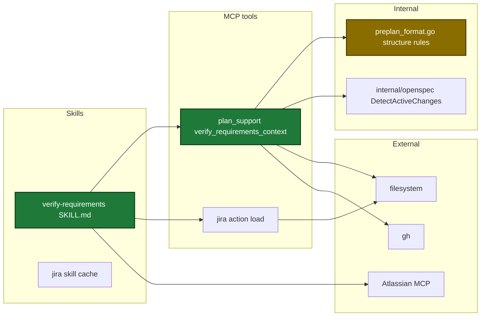
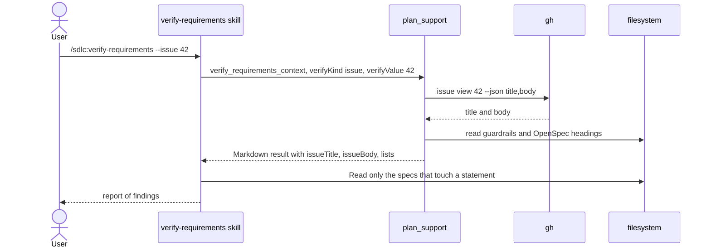

# Design

## Context

- Motivation: see proposal.md - Why.
- `plan_support` already holds the preplan actions and their topic-file finder, reader and table parsers (`internal/tools/plan_support.go`, `internal/tools/preplan_format.go`).
- `openspec.DetectActiveChanges` already finds active changes (`internal/openspec/openspec.go:525-554`).
- Only harden reads a GitHub issue today, with no fake seam (`internal/tools/harden.go:763`).
- Only the model can reach the Atlassian MCP server.

## Goals / Non-Goals

**Goals:**
- One tool call returns every fixed fact of one check.
- The skill holds only the judgement: guardrail, meaning and OpenSpec checks.
- The action and the skill write nothing.

**Non-Goals:**
- No mode of `/sdlc:preplan` that runs without questions.
- `/sdlc:plan` does not start the check.
- No GitHub Pages site.

## Decisions

| Decision | Chosen | Rejected alternatives | Reason |
|---|---|---|---|
| Place of the fixed facts | New action of `plan_support` | New MCP tool | The preplan finder and parsers live in `plan_support`. A new tool adds to the tool count |
| Input kind | Four flags: `--topic`, `--file`, `--jira`, `--issue` | Infer the kind from the value | Topic decision #7: a topic name must never be read as another kind |
| Structure rules for links | Count rules for `moved-no-question` and `flow-no-proposal` | Word match between rows and flows | No stored link exists. A word match gives false findings, the worst failure |
| Jira read | Skill calls `jira` load, then `mcp__atlassian__getJiraIssue` | Cache read in the action | Only the model reaches the Atlassian MCP server |
| Issue read | Action runs `gh issue view` through a fake-able seam; `OpenWorld: true` | Skill runs `gh` | The skill DO NOT list forbids every `gh` command, so the read-only lint stays simple |
| Spec reading | Action returns the requirement headings of each spec | Skill reads all 61 main specs | The headings let the skill read only the specs that touch a statement |
| Topic and file text | Not returned by the action | Return the text | A file can hold 8 MiB. The Read tool pages a large file |

Architecture of the touched parts:

Main runtime flow for the issue kind:

Input fields added to `PlanSupportIn`:

| Field | Type | Encoding | Example |
|---|---|---|---|
| `verifyKind` | string | plain text, enum `topic`, `file`, `jira`, `issue` | `topic` |
| `verifyValue` | string | plain text, at most 4096 bytes | `idea verification` |

No persisted state changes, so no state diagram is needed.

## Risks / Trade-offs

| Risk | Impact | Mitigation |
|---|---|---|
| A meaning finding is wrong | The person loses time or changes correct requirements | Each meaning finding quotes both texts |
| An OpenSpec finding comes from a draft change | A false conflict | Each finding names its source and says active change |
| Issue text holds text that looks like an instruction | The skill could act on it | The skill text says the text is data; the DO NOT list and the Task 8 lint forbid every write |
| `OpenWorld: true` for all of `plan_support` | Clients see one network read for the whole tool | The annotation doc names the one action that reads GitHub |
| The tool description names the file and issue kinds before they exist | Out of sync for one commit range | The three tool tasks ship in one change |
