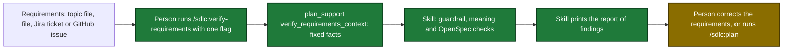

# Proposal

## Why

- Problem: requirements reach `/sdlc:plan` with gaps and contradictions. No step checks them before a plan run starts, so the plan run finds them late or not at all.
- Evidence: the only check today is a `/sdlc:preplan` dialogue, which asks questions and writes the topic file and its status (`internal/tools/plan_support.go`, actions `preplan_context`, `preplan_check`, `preplan_write`). Preplan topic file `2026-11-13-idea-verification.md`, decisions #1 to #9.
- Why now: requirements also come from requirements files, Jira tickets and GitHub issues, and none of these sources gets a check.

## What Changes

| Area | Before | After |
|---|---|---|
| Skills | No skill checks requirements without a dialogue | New skill `/sdlc:verify-requirements` with one of `--topic`, `--file`, `--jira`, `--issue`. It prints one report and changes nothing |
| `plan_support` actions | Twelve actions | Thirteen: new read-only action `verify_requirements_context` returns the fixed facts of one check |
| Topic-file structure checks | Only the empty-section list of `preplan_check` | Six structure rules: `open-fence`, `empty-section`, `decisions-table`, `cut-not-live`, `moved-no-question`, `flow-no-proposal` |
| `plan_support` annotations | `OpenWorld: false` | `OpenWorld: true`: the `issue` kind runs `gh issue view` |
| Docs | No page | `docs/skills/verify-requirements.md`, index and related-skill links, tool docs |

Requirements flow after the change (new steps marked):

## Capabilities

### New Capabilities
- `skill-verify-requirements`: the skill that checks one set of requirements with no dialogue and prints a report of findings.

### Modified Capabilities
- `tool-plan-support`: a new action `verify_requirements_context`, its input fields, and `OpenWorld: true`.

## Impact

| Path | Kind | Change |
|---|---|---|
| `plugins/sdlc/skills/verify-requirements/SKILL.md` | skill | new |
| `internal/tools/verify_requirements_context.go` | MCP tool | new action handler |
| `internal/tools/plan_support.go` | MCP tool | dispatch, fields, description, `OpenWorld: true` |
| `internal/tools/preplan_format.go` | MCP tool | structure rules |
| `internal/tools/annotations_test.go` | MCP tool | `plan_support` golden |
| `internal/skillcheck/skillcheck_verify_requirements_test.go` | CI | parity and read-only lint |
| `docs/skills/verify-requirements.md` | doc | new page |
| `docs/skills/README.md`, `docs/getting-started.md`, `docs/skills/preplan.md`, `docs/skills/plan.md` | doc | links |
| `docs/plan-architecture.md`, `docs/mcp-tool-annotations.md` | doc | action list, path input and `gh` read |
