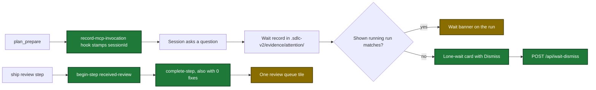

# Proposal

## Why

- Problem: the dashboard hides five facts that the user needs to act on a run: a plan run that waits for an answer, a wait with no run, the plan time of old ship History rows, the received-review step with 0 fixes, and the fix result of each review finding.
- Evidence: the plan state starts with no session ID (`internal/tools/plan.go:1384`). The snapshot drops a wait that matches no run (`internal/tools/dashboard_snapshot.go:490-494`). A fix record has no link key to a review finding (`internal/tools/ship_state.go:2387`).
- Why now: the user approved the draft page in `design/dashboard/static/`. The draft shows sample data in place of the missing data.

## What Changes

| Area | Before | After |
|---|---|---|
| Plan state | `sessionId` absent | the `record-mcp-invocation` hook writes the session ID after each `plan_prepare` call |
| Waits | a plan run that waits shows as running; a wait with no run is not shown | the plan run shows the wait banner and comes first; a wait with no run shows as a lone-wait card with Dismiss |
| Waiting counts | count runs with a wait | count runs with a wait plus lone waits |
| History times | an old ship row shows `—` for plan time | the row gets the plan time of the newest earlier plan row of its branch (`planPaired`) |
| History sort | finished and total | finished, plan, ship and total |
| History delete | by hand in `runs.jsonl` | checkboxes, Delete selected, one confirm question with a plan-time warning |
| Preplan status | by hand in the topic file | a status menu in the Preplans tab |
| received-review step | no `steps[]` entry; `decide` records only | `ship_prepare` seeds a pending entry after `review`; ship calls `begin-step` and `complete-step`, also with 0 fixes |
| Review results | a review tile and a separate fixes tile | one review queue tile with threshold, fix status and fix origin of each row |
| Fix rows | no origin | `origin`: `local-review` or `pr-comment` |
| Write errors | not applicable | a dialog with the reason and a recovery step; the file stays unchanged |

## Capabilities

### New Capabilities

- none

### Modified Capabilities

- `pipeline-dashboard`: plan session stamp, lone waits, History pairing and delete, review queue data and tile, three write routes, preplan status menu.
- `skill-ship`: received-review is recorded with `begin-step` and `complete-step` or `fail`, also with 0 fixes.
- `tool-ship-prepare`: the state scaffold seeds a `received-review` entry after `review`.
- `skill-preplan`: the dashboard can also set the topic status.

## Flow after the change

The user flow from an open wait or a finished review to the dashboard page:

## Impact

| Path | Kind | Change |
|---|---|---|
| `internal/hooks/mcp_invocation_record.go` | hook | stamp the plan session ID after `plan_prepare` |
| `internal/tools/dashboard_snapshot.go`, `dashboard_join.go`, `dashboard_activity.go`, `dashboard_review_queue.go` | MCP tool (dashboard collector) | new snapshot fields: `loneWaits`, `planPaired`, `planEndedAt`, `origin`, `reviewQueue` |
| `internal/attention/attention.go`, `internal/tools/dashboard_wait_dismiss.go`, `dashboard_preplan_status.go`, `dashboard_delete_runs.go` | MCP tool (dashboard writes) | three write functions |
| `internal/dashboard/web/server.go`, `cmd/sdlc/main.go` | MCP tool (dashboard server) | `POST /api/preplan-status`, `POST /api/history-delete`, `POST /api/wait-dismiss` |
| `internal/dashboard/web/static/` | doc (page) | copy of the draft page on real data |
| `internal/tools/ship.go` | MCP tool | `ship_prepare` seeds `received-review` |
| `plugins/sdlc/schemas/ship-state.schema.json` | schema | description of `condition` |
| `plugins/sdlc/skills/ship/` | skill | step 8 records received-review with `begin-step` and `complete-step` |
| `plugins/sdlc/skills/preplan/SKILL.md`, `plugins/sdlc/skills/plan/state-format.md` | skill | status text, `sessionId` row |
| `docs/dashboard.md`, `docs/skills/ship.md` | doc | new fields, routes and page actions |
| `go.mod`, `internal/dashboard/web/browser_e2e_test.go` | CI | chromedp browser test behind the `integration` tag |
