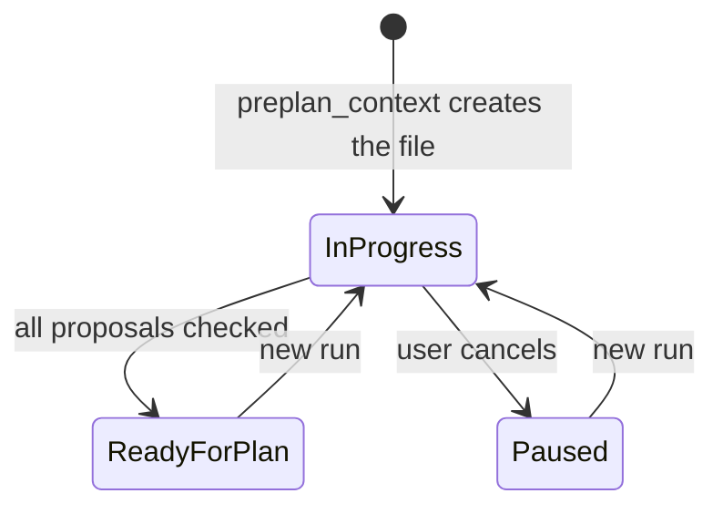

# Spec Delta

## MODIFIED Requirements

### Requirement: Topic status
The preplan skill SHALL change the topic file status only as the diagram shows. The dashboard Preplans tab SHALL set any of the three statuses that the user picks, outside this skill.

#### Scenario: Cancel
- **WHEN** the user cancels during a question
- **THEN** the status is `paused` and the file stays

#### Scenario: Status set from the dashboard
- **WHEN** the user picks `paused` in the dashboard status menu of a topic file with status `ready for plan`
- **THEN** the topic file has `**Status:** paused`
