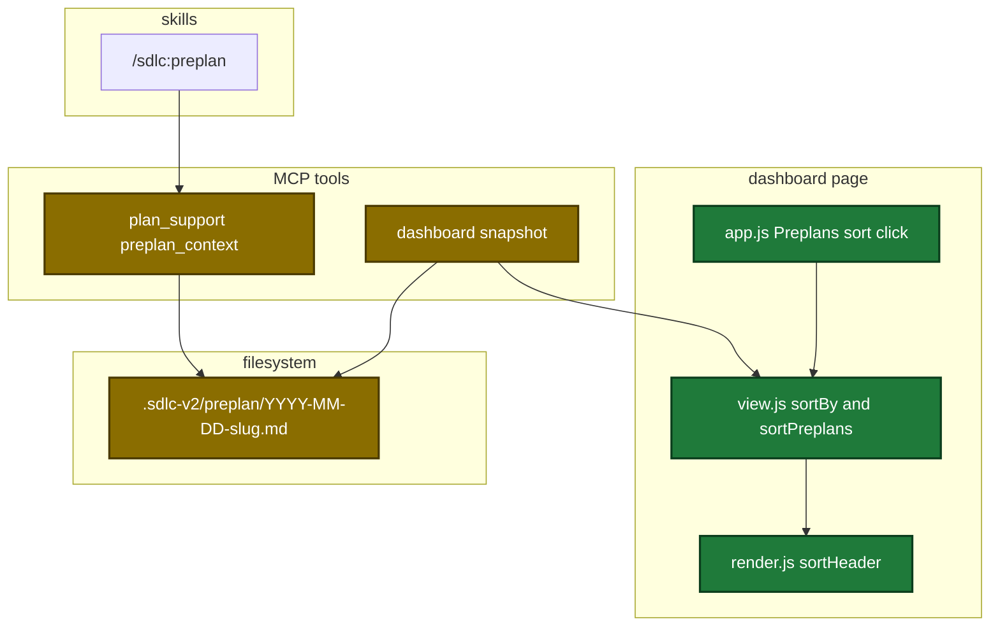
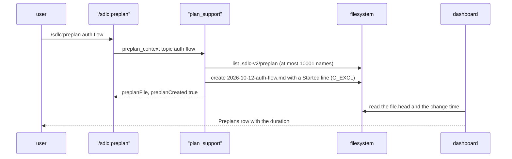

# Design

## Context

- Motivation: see proposal.md - Why.
- The page reuses the History sort code. The History header loop is inline in `historyTable`, and `nextHistorySort` starts every key with `desc`.
- An edit replaces a topic file. The replacement resets the file creation time, so the creation time cannot hold the start of a preplan.
- The snapshot reads only the first 4 KiB of a topic file.

Architecture of the touched parts:

Main runtime flow:

Data contract change:

| Field | Type | Encoding | Example |
|---|---|---|---|
| `DashboardPreplan.DurationMs` | `int64` | `"durationMs"`, no `omitempty`, 0 means unknown | `4800000` |

No config key changes. No persisted state other than the topic file changes.

## Goals / Non-Goals

**Goals:**

- One sort header function and one comparator for the History and Preplans tables.
- A start time that stays through every edit of a topic file.

**Non-Goals:**

- A start time for topic files from before this change.
- A rename of topic files with no date.
- A lock around the list step and the create step.

## Decisions

| Decision | Chosen | Rejected alternatives | Reason |
|---|---|---|---|
| Port of the draft | each task ports its changed blocks | port the four whole draft files | the draft holds preview code and a second sort design |
| Sort header | one `sortHeader(doc, name, sort, attr)` | a duplicate of the History loop | P4 forbids a duplicate of the sort code |
| Sort state | `nextHistorySort` with an optional first-direction map | a new `nextPreplanSort` | the current caller keeps `desc` with no map |
| Comparator | `sortBy(list, sort, values, defaultKey)` | the draft comparator | `dry` guardrail. The stable sort keeps equal rows newest first |
| Start time source | a `**Started:**` line that `preplan_context` writes | the file creation time, the date in the name | an edit resets the creation time. The name date has day precision only |
| Missing or bad Started line | missing: 0, no warning. Bad: 0 and one warning | a warning for each missing line | every file from before this change has no Started line |
| Clock | package variable `preplanNow = time.Now` | a function parameter | mirrors `evidenceNow`. Current test calls still compile |
| Match rule | exactly `<slug>.md` or exactly `YYYY-MM-DD-<slug>.md` | a glob `*-<slug>.md` | a glob also matches `other-<slug>.md` |
| Listing bound | at most 10000 names, InfraError past it | no bound, or a match on part of the folder | `persisted-io-failure-fallback` guardrail. A partial match can create a second file |
| Place of the Started line | after the Status line | before it, or in front matter | the status writer keeps every other byte. The stdio prefix check reads the heading and the Status line first |

## Risks / Trade-offs

| Risk | Impact | Mitigation |
|---|---|---|
| Two callers at UTC midnight both list, then both create | two topic files for one slug | the next call stops with the two-match DataError, which names both files. One user runs one preplan at a time |
| A user removes or edits the Started line | the duration shows a dash, or a repo warning shows | the line holds plain text, and the warning quotes it |
| The shared sort header breaks | the History table loses its sort controls | the History header tests stay unchanged and must pass |
| The name match misses a file | a second empty topic file | exact-name tests for bare, dated and non-matching names |
