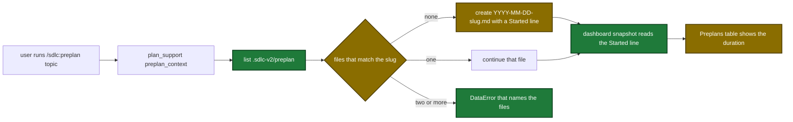

# Proposal

## Why

- The Dismiss button and the repo name of a lone-wait card sit far from the wait. The operator looks in two places.
- The Preplans table has one fixed order and no duration. Topic file names hold no date, so the preplan folder shows no time order.
- A design draft and the preplan topic file `dashboard-waits-and-preplans` recorded nine decisions. This change builds them.

## What Changes

| Area | Before | After |
|---|---|---|
| Lone-wait card | Dismiss and the repo name are in the right group of the card head | Dismiss is in the banner bar after the wait age. The repo name follows the branch |
| Preplans table | fixed newest-first order, no duration | repo, updated and duration headers sort the table. A duration column shows a time or a dash |
| Snapshot | each preplan has `slug`, `topic`, `status`, `path`, `updatedAt` | each preplan also has `durationMs`: change time minus the `**Started:**` time, 0 when unknown |
| `preplan_context` | creates `<slug>.md` | finds `<slug>.md` or `YYYY-MM-DD-<slug>.md`. Creates `YYYY-MM-DD-<slug>.md` with a `**Started:**` line. Two matches give a DataError. A folder over 10000 names gives an InfraError |
| Docs | name `<slug>.md` | name both forms, the match rule and the Started line |

The preplan topic file flow after the change (new and changed steps marked):

## Capabilities

### New Capabilities

- None.

### Modified Capabilities

- `pipeline-dashboard`: the preplan list gets `durationMs`, the Preplans tab gets sort headers and a duration column, the lone-wait card layout changes.
- `tool-plan-support`: `preplan_context` finds and creates dated topic files with a Started line.
- `skill-preplan`: the first run creates a dated topic file.

## Impact

| Path | Kind | Change |
|---|---|---|
| `internal/tools/dashboard_snapshot.go` | MCP tool | `DashboardPreplan.DurationMs` |
| `internal/tools/dashboard_preplans.go` | MCP tool | read the Started line |
| `internal/tools/plan_support.go` | MCP tool | match rule, dated name, Started line, folder bound, descriptions |
| `internal/dashboard/web/static/render.js` | dashboard page | `sortHeader`, card layout, duration column |
| `internal/dashboard/web/static/view.js` | dashboard page | `sortBy`, `sortPreplans`, first-direction map |
| `internal/dashboard/web/static/app.js` | dashboard page | Preplans sort click and focus |
| `internal/dashboard/web/static/app.css` | dashboard page | card and column rules |
| `internal/dashboard/web/testdata/snapshot.fixture.json` | test data | `durationMs` |
| `plugins/sdlc/skills/preplan/SKILL.md` | skill | skeleton sentence, Step 0 sentence, Step 1 error row |
| `docs/dashboard.md`, `docs/skills/preplan.md`, `docs/getting-started.md`, `docs/mcp-tool-annotations.md` | doc | new behavior |
| `internal/paths/paths.go` | doc comment | `PreplanSubdir` comment |
