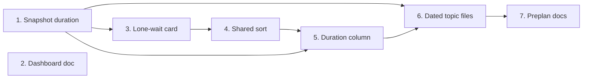

# Tasks

Group dependencies (groups with no path between them can run in parallel):

## 1. Snapshot duration

- [x] 1.1 Add `DurationMs` and read the Started line in internal/tools/dashboard_preplans.go — verify: go test ./internal/tools/ -run 'TestDashboardPreplans|TestDashboardContract|TestDashboardFixture' && go test -tags integration ./... <!-- ref:1-1-add-durationms-and-read-the-started-f045b8 -->

## 2. Dashboard doc

- [x] 2.1 Document the card layout, the Preplans sort and `durationMs` in docs/dashboard.md — verify: grep -n "durationMs" docs/dashboard.md <!-- ref:2-1-document-the-card-layout-the-preplan-896d72 -->

## 3. Lone-wait card

- [x] 3.1 Move Dismiss into the banner bar and the repo name after the branch in internal/dashboard/web/static/render.js — verify: node --test internal/dashboard/web/testdata/view.test.cjs && CI=1 go test -tags integration ./internal/dashboard/web/ -run TestBrowserE2E -v <!-- ref:3-1-move-dismiss-into-the-banner-bar-and-73811d -->

## 4. Shared sort

- [x] 4.1 Add `sortHeader`, `sortBy`, `sortPreplans` and the repo and updated sort in internal/dashboard/web/static/view.js — verify: node --test internal/dashboard/web/testdata/view.test.cjs && CI=1 go test -tags integration ./internal/dashboard/web/ -run TestBrowserE2E -v <!-- ref:4-1-add-sortheader-sortby-sortpreplans-a-1146f8 -->

## 5. Duration column

- [x] 5.1 Add the duration column and its sort header in internal/dashboard/web/static/render.js — verify: node --test internal/dashboard/web/testdata/view.test.cjs && CI=1 go test -tags integration ./internal/dashboard/web/ -run TestBrowserE2E -v <!-- ref:5-1-add-the-duration-column-and-its-sort-17218f -->

## 6. Dated topic files

- [x] 6.1 Add the match rule, the dated name, the Started line and the folder bound in internal/tools/plan_support.go — verify: go test ./internal/tools/ -run 'Preplan|TestEveryToolMatchesItsAnnotationDecision|TestReadOnlyToolsWriteNothingTracked' && go test -tags integration ./tests/integration/ -run TestMCPStdio_PreplanContext <!-- ref:6-1-add-the-match-rule-the-dated-name-th-6610a1 -->

## 7. Preplan docs

- [x] 7.1 Update the topic file name rule in docs/skills/preplan.md and plugins/sdlc/skills/preplan/SKILL.md — verify: go test ./internal/skillcheck/... ./internal/paths/... && go test ./internal/tools/ -run TestDashboardPreplans_StatusParity <!-- ref:7-1-update-the-topic-file-name-rule-in-d-2350e2 -->

## Workflow follow-up

- Archive the change after the review requirements are met.
