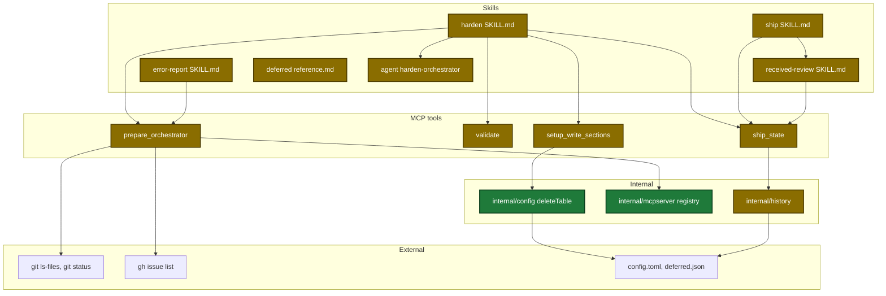
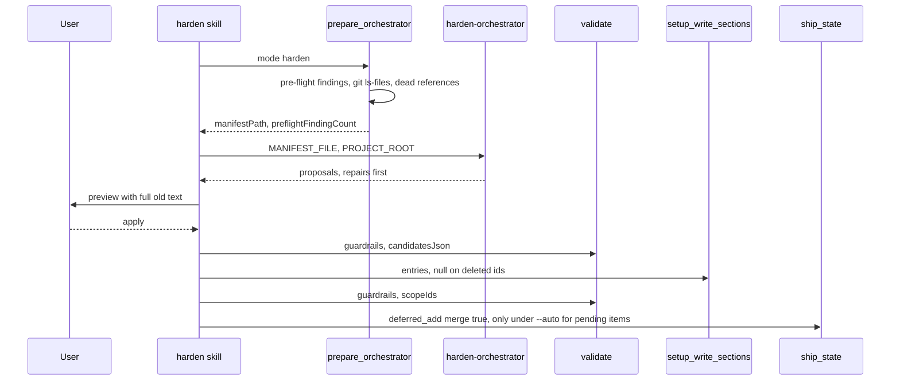
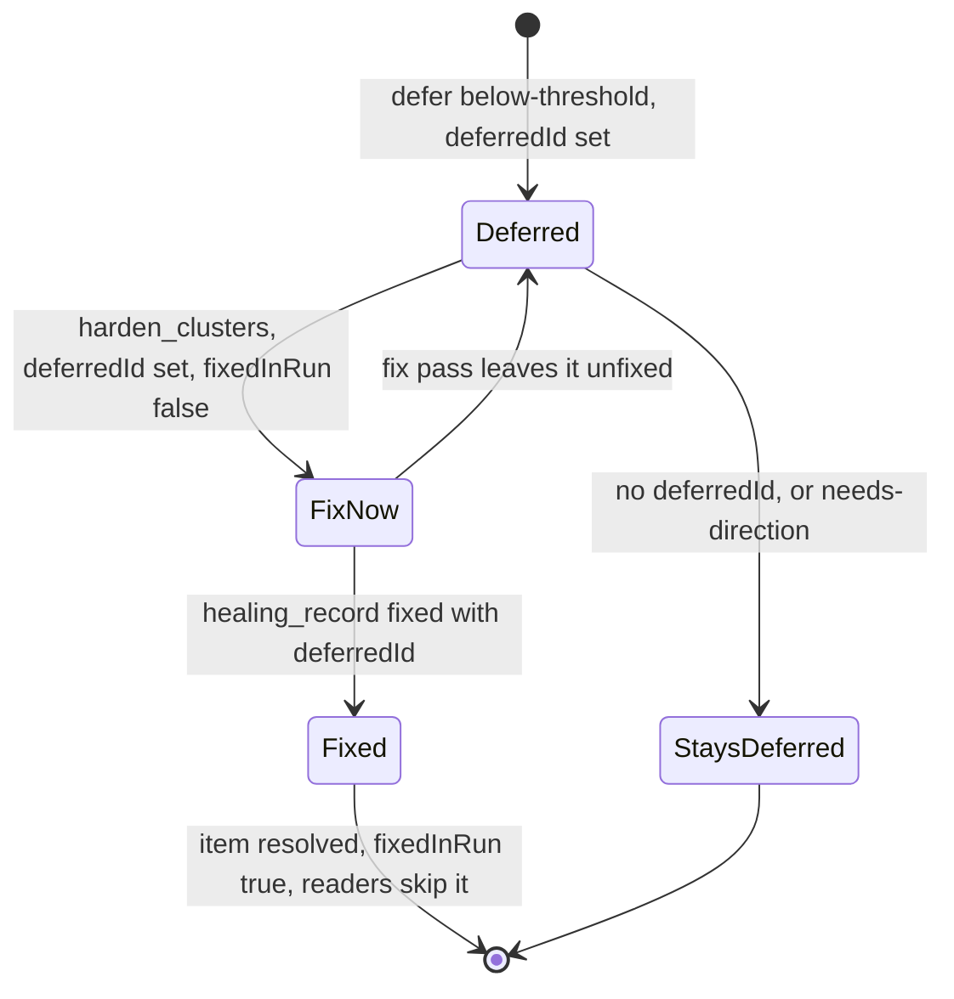

# Design

## Context

- Motivation: see proposal.md - Why.
- The harden orchestrator (an agent with the Read tool only) drafts proposals. The harden skill applies them. MCP tools do the checks and the writes.
- `prepare_orchestrator` mode `harden` builds one manifest file for the orchestrator.
- Ship stores each deferred review finding twice: one run entry in the ship state and one item in `.sdlc-v2/history/deferred.json`.

## Goals / Non-Goals

**Goals:**

- Keep every deterministic check in a tool: dead references, fix-now split, deferred merge, issue match.
- Keep judgment in the agent: the generic-rule gate and the overlap of classes.
- Keep a resumed ship harden step byte-identical in its cluster input.

**Non-Goals:**

- No new MCP tool.
- No change of the default `reviewThreshold` or of the default ship steps.
- No "no hits in N runs" stale test.

## Decisions

| Decision | Chosen | Rejected alternatives | Reason |
|---|---|---|---|
| Tool count | extend `validate`, `setup_write_sections`, `ship_state`, `prepare_orchestrator` | a new rule-maintenance tool | guardrail `mcp-tool-count-discipline` |
| Check scope | findings for `scopeIds`, else candidate ids | whole section | an old pre-flight finding fails each new proposal |
| Delete path | JSON `null` on a guardrail id | a new `delete` input | one write path for remove, merge and split |
| Fix-now mark | `harden_clusters` computes it from the deferral reason | harden returns a mark for each finding | harden has no return channel for each finding. A fixed table belongs in a tool |
| Fixed entry | keep the run entry, set `fixedInRun:true` | delete the run entry | a resumed step rebuilds the same cluster text |
| Issue match | `prepare_orchestrator` mode `error_report` | a `gh` call on each harden run | one call for each report, testable with a fake |
| `--auto` removal proof | each token is in `surfaces.deadReferences` | agent judgment | a tool check is repeatable |
| Agent model | sonnet | haiku | the gate and overlap judgment need more than a fast scan |

## Architecture

Touched parts, with new and changed elements marked:

Main runtime flow of one harden run:

Run entry and deferred item through one ship run:

## Data contracts

| Field | Type | Encoding | Example |
|---|---|---|---|
| `validate` `scopeIds` | array of string | JSON | `["dry","kiss"]` |
| `validate` candidate `remove` | bool | JSON | `{"id":"x","remove":true}` |
| `setup_write_sections` guardrail `null` | null | JSON | `{"plan.guardrails.x": null}` |
| `prepare_orchestrator` `preflightFindingCount` | int | output | `1` |
| manifest `preflightFindings[]` | object | JSON | `{surface, id, file, severity, message, fix, bytesOver}` |
| manifest `surfaces.deadReferences[]` | object | JSON | `{surface, ruleId, file, line, kind, token, reason}` |
| `prepare_orchestrator` `similarIssues` | array | output | `[{number, title, url}]` |
| ship state `deferredFindings[].deferredId` | string | JSON | `review-deferred-<ts>-2` |
| ship state `deferredFindings[].fixedInRun` | bool | JSON | `true` |
| `healing_record` `detail.deferredId` | string | JSON | `review-deferred-<ts>-2` |
| `deferred_add` `detail.merge` | bool | JSON | `true` |
| `harden_clusters` output `fixNow`, `staysDeferred`, `evidenceOnly` | array | output | `[]` |

## Risks / Trade-offs

| Risk | Impact | Mitigation |
|---|---|---|
| A removal deletes a real rule | a later run loses a protection | full old text in each preview. `--auto` removes only proven dead references |
| A fix-pass fix counts twice | wrong review ledger | every reader skips `fixedInRun:true` entries |
| A dimension merge fails half way | duplicate or lost rule | check the merged file before the delete. Write the old text back on a failed check |
| The deferred store grows past its bound | merges fail | 8 MiB bound with a DataError and a Suggestion. Atomic write |
| A naive dead-path scan is about 13% precise | false removals | skip placeholders, examples and URLs. `--auto` needs the tool list |
| The skill-harden Purpose text still says strengthen-only | stale main spec text | the follow-up in tasks.md edits it after archive |

## Migration Plan

- No data migration. New fields are optional and old readers accept them.
- After release, the user runs one harden cleanup pass over the current rule set (tasks.md group 6).
- Rollback: revert the release. Deferred items with `source: harden-pending` stay open and readable.
