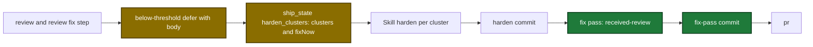

# Proposal

## Why

- Problem: harden only adds or tightens rules. The rule set grows each run and keeps rules for removed code and rules for one case.
- Evidence: 6 guardrails are over the 1024-byte limit (`.sdlc-v2/config.toml:386`). The pre-flight check stops harden on them (`internal/tools/harden.go:763-773`). 6 review-dimension rules name tools, steps or paths that do not exist (`.sdlc-v2/review-dimensions/mcp-contract-compliance.md:93`).
- Why now: ship's harden step ran 0 of 5 clusters. 46 deferred items are open, and 35 of them are review findings that nothing fixes.

## What Changes

| Area | Before | After |
|---|---|---|
| Harden start | A pre-flight finding stops harden | Pre-flight findings go into the manifest. Harden drafts `repair` proposals for them first |
| Harden actions | add, strengthen, consolidate | plus `repair`, `remove`, `merge`. A removal needs a dead reference, a covering rule or a pre-flight repair, and shows the full old text |
| Generic-rule gate | none | Each draft names a class of failure. A draft for one case is dropped. A draft that matches an existing class extends that rule |
| Learnings | context only | A pattern that recurs 3 or more times becomes a proposal |
| Dead references | not checked | `prepare_orchestrator` lists dead paths, tools, actions, flags and steps in the manifest |
| `--auto` | applies add, strengthen, consolidate | also applies repairs and proven dead-reference removals. Merges and covered-by removals wait in one deferred item for each rule section |
| Guardrail check | whole section | `scopeIds` and candidate ids only. Candidates can carry `remove:true` |
| Guardrail delete | not possible | a JSON `null` on a guardrail id in `setup_write_sections` deletes the table |
| Ship harden step | below-threshold findings are dropped | the step runs one fix pass for them and commits the fixes |
| Deferred store | add by exact id only | a `needs-direction` item merges into an open item for the same file. `deferred_add` can merge by id |
| Error report | `gh issue list` in the skill | `prepare_orchestrator` returns `similarIssues` |

Ship harden step after the change, with new and changed steps marked:

## Capabilities

### New Capabilities

- none

### Modified Capabilities

- `skill-harden`: repair, removal and merge actions, generic-rule gate, learnings as proposals, `--auto` action table and pending items.
- `tool-prepare-orchestrator`: pre-flight findings in the manifest, dead-reference scan, `similarIssues` in `error_report` mode.
- `tool-validate`: scoped guardrail findings, remove candidates, dimensions `file` scope, new downgrade message.
- `tool-setup-write-sections`: a `null` on a guardrail id deletes the table.
- `tool-ship-state`: deferred id on run entries, fix records that resolve a deferred item, deferred merge, `harden_clusters` fix-now split, report counts skip fixed entries.
- `skill-ship`: harden step fix pass and below-threshold body.
- `skill-received-review`: findings with a `**Deferred-id:**` line.
- `skill-error-report`: duplicate search reads `similarIssues`.
- `skill-deferred`: `harden-pending` items are never filed as issues.

## Impact

| Path | Kind | Change |
|---|---|---|
| `internal/tools/validators.go` | MCP tool | `scopeIds`, `remove` candidates, dimensions `file`, size constant |
| `internal/tools/setup_write.go`, `internal/config/` | MCP tool | guardrail table delete |
| `internal/tools/harden.go`, `internal/tools/guardrails.go`, `internal/tools/harden_deadrefs.go` | MCP tool | pre-flight findings, dead-reference scan |
| `internal/tools/prepare_orchestrator.go`, `internal/tools/error_report.go`, `internal/ghx/ghx.go` | MCP tool | output fields, `similarIssues` |
| `internal/mcpserver/register.go`, `internal/mcpserver/server.go` | MCP tool | tool-name and action registry |
| `internal/history/history.go` | MCP tool | deferred merge, size bound, atomic write |
| `internal/tools/ship_state.go`, `internal/tools/ship_harden_clusters.go`, `internal/tools/ship.go`, `internal/tools/ship_report.go`, `internal/tools/execute_state.go` | MCP tool | deferred id, fix records, fix-now split, readers |
| `plugins/sdlc/schemas/ship-state.schema.json`, `plugins/sdlc/schemas/sdlc-config.schema.json` | schema | new fields, description text |
| `plugins/sdlc/agents/harden-orchestrator.md` | skill | actions, gate, model sonnet |
| `plugins/sdlc/skills/harden/`, `plugins/sdlc/skills/ship/`, `plugins/sdlc/skills/received-review/SKILL.md`, `plugins/sdlc/skills/error-report/SKILL.md`, `plugins/sdlc/skills/deferred/reference.md` | skill | flows above |
| `plugins/sdlc/skills/plan/g17-dimension-coverage-prompt.md` | skill | text |
| `docs/skills/harden.md`, `docs/skills/ship.md`, `docs/skills/received-review.md`, `docs/skills/deferred.md`, `docs/dashboard.md` | doc | behavior text |
| `internal/skillcheck/` | CI | string pins |
