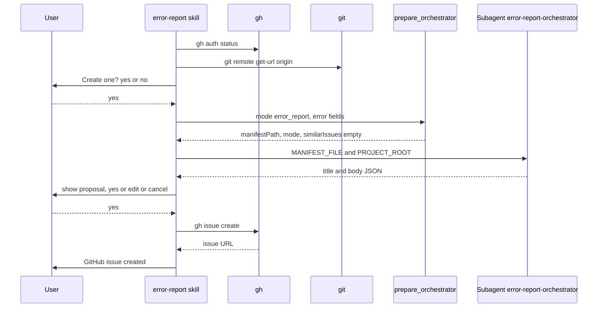

# Spec Delta

## MODIFIED Requirements

### Requirement: Main flow ordering
The skill SHALL run classify, pre-flight, consent gate 1, `prepare_orchestrator`, orchestrator dispatch, consent gate 2, duplicate search, then issue creation, with both gates and all `gh` writes in the main context.

Main flow when no duplicate issue exists:

#### Scenario: Normal creation
- **WHEN** both gates get **yes** and no duplicate is found
- **THEN** the skill prints `GitHub issue created: #<number> — <url>`

### Requirement: Duplicate issue search
After gate 2 **yes**, the skill SHALL read `similarIssues` and `similarIssuesNote` from the `prepare_orchestrator` result, and SHALL NOT run `gh issue list` itself.

- `similarIssuesNote` set: print it, then go to issue creation without a prompt.
- No match: go to issue creation without a prompt.
- Matches: ask **comment**, **new** or **cancel**.
- **comment**: user picks an issue, approves the body `Additional occurrence reported by error-report:` plus the proposal body, then the skill runs `gh issue comment <number> --repo "rnagrodzki/sdlc-plugin" --body ...` and prints `Comment added to #<number> — <url>`.
- **cancel** at any point: remove the manifest, create nothing.

#### Scenario: Similar issue exists
- **WHEN** `similarIssues` holds an open issue titled `[plan] Gate A dispatch timeout` and the skill is `plan`
- **THEN** the skill offers **comment**, **new** and **cancel**

#### Scenario: Search failed
- **WHEN** `similarIssuesNote` is `duplicate search skipped: gh not found`
- **THEN** the skill prints the note
- **AND** it goes to issue creation without a prompt
