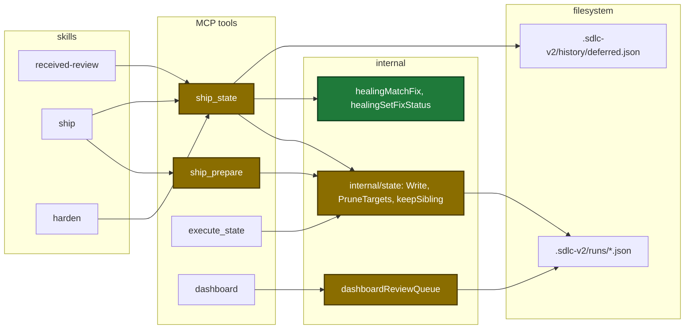
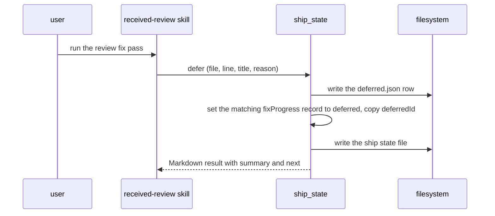
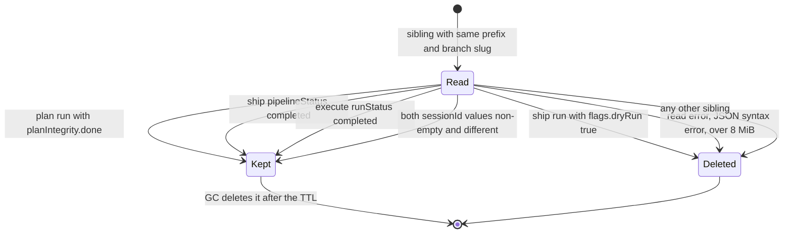

# Design

## Context

- Motivation: see proposal.md - Why.
- A fix record changes today only through a `healing_record` call of kind `fix-progress` (`internal/tools/ship_state.go:2646-2690`).
- `state.Write` deletes every same-prefix, same-branch sibling except a done plan run (`internal/state/state.go:433-467`).
- The state package reads no config and has no clock that a test can set. GC applies the TTL (`internal/state/gc.go:163-176`).
- 11 of 22 real ship state files have `sessionId: null`. A session rule alone cannot keep a completed run.

## Goals / Non-Goals

**Goals:**

- One keep rule in `state.Write` for every ship and execute start.
- One delete list (`state.PruneTargets`) for the write and for `prunedOrphans`.
- One match helper for the fixed call and the defer call.

**Non-Goals:**

- Repair of runs that already completed.
- A session-aware `state.Find` for two live runs.
- A `sessionId` from the ship skill text.
- A TTL check inside `state.Write`.

## Architecture

Touched parts, with new and changed parts marked:



Main runtime flow of a deferred finding:



Keep rule for one sibling state file at a state write:



## Data contracts

```go
// internal/state
func PruneTargets(root, prefix, branchSlug, selfPath, sessionID string) ([]string, error)

type siblingMeta struct {
	SessionID      string `json:"sessionId"`
	PipelineStatus string `json:"pipelineStatus"`
	RunStatus      string `json:"runStatus"`
	Flags          struct {
		DryRun bool `json:"dryRun"`
	} `json:"flags"`
}

// internal/tools
type DashboardFix struct {
	// existing fields
	DeferredID string `json:"-"`
}
```

| Field | Type | Encoding | Example |
|---|---|---|---|
| `data.healing.fixProgress[].deferredId` | string, optional | plain text | `review-deferred-2026-10-13T10:05:00Z-1` |
| `next.id` of `healing_record` kind `review-total` | string | plain text | `continue-after-review-total` |
| `next.id` of `healing_record` kind `hardened` | string | plain text | `continue-harden` |

No config key changes.

## Decisions

| Decision | Chosen | Rejected alternatives | Reason |
|---|---|---|---|
| Where the status sync lives | the fixed call and the defer call set the fix record | skill text only | the fix agent skipped the status calls in issue #98 |
| Match rule | exact key, then file+line+title, then the only `queued` or `fixing` record on file+line | file+line only | two findings on one line stay two records |
| Keep rule location | `state.Write`; GC applies the TTL | TTL check in the write | the state package reads no config |
| Keep rule order | first matching row of the keep table | a score over all rows | a dry-run is always deleted |
| Delete list | one `state.PruneTargets` for the write and `prunedOrphans` | two lists | two lists can disagree |
| Damaged healing data | a damaged `fixProgress` gives a warning in summary and next, and the call succeeds, for both the fixed call and defer; a `healing` that is not an object stays a `DataError` for the fixed call | the fixed call returns the `DataError` | `fixProgress` is display-only; a damaged value must not block the durable `fixed` record or the `deferred.json` resolve |
| Defer and a failed `deferred.json` write | the record stays as it is | set the record to `deferred` with no `deferredId` | received-review sets the row only after its record succeeded (`defer` or the `deferred_add` fallback) |
| `next` of `healing_record` | every kind returns `next` | fixed only; no change | guardrail `mcp-output-drives-behavior`; user decision D5 |

## Risks / Trade-offs

| Risk | Impact | Mitigation |
|---|---|---|
| Two live runs on one branch with different sessions | `state.Find` returns the newest file by mtime | the ship skill passes no `sessionId`, so a ship start still deletes a live run |
| A second finding on the same file and line as a deferred finding | a deferred finding with no `deferredId` loses its own queue row | the file-and-line fallback applies only to a deferred finding with no `deferredId`; `defer` copies the `deferredId` onto the fix record that it matched, so new runs pair exactly |
| A sibling field with a wrong JSON type | the field reads as its zero value | other fields still apply; a test pins each case |
| Each write reads each sibling, at most 8 MiB | slower writes on a branch with many files | GC deletes old files |

## Migration Plan

- None. Skills and the binary ship in one plugin version.
- Rollback: revert the change. Kept files stay until GC deletes them.
