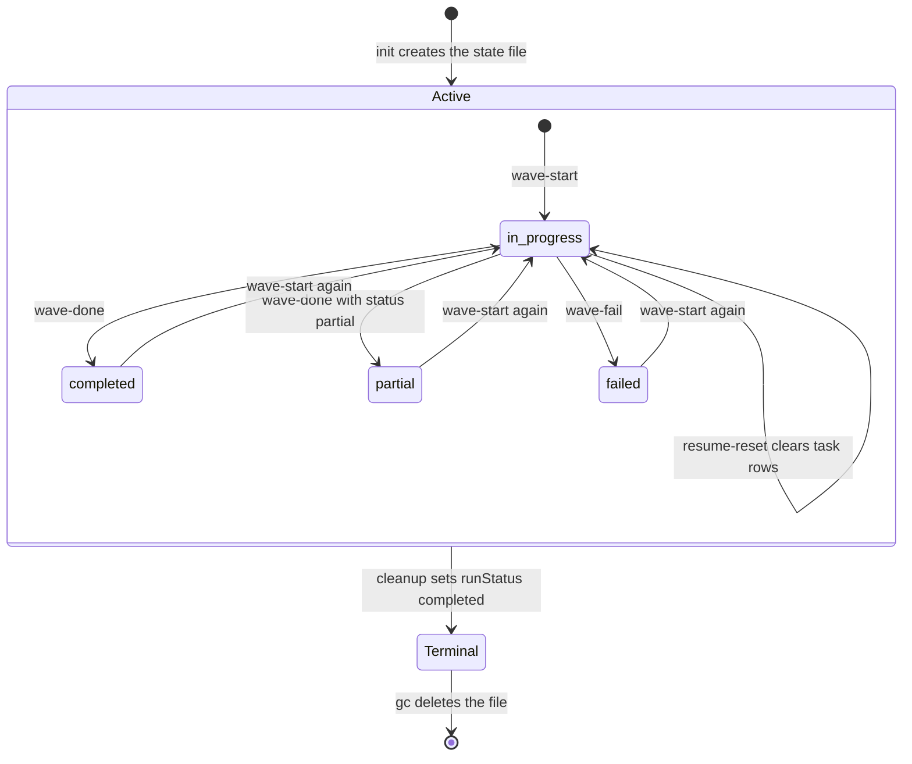

# Spec Delta

## MODIFIED Requirements

### Requirement: Run and wave lifecycle
The tool SHALL move each recorded wave through the statuses `in_progress`, `completed`, `partial`, and `failed` as wave actions are called, and SHALL mark a run terminal only through `cleanup`.

Execution state lifecycle: the run file (outer) and one wave's `status` (inner), as driven by `execute_state` actions.

- A new wave entry is `{number, status: "in_progress", startedAt, tasks: []}`.
- `wave-done`, `wave-fail`, `task-done`, `task-fail`, and `wave-split` create the wave as `in_progress` first when its number is not recorded.
- `wave-commit` and `wave-committed` record `committedSha` on a `completed` wave; the status stays `completed`.
- Every state write deletes the older execute state files for the same branch slug that are not kept, so a second `init` supersedes an earlier in-flight run.
- `init` returns `prunedOrphans`: the files that its state write deleted (`[]` when none; a failed delete is not listed).
- A state write keeps an older run with `runStatus` `completed`, and an older in-flight run whose non-empty `sessionId` differs from the non-empty `sessionId` of the writer. GC deletes a kept file later.

#### Scenario: Restarting an existing wave
- **WHEN** `wave-start` is called for a wave that is already recorded
- **THEN** its `status` becomes `in_progress`
- **AND** its original `startedAt` is kept

#### Scenario: Task recorded on an unrecorded wave
- **WHEN** `task-done` names a wave number that has no entry
- **THEN** the wave is created with `status` `in_progress` and the task row is added to it

#### Scenario: Completed run kept at init
- **WHEN** an older `execute-<same-slug>-*.json` file has `runStatus` `completed`
- **AND** `init` creates a new run on the same branch
- **THEN** the older file is kept

#### Scenario: In-flight run deleted at init
- **WHEN** an older `execute-<same-slug>-*.json` file has no `runStatus` `completed` and the same or no `sessionId`
- **AND** `init` creates a new run on the same branch
- **THEN** the older file is deleted
- **AND** `prunedOrphans` lists it
