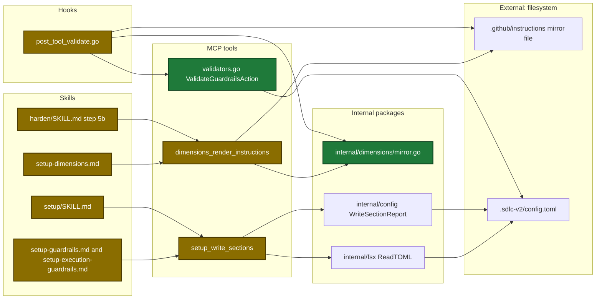
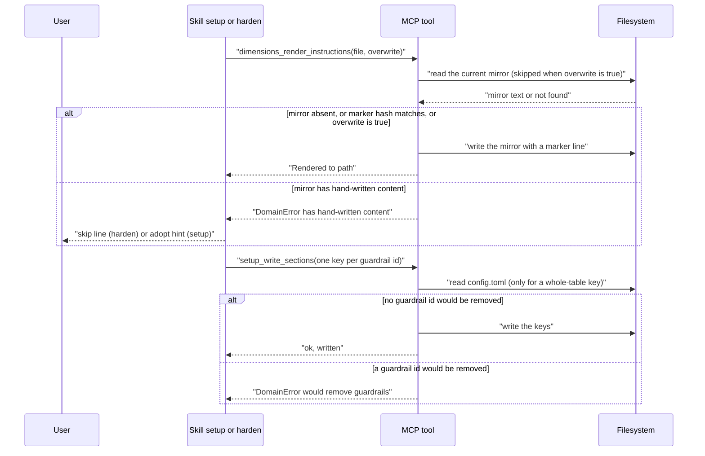
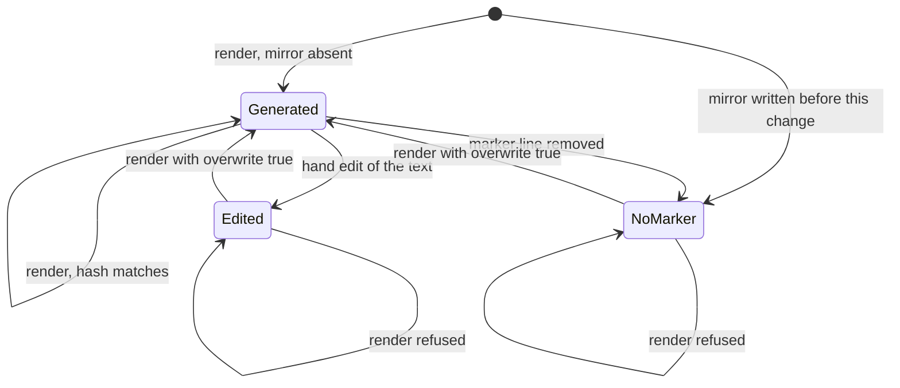

# Design

## Context

- Both tools replace stored data: one writes a whole file, one replaces a whole table. Neither reads what it removes.
- The config tests require that a write replaces the full value at one key (`internal/config/splice_test.go:102-118`). The check cannot live in the config package.
- Skill text quotes Go error strings, and skillcheck tests read the skill files. Go and skill changes land in dependency order.
- The edit hook `post-tool-validate` matches dimension files with `.yaml` and `.yml`, but the loader reads `.md` files only (`internal/hooks/post_tool_validate.go:18`, `internal/dimensions/dimensions.go:73-102`). The hook never ran on a real dimension file.
- See proposal.md - Why for the motivation.

## Goals / Non-Goals

**Goals:**
- A render never replaces a mirror with hand-written content, unless the caller passes `overwrite: true`.
- A write never removes a guardrail id through a whole-table key.
- The setup and harden skill text matches the new refusals.
- After an edit of a dimension file or of `config.toml`, a validator runs without the agent. A finding blocks the edit.
- After an edit of a mirror with no valid marker line, the agent gets a note.

**Non-Goals:**
- No bulk adoption of the 13 existing mirrors. A user reviews each diff.
- No read action for the current guardrails table.
- No check for other data in a whole-section write, for example `plan.tasks`.
- No change to the `/harden` remove step (`rm -f`).
- No temp file and rename for the mirror write.
- No comment line in each dimension file, config file or mirror. An agent can skip a comment.
- No hook check for `local.toml`.
- No block when a validator returns an error, for example invalid TOML.

## Decisions

Architecture of the touched parts. New elements are green. Changed elements are amber.

Main runtime flow of both tools.

Persisted state of one mirror file.

Changed input contract. The tool description and the `sectionsJson` description change in text only. No config key, schema or template changes.

| Field | Type | Encoding | Example |
|---|---|---|---|
| `overwrite` (`DimensionsRenderInstructionsIn`) | boolean | JSON boolean, render mode only | `true` |

| Decision | Chosen | Rejected alternatives | Reason |
|---|---|---|---|
| Where the checks live | Inside the two tools | Skill text only | Skill text already warned about both losses. The losses still happened. A tool check applies to every caller |
| How the render tool knows it wrote a mirror | Last line `<!-- sdlc:generated sha256=<hex> -->`. The hash covers the text above it | A marker with no hash. A protected block | A plain marker does not detect an edit below it |
| Line endings in the hash | Change CRLF to LF before the hash | Hash the raw bytes | A checkout with `core.autocrlf` changes line endings. That is not hand-written content |
| Refusal kind | `DomainError`, no byte written | Warning plus write | A warning after the write is the current defect |
| How a user replaces a refused mirror | New input `overwrite: true`, render mode only | No such input | A user must adopt the 13 unmarked mirrors after a review |
| Keys covered by the guardrail check | `plan`, `plan.guardrails`, `execute`, `execute.guardrails`, with a value or `null` | Only `execute.guardrails` | The plan sub-flow has the same defect |
| What the check compares | Ids on disk against ids in the new value of that key | Disk against all keys of the call | The result must not depend on key order |
| Setup write shape | One key per guardrail id in both modes | A read tool, then a merge | No new tool. Setup never removes a guardrail |
| `/harden` on a refused render | Print a skip line and continue | Stop the run | The dimension file is valid. Only the mirror is stale |
| Layer of the guardrail check | `internal/tools/setup_write.go` | The config package | The config tests pin the replacement of a whole leaf |
| Mirror write method | `os.WriteFile` to the same file | Temp file and rename | A partial write leaves no valid marker line. The next render refuses it |
| Read bounds | 1 MiB for each read site | No bound | A real mirror and a real `config.toml` hold a few KiB |
| How the agent runs the validator after an edit | The hook `post-tool-validate` runs it. The agent does nothing | A comment line in each file | An agent can skip a comment. The hook runs without the agent |
| Files the hook covers | `.md` dimension files, `.sdlc-v2/config.toml`, and mirrors | `.yaml` and `.yml` dimension files (today). `local.toml` | The loader reads `.md` files only. `local.toml` has no validator |
| Hook action for each file | Dimension file and `config.toml`: block on a finding. Mirror: note, no block | Block on a mirror | `/harden` edits a mirror on purpose, so a mirror with no marker line is a valid state |
| Guardrail sections the hook checks | `plan` and `execute` in one run | Parse the edit to find the changed section | The hook has the file text, not the changed section |

## Risks / Trade-offs

| Risk | Impact | Mitigation |
|---|---|---|
| The 13 existing mirrors have no marker line | Every `/harden` render of them is skipped until a user adopts them | The skip line names the file. Adoption is one call with `overwrite: true` |
| `/harden` edits a mirror itself (surface `copilot-instructions`) | That edit leaves no valid marker line. The next render is refused | `docs/skills/harden.md` states this. The user adopts the mirror |
| A change of `config.toml` between the guard read and the write | The guard does not see the change | Accepted for one user on one machine |
| A one-id write onto the array-of-tables form fails | The user sees a per-key error | The refusal Suggestion tells the user to convert the array to named tables by hand |
| Skill text and Go error text drift | A skill branches on a string that no longer exists | Skillcheck tests pin both strings against the Go source |
| A check that is too strict | A normal setup write is blocked | One-id keys are never checked. Both disk forms have test cases |
| The hook blocks an edit for a finding that the edit did not cause | The agent must fix the old finding first | The dimensions check and both guardrail checks pass on this repo today. The block text names the finding and the file |
| The hook stays silent on a validator error, for example invalid TOML | The hook does not report an invalid `config.toml` | Each tool reads `config.toml` and fails on the next call. The other hook branches work the same way |
| The mirror note names a refusal before the render tool has it | The note misleads the agent | The hook task runs last in the chain |

## Migration Plan

- No data migration. The marker line is an HTML comment inside the mirror.
- A user adopts each existing mirror once: review the diff, move hand-written rows into the dimension file, call the tool with `overwrite: true`.
- Rollback: revert the change. A mirror with a marker line stays valid for the old tool, which replaces it.
