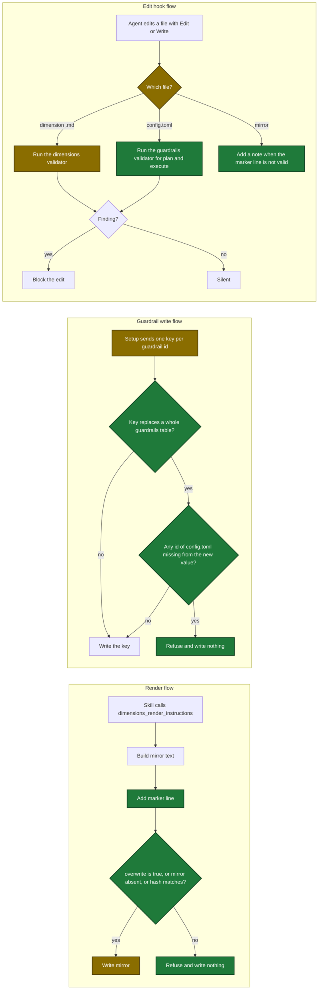

# Proposal

## Why

- Problem: two tools replace stored data and never check what they remove. A user loses hand-written rows of a Copilot mirror, and `/setup` removes guardrails that `/harden` added.
- Evidence: `dimensions_render_instructions` replaces a mirror with `os.WriteFile` and never reads it (`internal/tools/dimensions_render.go:224-239`). Setup replace mode sends one whole-table key, which removes the other ids (`plugins/sdlc/skills/setup/setup-execution-guardrails.md:106-116`).
- Why now: both losses happened twice, and the skill text already warns about them. The warnings did not stop the losses.
- Hook gap: the user asked that a validator run after each edit of these files. The edit hook never runs on a `.md` dimension file, and it has no branch for `config.toml` or a mirror (`internal/hooks/post_tool_validate.go:18`).

## What Changes

| Area | Before | After |
|---|---|---|
| **BREAKING** `dimensions_render_instructions` render mode | Replaces the mirror file with no check | Ends each mirror with `<!-- sdlc:generated sha256=<hash> -->`. Refuses to replace a mirror with no marker line or a changed hash. New input `overwrite: true` replaces a refused mirror |
| **BREAKING** `setup_write_sections` | A whole-table key (`plan`, `plan.guardrails`, `execute`, `execute.guardrails`) removes guardrail ids with no check | Refuses a whole-table key that removes a guardrail id of `config.toml`. Writes nothing. One-id keys are not checked |
| Setup guardrail sub-flows | Replace mode sends one whole-table key | Both modes send one `<section>.guardrails.<id>` key for each selected id |
| `/harden` Copilot mirror step | A render error stops the run | A refused render prints a skip line and the run continues. Other render errors still stop the run |
| `/setup --dimensions` | Renders mirrors with no overwrite input | Passes `overwrite: true` only for a mirror that the user confirmed |
| Edit hook `post-tool-validate` | Matches dimension files with `.yaml` and `.yml`, so it never runs on a `.md` dimension file. No check of `config.toml`. No check of a mirror | Runs the dimensions validator after an edit of a `.md` dimension file. Runs the guardrails validator for `plan` and `execute` after an edit of `.sdlc-v2/config.toml`. Adds a note after an edit of a mirror with no valid marker line |
| Docs | Say a render overwrites the mirror | Describe the marker line, the refusal, and the adoption with `overwrite: true` |

## Capabilities

### New Capabilities

- `hook-post-tool-validate`: validator run after an edit of a dimension file or of `config.toml`, and a note after an edit of a mirror with no valid marker line

### Modified Capabilities

- `tool-dimensions-render-instructions`: marker line, refusal to replace a hand-written mirror, `overwrite` input
- `tool-setup-write-sections`: refusal of a whole-table guardrail write that removes an id
- `skill-setup`: guardrail sub-flows write one id at a time, and the dimensions sub-flow passes `overwrite` only after confirmation
- `skill-harden`: a refused mirror render is skipped, not a stop

## Impact

| Path | Kind | Change |
|---|---|---|
| `internal/dimensions/mirror.go` | MCP tool | New: `StampMirror` and `CheckMirror` |
| `internal/tools/dimensions_render.go` | MCP tool | `overwrite` input, marker line, check of the current mirror |
| `internal/tools/setup_write.go` | MCP tool | Check that a whole-table guardrail key removes no id |
| `internal/dimensions/mirror_test.go`, `internal/tools/*_test.go` | MCP tool | New and changed tests, including integration tests |
| `internal/hooks/post_tool_validate.go` | hook | Dimension regex matches `.md`. New config branch and mirror branch |
| `internal/tools/validators.go` | MCP tool | New export `ValidateGuardrailsAction` for the hook |
| `internal/hooks/*_test.go`, `internal/tools/validators_test.go` | hook | New and changed tests |
| `plugins/sdlc/skills/setup/setup-guardrails.md`, `plugins/sdlc/skills/setup/setup-execution-guardrails.md` | skill | Step 3 sends one key per id |
| `plugins/sdlc/skills/setup/setup-dimensions.md` | skill | Step 8 passes `overwrite: true` after confirmation |
| `plugins/sdlc/skills/setup/SKILL.md` | skill | Six sites stop naming a whole-table guardrail write |
| `plugins/sdlc/skills/harden/SKILL.md` | skill | Step 5b skips a refused mirror |
| `internal/skillcheck/*_test.go` | skill | Pins for the new text, two re-keyed line numbers |
| `docs/skills/harden.md`, `docs/skills/setup.md`, `docs/plan-architecture.md` | doc | Describe the marker line, the refusal, that neither setup mode removes a guardrail, and the hook table row |

Flows after the change. New steps are green. Changed steps are amber.

