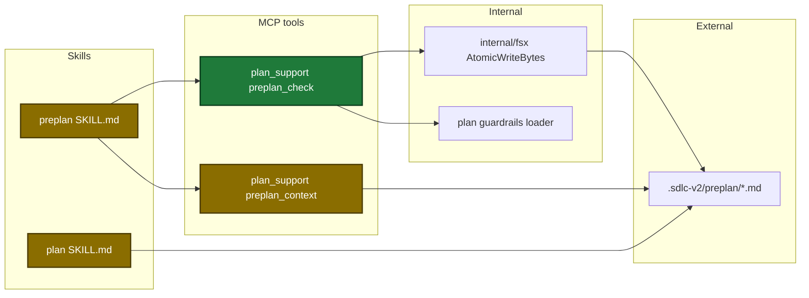
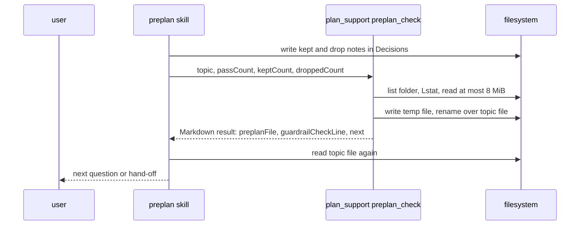
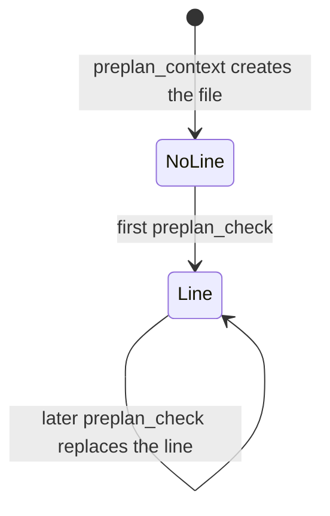

# Design

## Context

- See proposal.md - Why.
- The tool already owns the topic file create (`preplan_context`). The skill cannot read the clock, so the skill cannot write an exact UTC time.
- The dashboard rewrites the `**Status:**` line with a bounded read, a 4096-byte head and a temp-file rename (`internal/tools/dashboard_preplan_status.go:146-180`). The new write copies that logic.

## Goals / Non-Goals

**Goals:**
- One tool call writes the check line with counts and the exact UTC time.
- The topic file stores only two short notes for check results.

**Non-Goals:**
- No change to the dashboard view or the dashboard reads of topic files.
- No lock between a dashboard rewrite and a `preplan_check` rewrite.
- No tool parse of the `## Decisions` table.
- No migration task for existing topic files: the skill converts a file when the user continues it.

## Architecture

Touched parts (new and changed marked):

Main runtime flow at the end of Step 4:

Check line states in the topic file:

## Data contracts

| Field | Type | Encoding | Example |
|---|---|---|---|
| `topic` (in) | string | plain text, 1-50 characters | `auth flow` |
| `passCount` (in) | `*int` | JSON integer, 0 or more, required | `6` |
| `keptCount` (in) | `*int` | JSON integer, 0 or more, required | `1` |
| `droppedCount` (in) | `*int` | JSON integer, 0 or more, required | `0` |
| `guardrailCheckLine` (out) | string | plain text, one line, no line end | `**Guardrail check:** 53 guardrails, 7 proposals: 6 pass, 1 kept, 0 dropped. Last check: 2026-10-21T17:05:00Z.` |
| `preplanFile` (out) | string | absolute path | `/repo/.sdlc-v2/preplan/2026-10-21-auth-flow.md` |

## Decisions

| Decision | Chosen | Rejected alternatives | Reason |
|---|---|---|---|
| Who writes the time | new action `preplan_check` | the skill writes the line | the skill cannot read the clock; the line form must stay fixed |
| Line place | under the `**Started:**` line | a section with one line | the body keeps only analysis and solution |
| Guardrail count | the tool loads it | a `guardrailCount` input | the count comes from the config, not from the skill |
| Proposal counts | the skill counts the Decisions rows | a tool parse of the table | pass and kept are results of a model check on free text that the user edits |
| Count overlap | each live proposal in `passCount` or `keptCount`, never both | `passCount` = proposals with no conflict | `
` must count each proposal once |
| Two check lines | replace the first, keep the second | refuse the call | a hand-written line must not block the skill |
| File rewrite | copy the dashboard head logic into a new function | change the dashboard function into a shared one | the dashboard code and its tests stay as they are; a later fix changes both |
| Lookup errors | one shared helper for both actions | copy the 35 lookup lines | the same error texts, with the action name of the caller |
| Annotations | `readOnly: true`, `idempotent: true` (no change) | `destructive: true` | the plan-tools exception keeps `plan_support` callable in plan mode; the reason text names the one-line replace |

## Risks / Trade-offs

| Risk | Impact | Mitigation |
|---|---|---|
| The dashboard and `preplan_check` rewrite the file at the same time | the second write replaces the first | the same behavior as today for the Status line; both writes are atomic renames |
| The skill counts the rows wrong | the check line shows wrong counts | the skill rules define each count; the plan skill checks the guardrails again |
| Step 4 checks every live proposal each time | more model work for each check | topic files hold few proposals |
| An old topic file keeps its table | the reader sees the old table | Step 2 converts the file when the user continues it |
| `preplan_check` fails at Step 4 | no check line in the file | the skill goes to the cancel step; a new run checks again and writes the line |
