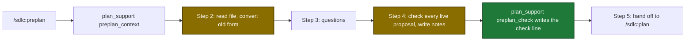

# Proposal

## Why

- Problem: the preplan topic file shows a `## Guardrail check` table with one row for each proposal. The reader must scroll past it to read the analysis and the solution.
- Evidence: the three local topic files have 11 to 20 table lines, and the widest row has 2207 characters. A new file also gets an empty `## Open questions` heading (`internal/tools/plan_support.go:1283-1301`).
- Why now: users read topic files before `/sdlc:plan`. The current spec and skill also disagree about a bare `pass` row.

## What Changes

| Area | Before | After |
|---|---|---|
| Topic file skeleton | holds `## Open questions` and a `## Guardrail check` table | ends after the `## Decisions` table header |
| Check record | one table row for each proposal, with a basis text | one `**Guardrail check:**` line under the `**Started:**` line: guardrail count, proposal counts, UTC time of the last check |
| Kept and dropped results | table rows `kept — <ids>` and `dropped — <ids>` | notes `Kept with warning: <ids>.` and `Dropped by: <ids>.` at the end of the Reason cell |
| `## Open questions` | always present, also when empty | present only when a question is open |
| `plan_support` | 10 actions | 11 actions: new `preplan_check` writes the check line |
| Old topic files | — | preplan converts an old table into notes, then deletes the table |

Topic file flow after the change (new and changed steps marked):

## Capabilities

### New Capabilities

(none)

### Modified Capabilities

- `tool-plan-support`: the action list gets `preplan_check`; the `preplan_context` skeleton loses two sections; new requirements define the check line write and its errors.
- `skill-preplan`: the guardrail check is recorded as one line plus two notes; `## Open questions` is optional; old topic files are converted.

## Impact

| Path | Kind | Change |
|---|---|---|
| `internal/tools/plan_support.go` | MCP tool | skeleton, new action `preplan_check`, shared lookup helper |
| `internal/tools/plan_support_test.go`, `internal/tools/plan_support_unix_test.go` | MCP tool | unit tests |
| `internal/tools/execute_state_test.go`, `internal/tools/annotations_test.go` | MCP tool | action list and annotation reason |
| `tests/integration/preplan_context_test.go` | MCP tool | real-binary test for `preplan_check` |
| `plugins/sdlc/skills/preplan/SKILL.md` | skill | Steps 1 to 4, notes, optional Open questions |
| `internal/skillcheck/skillcheck_preplan_test.go` | skill | `mustCall` lists `preplan_check` |
| `plugins/sdlc/skills/plan/SKILL.md` | skill | reads the check line and the notes |
| `docs/skills/preplan.md`, `docs/plan-architecture.md`, `docs/mcp-tool-annotations.md`, `docs/dashboard.md` | doc | new form and new action |
