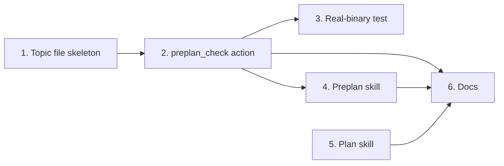

# Tasks

Group dependencies:

## 1. Topic file skeleton

- [x] 1.1 Remove the Open questions and Guardrail check sections from the skeleton and change the next texts in internal/tools/plan_support.go and internal/tools/plan_support_test.go — verify: go test ./internal/tools/ -run 'Preplan' <!-- ref:1-1-remove-the-open-questions-and-guardr-5de0dd -->

## 2. preplan_check action

- [x] 2.1 Add the preplan_check action, the shared lookup helper, setGuardrailCheckLine, the sync sites and their tests in internal/tools/plan_support.go, internal/tools/plan_support_test.go, internal/tools/plan_support_unix_test.go, internal/tools/execute_state_test.go and internal/tools/annotations_test.go — verify: go test ./... <!-- ref:2-1-add-the-preplan-check-action-the-sha-4c812f -->

## 3. Real-binary test

- [x] 3.1 Add TestMCPStdio_PreplanCheck in tests/integration/preplan_context_test.go — verify: go test -tags integration ./tests/integration/ -run TestMCPStdio_PreplanCheck <!-- ref:3-1-add-testmcpstdio-preplancheck-in-tes-91fc61 -->

## 4. Preplan skill

- [x] 4.1 Change Steps 1 to 4, the notes, the optional Open questions section and the old-form conversion in plugins/sdlc/skills/preplan/SKILL.md, and add plan_support:preplan_check to mustCall in internal/skillcheck/skillcheck_preplan_test.go — verify: go test ./internal/skillcheck/... ./internal/tools/... <!-- ref:4-1-change-steps-1-to-4-the-notes-the-op-99c743 -->

## 5. Plan skill

- [x] 5.1 Change the Guardrail check and Open questions bullets of the Preplan topic file block in plugins/sdlc/skills/plan/SKILL.md — verify: go test ./internal/skillcheck/... <!-- ref:5-1-change-the-guardrail-check-and-open-e9a980 -->

## 6. Docs

- [x] 6.1 Describe the check line, the notes and preplan_check in docs/skills/preplan.md, docs/plan-architecture.md, docs/mcp-tool-annotations.md and docs/dashboard.md — verify: go test ./internal/skillcheck/... and the Task 6 grep commands of the plan give the stated results <!-- ref:6-1-describe-the-check-line-the-notes-an-23398e -->
