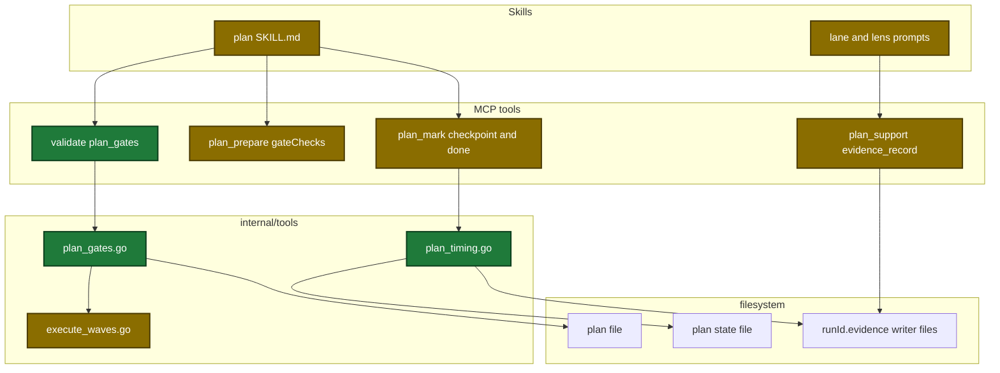
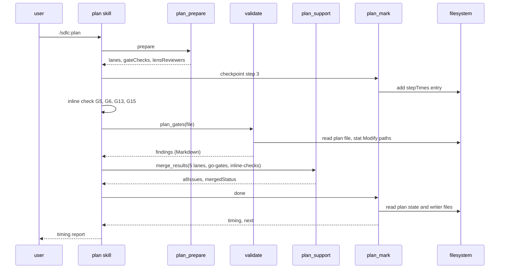
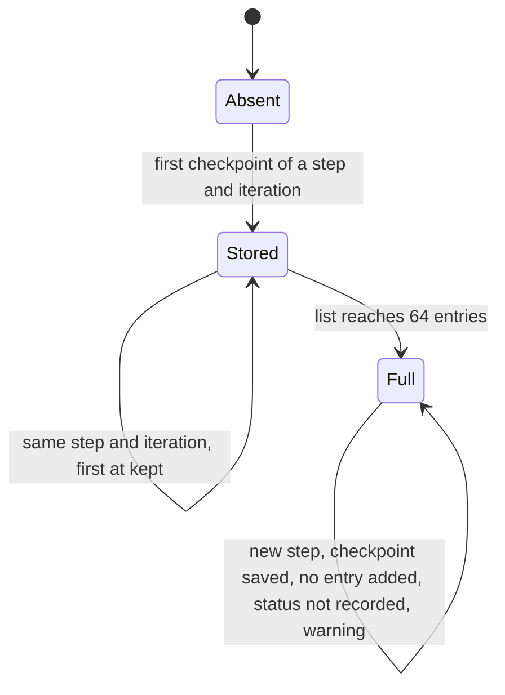
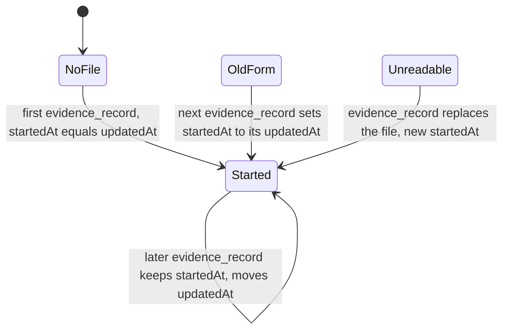

# Design: plan-verification-speed

## Context

- Motivation: see proposal.md - Why.
- The lane table is one Go list with 6 lanes (`internal/tools/plan.go:958-1002`).
- `merge_results` takes any lane entry, so a Go entry and an inline entry need no tool change (`internal/tools/plan_support.go:425-609`).
- PF3 checks the Verify field and PF4 checks the Depends on targets (`internal/tools/validators.go:903-1211`).
- A writer file keeps only `updatedAt`, and each checkpoint replaces the one before it (`internal/tools/plan_evidence.go:66-72`, `internal/tools/plan.go:2698-2714`).
- The 5-task lens rule is SKILL.md text only. Go has no task count (`internal/tools/plan.go:1006-1029`).

## Goals / Non-Goals

**Goals:**

- Go answers each gate that gives the same answer for the same plan.
- Each gate from G1 to G22 has exactly one owner in `merge_results`.
- Step 7 shows where the time goes: total, each step, the 3 slowest agents.

**Non-Goals:**

- Selective re-dispatch of lanes and lenses (the user dropped it).
- G19 presence in Go (the plan format has no render-trigger marker).
- The PF4 cycle code and the PF7 task splitter.
- Step times on the dashboard, and a change to the `runs.jsonl` rows.

## Architecture

Touched parts after the change, with new and changed parts marked:



## Runtime flow

Main runtime flow of one plan run after the change:



## Persisted state

Life of one `stepTimes` entry in the plan state:



The `done` report reads only the first 64 entries of a longer, hand-edited list and warns about the rest.

Life of the `startedAt` field of one evidence writer file:



## Data contracts

```go
// plan_prepare output: new field
type GateCheck struct {
    Name    string   `json:"name"`    // go-gates | inline-checks
    Kind    string   `json:"kind"`    // validate | inline
    GateIDs []string `json:"gateIds"` // never empty; go-gates also reports G18 floor findings outside its gateIds
}

// plan_mark output: new field, wider next and warnings
type PlanMarkOut struct {
    OK       bool     `json:"ok"`
    Marker   string   `json:"marker"`
    Path     string   `json:"path"`
    Next     string   `json:"next,omitempty"`     // checkpoint, review-outcome, done
    Warnings []string `json:"warnings,omitempty"` // checkpoint: step time not recorded; done: history or evidence read failed
    Timing   string   `json:"timing,omitempty" render:"raw"` // done only
    StepTime *PlanStepTimeResult `json:"stepTime,omitempty"` // checkpoint only
}

// what a checkpoint did to stepTimes
type PlanStepTimeResult struct {
    Step      string `json:"step"`
    Iteration int    `json:"iteration"`
    At        string `json:"at"`     // the stored time; empty when not recorded
    Status    string `json:"status"` // added | kept | not recorded
}

// evidence_record output: new fields
type EvidenceRecordOut struct {
    // writerId, status, itemCount, fileBytes, briefPath as before
    StartedAt string `json:"startedAt"`
    UpdatedAt string `json:"updatedAt"`
}

// evidence writer file: new field
type evidenceWriterFile struct {
    WriterID  string         `json:"writerId"`
    Status    string         `json:"status"`
    StartedAt string         `json:"startedAt,omitempty"`
    UpdatedAt string         `json:"updatedAt"`
    Items     []EvidenceItem `json:"items"`
}
```

| Field | Type | Encoding | Example |
|---|---|---|---|
| `validate` `action` | string enum | plain text, new value `plan_gates` | `plan_gates` |
| `validate` `file` | string | path, relative to the active root for `plan_gates` | `~/.claude/plans/x.md` |
| plan state `stepTimes[]` | array | JSON `{step, iteration, at}` | `{"step":"2","iteration":0,"at":"2026-10-23T12:20:11Z"}` |

Timing report render (raw text):

```text
Step 7: Timing (wall clock, UTC)
  Total: 1h 23m (2026-10-23T11:54:41Z to 2026-10-23T13:17:40Z)
  Steps: 0 15m · 1 22m · 2 9m · 3 r1 6m · 4 r1 4m · 5 r1 7m · 6 r1 3m · 6.5 1m · 6.6 0m · 7 2m
  Slowest agents: explore-skill-docs-spec-sync 10m 8s · lens-risk-r1 8m 12s · lane-content-coverage-r1 6m 30s
```

## Decisions

| Decision | Chosen | Rejected alternatives | Reason |
|---|---|---|---|
| Where the Go gates run | new `validate` action `plan_gates` | add them to `plan_format`; a new tool | The edit hook runs `plan_format` on each edit, and G8 and G9 are warnings. A new action adds no tool schema. |
| Gate ownership source | `plan_prepare` returns `gateChecks` | gate ids written in SKILL.md | One Go list holds the ownership. A test proves that each gate has one owner. |
| G3 rule | flag a reference to the same task or a later task | reuse the PF4 cycle code | A plan with no forward reference has no cycle. |
| G10 root | the active worktree, error when it cannot be resolved | fall back to the main worktree | A silent fallback reports a clean result for files that nobody checked. |
| G10 stat error caused by the plan text | a G10 `error` finding (a parent is a file, a name too long, a symbolic link loop) | an `InfraError` that stops every gate | The plan text is the caller's input, and one bad path must not hide the other findings. Other stat errors stay an `InfraError`. |
| Files bullet path | the first path with an extension, else the first path with a slash; a bullet with no path gives a G10 warning | the first path of any shape | wave-compute keeps the path it read before, and an unread bullet is reported, not dropped. |
| No `### Task N:` heading | `DomainError` | `findings: (none)` | No gate was checked, so an empty list would read as a clean pass. |
| G17 in round 2 and later | a fixed entry with no issues | store the round 1 result | G17 is advisory. A fixed entry gives the same merge with no storage. |
| Time data | writer `startedAt`, top-level `stepTimes`, `done` `timing` | a list inside `checkpoint`; keys in `planIntegrity` | The typed checkpoint read and the ship report read those keys. |
| Lens limit | 8 tasks in SKILL.md text | a Go task count | Go has no task count and does not know the author model. |
| Lane reference | `lanes[i].name` | the lane index | A removed lane changes each later index. |
| Report text | Go builds it, with `unknown` for absent data | the skill builds it | The plugin must show a visible value for absent data. |
| G15 owner | the inline check | `plan_gates` | The brief ids are in the evidence store, not in the plan file. |
| Finding mapping | SKILL.md maps each finding to a lane issue | `validate` returns a lane entry | `validate` returns one finding shape for every action. |

## Risks / Trade-offs

| Risk | Impact | Mitigation |
|---|---|---|
| The inline check is less independent than a lane | a G5, G6, G13 or G15 warning is missed | These gates never block. The lenses still read every task. |
| A Go rule differs from the old lane judgement | a G3, G4 or G10 result changes | The test table pins each rule. A planned Modify path is no longer a false positive. |
| A writer file from before the upgrade has no `startedAt` | its agent time is too short | The report is for measurement only. |
| `plan_gates` fails at run time | the Go gates have no result | A blocking synthetic issue, one retry, then a Deviations row. |
| The lane removal lands without its prompt pin change | `task check` fails | One task changes the lane list, the prompt and the pin together. |

## Migration Plan

- Deploy: `task deploy`, then reload the plugin. The skill and the binary ship together.
- Old evidence files get `startedAt` at their next write. No migration step runs.
- Rollback: revert the change and deploy again.
