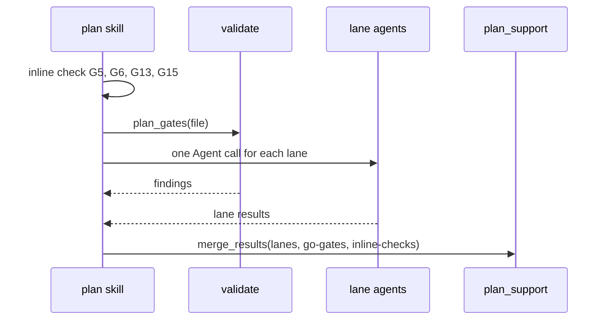
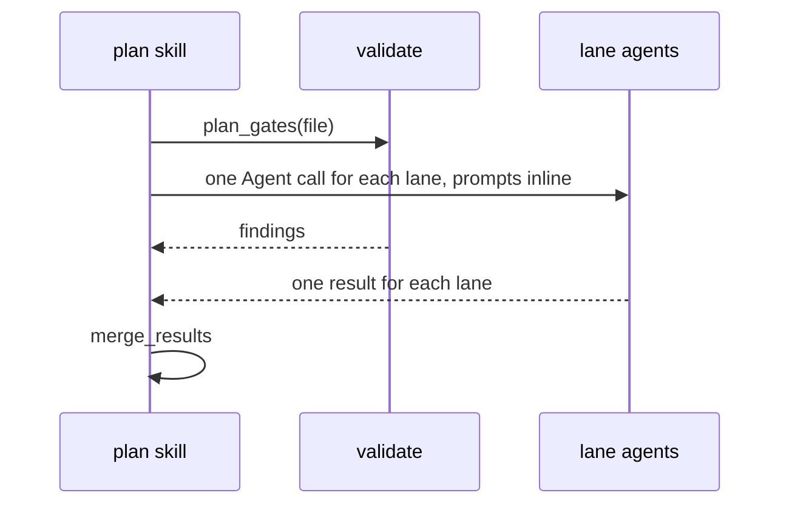
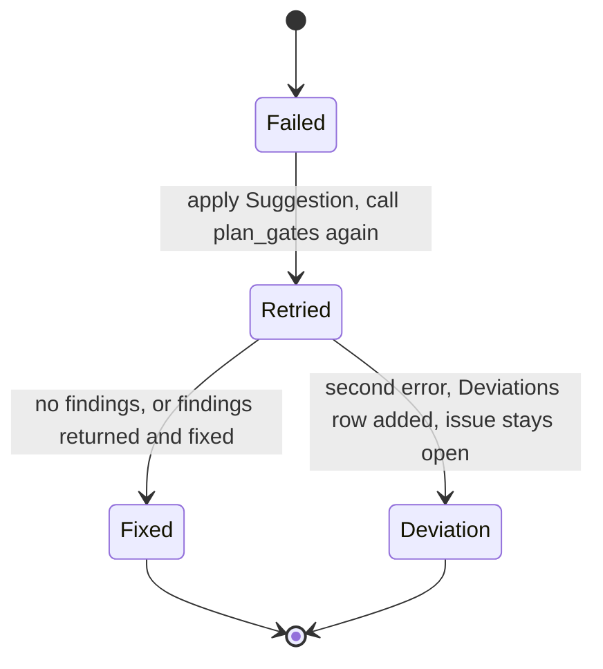

# Spec Delta

## MODIFIED Requirements

### Requirement: Checkpoints and integrity markers
The skill SHALL record progress with `plan_mark`, one call at a time.

| When | Call |
|---|---|
| Step 0, after the `plan-file` marker | `plan_mark({marker: "checkpoint", path: "", data: {step: "0", iteration: 0}})` |
| Start of Step 1, before the path choice, on every path | `plan_mark({marker: "checkpoint", path: "", data: {step: "1", iteration: 0}})` |
| Start of Steps 2, 3, 4, 5, 6, 6.5, 6.6, 7 | `plan_mark({marker: "checkpoint", path: "", data: {step, iteration}})` |
| Fan-outs (Step 1 explorers, Step 3 lanes, Step 5 lenses or reviewer) | same, plus `expectedWriters` with the agent writers only, never the gate checks |
| After the `guardrail-compliance` lane result is merged | `plan_mark({marker: "guardrailsEvaluated"})` |
| After every lane and both gate checks returned and merged | `plan_mark({marker: "critiqueRan"})` |
| Before the Step 7 handoff branch | `plan_mark({marker: "done"})` |

- `guardrailsEvaluated` and `critiqueRan` are written once per run, never on a re-dispatch.
- Steps 0–2 use `iteration: 0`; the first Step 3 and Step 5 rounds are `r1`.
- On a resume at step 1, a step 1 checkpoint with no `expectedWriters` means that no explorer started. The skill then runs Step 1 from its start.

#### Scenario: Critique marker waits for all lanes
- **WHEN** four of the five Step 3 lanes have returned
- **THEN** the skill has not called `plan_mark({marker: "critiqueRan"})`

#### Scenario: Resume before the explorer dispatch
- **WHEN** the session resumes at step 1
- **AND** the step 1 checkpoint has no `expectedWriters`
- **THEN** the skill runs Step 1 from its start

### Requirement: Step 3 lane critique
The skill SHALL dispatch every `lanes[]` entry and one `validate({action: "plan_gates"})` call in one message, using `subagentType`, `model`, and `promptTemplatePath` from `plan_prepare` verbatim and no `isolation` value. It SHALL merge with `plan_support({action: "merge_results", laneResults, expectedGates: ["G1".."G22"]})`, with one entry for each lane and one entry for each `gateChecks[]` item.

- Before the merge, the skill maps each lane's JSON to the tool's lane shape; it never passes the raw lane JSON.
- The skill names each lane by `lanes[i].name`, never by its index.

| `laneResults[]` field | Each lane except `dimension-coverage` | `dimension-coverage` (G17) | `go-gates` | `inline-checks` |
|---|---|---|---|---|
| `name` | `lanes[i].name` | `dimension-coverage` | `go-gates` | `inline-checks` |
| `status` | `pass` when `laneStatus` is `ok`; `fail` when `failed`, `timeout`, or no parseable JSON | `pass` when the G17 JSON parsed; `fail` on dispatch failure, timeout, malformed JSON, or null template | `pass` when `plan_gates` returned findings or none; `fail` when it returned an error | `pass` |
| `gateIds` | the lane's `gateIds` | `["G17"]` | `gateIds` of the `go-gates` gate check | `gateIds` of the `inline-checks` gate check |
| `issues[].gateId` | the gate of the issue | no issues | the finding `id` | `G5`, `G6`, `G13` or `G15` |
| `issues[].severity` | `blocking` when the issue has `blocking: true` or `severity: "error"`; otherwise `advisory` | no issues | `blocking` for an `error` finding, `advisory` for a `warning` finding | `advisory` |
| `issues[].summary` | `<taskRef>: <message>`, or `message` when `taskRef` is null | no issues | the finding `message` | `Task N: <issue>` |

- The mapping produces only lane `status` `pass` or `fail` and issue `severity` `blocking` or `advisory`; `merge_results` rejects any other value with a `DomainError` and merges nothing.
- The `dimension-coverage` lane is always in `laneResults`, so G17 is never a coverage gap; a failed `dimension-coverage` lane becomes an advisory note.
- A lane with null `promptTemplatePath` is not dispatched and becomes a synthetic entry with `status: "fail"` and one `blocking` issue.
- Exception: a null `dimension-coverage` template counts as empty advisory findings and is logged with `learnings_log`.
- A `plan_gates` error gives a `go-gates` entry with `status: "fail"` and one `blocking` issue `Gate check go-gates failed — <error>` with `gateId` `G3`.
- Step 3 does not edit the plan file.
- The `style-compliance` lane receives `styleGuideFile` and evaluates G22 (style compliance), including the STE rules that need meaning and each custom plan instruction.

#### Scenario: Missing lane template
- **WHEN** the `static-structural` lane has a null `promptTemplatePath`
- **THEN** the merged issues include a blocking issue `Lane static-structural skipped — promptTemplatePath null (template not found at prepare time)`

#### Scenario: Lane reports an error-severity issue
- **WHEN** the static-structural lane returns `laneStatus: "ok"` and an issue with `severity: "error"`, `blocking: true`, `taskRef: "Task 3"`, and `message: "No requirement for this task"`
- **THEN** the skill sends that lane with `status: "pass"` and an issue with `severity: "blocking"` and `summary: "Task 3: No requirement for this task"`
- **AND** `merge_results` returns `mergedStatus: Issues Found`

#### Scenario: Gate check finding
- **WHEN** `plan_gates` returns a finding with `id: G12`, `severity: error`, and `message: "Task 3: depends on nonexistent Task 9"`
- **THEN** the `go-gates` entry has `status: "pass"` and an issue with `gateId: G12`, `severity: "blocking"`, and `summary: "Task 3: depends on nonexistent Task 9"`

#### Scenario: Full gate coverage
- **WHEN** Step 3 merges the 5 lanes, the `go-gates` entry, and the `inline-checks` entry
- **THEN** `merge_results` returns no coverage gap for G1 to G22

### Requirement: Step 5 review loop
Except for lightweight plans, the skill SHALL review the plan and loop through Step 6 at most `reviewLoop.maxRounds` times, a value that `plan_prepare` returns (5).

| Plan size | Dispatch |
|---|---|
| 8 or more tasks | All 3 `lensReviewers[]` in one message, `run_in_background: false`, model opposite to the plan author's |
| Fewer than 8 tasks | One reviewer from `plan-reviewer-prompt.md` with `{LENS}=all`, model opposite to the plan author's |

- The skill waits for every dispatched result before merging with `plan_support({action: "merge_results", lensResults})`; the iteration counter moves only then.
- Each lens result is sent as `name` = the lens, `status` = the `**Status:**` value as written (`Approved` or `Issues Found`; the tool ignores letter case), one `blocking` issue per `**Issues**` bullet, and one recommendation per `**Recommendations**` bullet.
- It regenerates `## Verification Scorecard` each round: dimension counts, traceability matrix, and a verdict.
- `Approved` ends the loop; Step 6 is a no-op. `Issues Found` goes to Step 6.
- After round `reviewLoop.maxRounds` with open blocking issues it summarizes them, asks with AskUserQuestion, and offers **harden** unless `--auto` is set. `--auto` does not suppress the question itself.
- The skill contains no hardcoded round number; every limit site reads `reviewLoop.maxRounds`.

#### Scenario: Review does not converge
- **WHEN** the fifth review round still has blocking issues
- **THEN** the skill surfaces the issues with AskUserQuestion instead of looping again

#### Scenario: Third round does not stop the loop
- **WHEN** the third review round still has blocking issues
- **THEN** the skill goes to Step 6 and runs round 4

#### Scenario: Seven-task plan
- **WHEN** the plan has 7 tasks and opus wrote it
- **THEN** the skill dispatches one reviewer with `{LENS}=all` on sonnet

#### Scenario: Eight-task plan
- **WHEN** the plan has 8 tasks
- **THEN** the skill dispatches all 3 `lensReviewers[]` in one message

### Requirement: Step 6 fixes and material change re-dispatch
The skill SHALL snapshot the plan with `plan_support({action: "material_snapshot"})` before fixes and compare with `plan_support({action: "material_compare"})` after. A material change SHALL trigger one merged re-dispatch of every lane except `dimension-coverage`, both gate checks, and all lenses.

- The merged re-dispatch adds the fixed entry `{name: "dimension-coverage", status: "pass", gateIds: ["G17"], passes: [], issues: []}`, so G17 is never a coverage gap.
- The merged re-dispatch counts as one iteration and merges with `merge_results` and `isRedispatch: true`.
- A Gate B `CRITICAL` verdict adds its findings to the Step 6 blocking issues.
- An error-severity guardrail finding in the re-dispatch triggers the same **harden** offer as Step 4.

#### Scenario: Wording-only fix
- **WHEN** Step 6 changes only wording
- **THEN** the change is not material
- **AND** only the Step 5 reviewers are dispatched again

#### Scenario: Material change in a later round
- **WHEN** a Step 6 fix in round 2 is material
- **THEN** the skill dispatches 4 lanes, the `plan_gates` call, the inline check, and the reviewers
- **AND** no `dimension-coverage` agent starts
- **AND** `laneResults` holds the fixed `dimension-coverage` entry

### Requirement: Handoff
The skill SHALL call `plan_mark({marker: "done"})` and then hand off without running `execute` or `ship` in the same turn.

- After the `done` call, it prints the `timing` text of the result verbatim, then each `warnings` line, before either branch.
- With a scorecard, it prints `Verification Scorecard: <verdict line> — see ## Verification Scorecard in the plan for details.`
- With a non-empty `styleReport.instructions`, it prints a self-check table (`# | Instruction | Followed? | Where`) with evidence from the plan file and fixes every "no" row first.
- Plan mode: announce the path with `ship` and `execute` options, then call ExitPlanMode.
- Normal mode: show the menu `ship`, `execute`, `done`; invoke the chosen skill with the Skill tool.
- After writing the plan it appends a learning entry with `learnings_log`.

#### Scenario: Normal mode handoff
- **WHEN** the plan passes both hard gates in normal mode
- **THEN** the skill shows `ship`, `execute`, `done`
- **AND** on `done` it ends without further action

#### Scenario: Timing report printed
- **WHEN** `plan_mark({marker: "done"})` returns `timing`
- **THEN** the skill prints the `timing` text before the plan-mode or normal-mode branch

### Requirement: Awaited inline lane dispatch
The skill SHALL dispatch every Step 3 lane in one message as foreground Agent calls, with the filled prompt text inline, together with the `validate({action: "plan_gates"})` call, and SHALL NOT poll `evidence_digest` or the evidence directory for lanes, lenses, the reviewer, or Gate A.

#### Scenario: Denied dispatch
- **WHEN** the permission check denies one lane dispatch
- **THEN** the skill sends that dispatch again one time
- **AND** a second denial merges that lane with status `fail`

#### Scenario: Prompt delivery
- **WHEN** the skill dispatches a lane
- **THEN** the Agent prompt holds the filled template text and does not tell the agent to read its instructions from a file

## ADDED Requirements

### Requirement: Inline gate check
The skill SHALL judge the warning gates G5, G6, G13 and G15 in the main session before the Step 3 lane dispatch. It SHALL send the result as the `inline-checks` entry of `merge_results`, with every issue `advisory`.

#### Scenario: Task with no brief citation
- **WHEN** the run has a brief and a Standard task cites no `F-<dim>-<n>` id
- **THEN** the `inline-checks` entry holds an `advisory` issue with `gateId: G15`

#### Scenario: No brief
- **WHEN** `briefPath` is none
- **THEN** the `inline-checks` entry holds no G15 issue

#### Scenario: Wrong classification
- **WHEN** a task touches one file and its Complexity is `Complex`
- **THEN** the `inline-checks` entry holds an `advisory` issue with `gateId: G6`

#### Scenario: Resume at step 3
- **WHEN** the session resumes at step 3
- **THEN** the skill runs the inline check again and starts no sub-agent for it

### Requirement: Gate check retry
When a `go-gates` entry has `status: "fail"`, the skill SHALL apply the error's Suggestion, call `validate({action: "plan_gates"})` again one time, and fix its findings. After a second error, it SHALL add a Deviations row, keep the issue open, and set `materialChangeDetected = true`.

#### Scenario: Retry returns findings
- **WHEN** the Step 3 `plan_gates` call failed and the retry returns a G10 finding
- **THEN** the skill fixes the G10 finding in the plan file
- **AND** the flow continues Step 4

#### Scenario: Retry fails again
- **WHEN** the retry of `plan_gates` returns an error
- **THEN** the plan has a Deviations row that names G3, G4, G8, G9, G10, G12, the G18 no-visual-block floor and the error, with `asked=no`
- **AND** `materialChangeDetected` is true, so round 2 runs `plan_gates` again

#### Scenario: Retry in Step 6
- **WHEN** a merged re-dispatch gives the synthetic issue `Gate check go-gates failed`
- **THEN** a retry with no findings records that issue as `fixed: true`
- **AND** a retry with findings fixes them, records the issue as `fixed: true`, and sets `materialChangeDetected = true`
- **AND** a second error adds a Deviations row, records the issue as `fixed: false`, and sets `materialChangeDetected = true`
