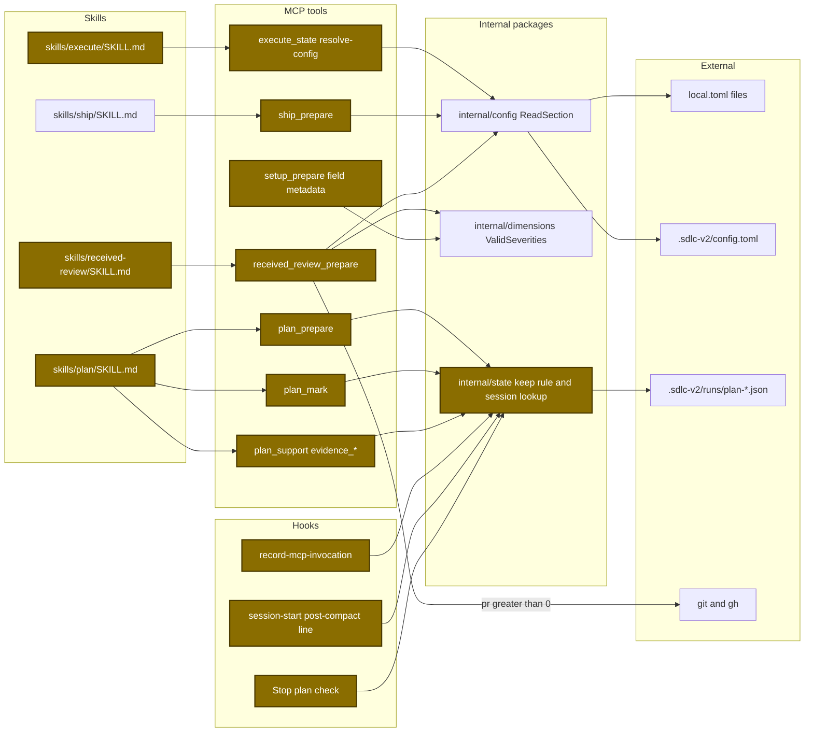
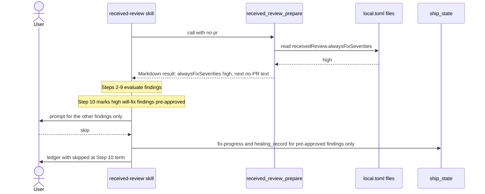
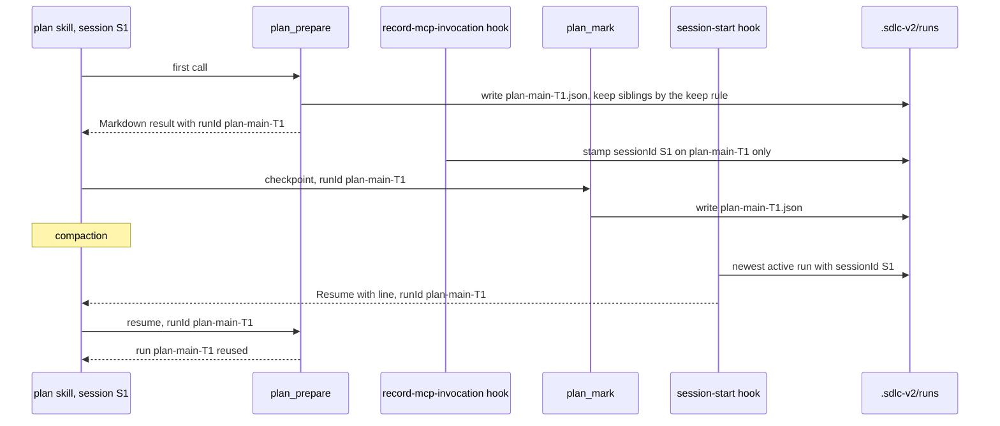
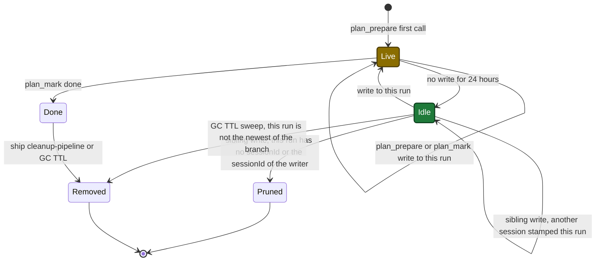

# Design

## Context

- See proposal.md - Why for the motivation.
- `config.ReadSection` merges `~/.sdlc/local.toml` and `.sdlc-v2/local.toml` (the project file wins per key) before a tool sees a value (`internal/config/config.go:956-963`). A tool cannot tell which local file set a value.
- Every `[ship]` key and every `[executePrefs]` key lives in a local file. `execute.commitWaves` and `[version]` live in `.sdlc-v2/config.toml` (`internal/config/config.go:60-71`).
- `dimensions.ValidSeverities` (`internal/dimensions/dimensions.go:40`) is the one Go list of severities: `critical, high, medium, low, info`.
- Plan run files are `.sdlc-v2/runs/plan-<branch-slug>-<YYYYMMDDTHHMMSSZ>.json`. The time in the name counts whole seconds (`internal/state/state.go:134-136`).
- MCP tools get only the session ID of the MCP transport (`internal/mcpserver/register.go:127-131`). The Claude Code `session_id` reaches only the hooks (`internal/hooks/hooks.go:133`).
- `plan_support` `evidence_*` already loads a run by ID (`internal/tools/plan_evidence.go:116`).

Architecture of the touched parts:



## Goals / Non-Goals

**Goals:**

- One meaning per source label: `local` for a local-file value, `config` for a `.sdlc-v2/config.toml` value.
- The high-risk warning shows in the same cases as before the label change.
- `alwaysFixSeverities` takes effect in manual mode, with or without a PR number.
- Two plan sessions on one branch never write the run of each other. A write of one session never deletes a not-done run of the other session that was written in the last 24 hours or that the other session stamped.

**Non-Goals:**

| Not built | Reason |
|---|---|
| A constant for every source label | A larger refactor; no issue asks for it |
| A label that names which local file set a value | `config.ReadSection` merges both files first |
| A change to `releaseSource` of `pr_apply` | A separate value list |
| Thread resolution or a Step 12 reply prompt change | Step 12 keeps its prompt |
| Two plan runs that start in the same second | A fix changes the run ID form |
| Session keep rules for ship and execute runs | They already exist (`internal/state/state.go:572-574`); this change does not touch them |
| Prune of a run of the same session written in the last 24 hours | The age rule keeps every run written in the last 24 hours; the first write of a new run has no `sessionId` yet |

## Data contracts

```go
type ReceivedReviewIn struct {
	PR int `json:"pr,omitempty"` // omit or 0: no git or gh command; negative: DomainError
}

type ReceivedReviewOut struct {
	Version             int              `json:"version"`
	Timestamp           string           `json:"timestamp"`
	PR                  receivedReviewPR `json:"pr"` // {0, "", ""} with no PR
	View                string           `json:"view"`
	Checks              string           `json:"checks"`
	PluginVersion       string           `json:"plugin_version"`
	Style               ChatStyle        `json:"style"`
	AlwaysFixSeverities []string         `json:"alwaysFixSeverities"` // never nil; (none) when empty
	Warnings            []string         `json:"warnings,omitempty"`
	Next                string           `json:"next"`
}

type PlanMarkIn struct {
	Marker string         `json:"marker"`
	Path   string         `json:"path"`
	Data   map[string]any `json:"data,omitempty"`
	RunID  string         `json:"runId,omitempty"` // new
}

type PlanPrepareIn struct {
	// existing fields unchanged
	RunID string `json:"runId,omitempty"` // new; resume and resolveTemplate only
}

// internal/state
const PlanRunLiveWindow = 24 * time.Hour
func keepPlanSibling(path, writerSession string, now time.Time) bool
func IsActivePlanRun(st *State) bool
func PlanRunForSession(root, branch, sessionID string, activeOnly bool) (*State, error)

// internal/tools
func planRunByID(mainRoot, runID string) (*state.State, error)
func planRunForMark(mainRoot, branch, runID string) (*state.State, error)
func planRunForReuse(mainRoot, branch, runID string) (*state.State, error)
```

Local config, `plugins/sdlc/templates/local.toml`:

```diff
 [receivedReview]
 # Severities whose 'will fix' findings /received-review applies with no
 # consent prompt (Step 10, manual mode).
 # Local-only — must NEVER be set in .sdlc-v2/config.toml.
-# Valid items: "low" | "medium" | "high" | "critical"
+# Valid items: "critical" | "high" | "medium" | "low" | "info"
 # alwaysFixSeverities = []
```

## Main runtime flow

received-review run with no PR number, from `/ship`:



Plan run lookup with two sessions on one branch:



## Plan run state

Keep and prune states of one plan run, as seen by a write to a sibling run of the same branch:



- Before this change, a sibling write moved a not-done run straight to Pruned.
- The age comes from the file write time (one `os.Stat`), not from the time in the file name.
- A sibling write keeps an idle run that another session stamped. An empty writer `sessionId` (the first write of a new run, before the hook stamps it) counts as another session.
- The GC TTL is 7 days by default.

## Decisions

| Decision | Chosen | Rejected alternatives | Reason |
|---|---|---|---|
| Label and warning rule | change both in one task | label first, rule later | a label with no rule edit hides the high-risk warning with no error |
| Label form | string `local` at each site | a constant for every label | both tools use string labels; one constant adds a second style |
| Execute labels | three keys (`auto`, `quality`, `highRiskAutoApprove`) | all four keys | `commitWaves` comes from `.sdlc-v2/config.toml` |
| Ship labels | change in the same change, with the `executeCommitWaves` compare | execute only | the compare must change with its label, or ship never sends `--commit-waves` |
| Severity list | tool and setup read `dimensions.ValidSeverities`; schema and template repeat it | a second Go list | JSON and TOML cannot import Go; `schema_sync_test.go:179` compares setup with the schema |
| Bad setting value | warning and `[]` | error | with `[]`, every finding asks: the safe side |
| Unreadable local file | `InfraError` | `DataError`, or a warning | `review_prepare` uses `InfraError` for the same read |
| Letter case and repeats | `High` counts as `high`; a repeat gives a warning and counts once | reject | a case typo must not disable the setting with no message |
| PR number | optional; omitted or 0 skips git and gh | keep required | `/ship` starts received-review with no PR number |
| Severity source | finding severity, or `medium` for a comment with none, plus the skill verdict | reviewer severity alone | reviewer text alone must not start a fix |
| Split prompt | `skip` discards only the prompted findings | `skip` discards the pre-approved findings too | the setting promises a fix with no prompt |
| No prompt | only when no other finding exists | no prompt when all will-fix findings are pre-approved | a pushback finding needs the prompt and its `edit` option |
| `--auto` | priority: every will-fix finding gets its fix | combine with the list | the setting adds nothing under `--auto` |
| Ledger | new term `skipped at Step 10` | count skips as deferred | the sum must stay true; a skip writes no record |
| Live plan runs | first matching rule: keep a done sibling; keep a sibling written in the last 24 hours; keep a sibling with a non-empty `sessionId` that differs from the writer `sessionId` (an empty writer `sessionId` counts as different); else delete | the age rule alone; the session rule alone | a new run has no `sessionId` until the hook stamps it, so the age rule is necessary; an idle run of another session must stay, so the session rule is necessary; the GC TTL sweep (7 days by default) deletes it later; 24 hours match the post-compact line |
| Run selection in tools | optional `runId` on `plan_mark` and the `plan_prepare` reuse call; old lookup without it | session ID in the tools | tools see only the MCP transport session ID; a session that started before the update still works |
| Run selection in hooks | by the Claude Code session ID | newest run of the branch | only hooks know the session ID |
| Run ID for the stamp | regexp on the encoded `tool_response` (Markdown and JSON forms) | parse the MCP result shape | no test pins the result shape in the hook envelope |
| One run-by-ID lookup | `planRunByID` for `plan_mark`, `plan_prepare` and `evidence_*` | one lookup per tool | same class and message for the same `runId` state |
| Staging of another plan | `openspec_stage` refuses when `stage.json` of the change names another `planPath` | a staging folder for each run; a name check in the skill | the staging key is the change name; `stage.json` already has `planPath`; a tool check needs no new state and runs before any write |
| Close comments | fixed links to commit `30c6467` | links to `main` | a fixed commit link stays true when files change |

## Risks / Trade-offs

| Risk | Impact | Mitigation |
|---|---|---|
| The warning rule misses the new label | a high-risk wave runs with no warning | Task 1 edits both; `TestExecuteSkillsHighRiskGateLabels` pins the rule text |
| The ship compare keeps `"config"` | ship never sends `--commit-waves` | same edit; `ship_test.go:2003-2006` checks it |
| A wrong Step 10 edit | fixes with no user approval | pre-approval needs a listed severity and the skill verdict; two regexps in `TestReceivedReviewSkillParity` |
| An old ship state file holds `config` | the ship report shows `config` | no code compares a stored label; the schema has no value list |
| Two plan starts in the same second | both sessions share one run file | non-goal; rare |
| The session stamp fails | the post-compact line picks the newest unstamped run, which can be the other session's run; a sibling write deletes the run after 24 hours with no write | current behavior kept as the fallback |
| A not-done run stays up to 24 hours, or up to the GC TTL (7 days by default) when another session stamped it | the dashboard shows two plan rows | expected; a later write or the GC TTL sweep deletes it |
| A session that started before the update | its old skill text passes no `runId`, so its calls can reach the newest run of the branch, which can be the run of the other session | the skill text loads when the session starts, so the risk ends when that session ends; the tools keep the old lookup, so the old session does not fail; the new skill passes `runId` on every call and `TestPlanSkillCallsPassRunID` checks it |
| A GC call with `ttlDays` 0 | `execute_state` or `ship_state` GC deletes a live plan run that is not the newest run of its branch | the default TTL is 7 days (`internal/tools/execute_state.go:4933-4945`); only a manual call sets a smaller value |
| An abandoned staging holds a change name | a new plan with the same name stops with `staged by another plan` | the error text says to pick another name, or to delete the staging folder of the abandoned plan |
| Public issue comments | cannot be taken back | Task 8 is Risk High; the execute high-risk prompt asks first; the task checks the `gh` account and skips a closed issue |

## Migration Plan

- No data migration. An old state file with `config` stays valid.
- A plan session that started before the update keeps working: a call with no `runId` uses the old lookup.
- Rollback: revert the change. Plan run files keep the same shape.
