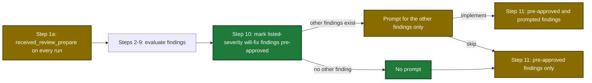
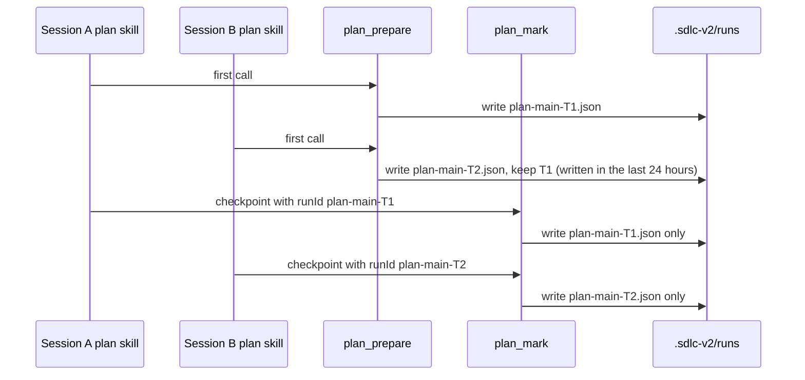

# Proposal

## Why

- Problem: `execute_state` `resolve-config` and `ship_prepare` report the source label `"config"` for values that come from a local file, and setup offers `receivedReview.alwaysFixSeverities`, which no code reads (#78, #82).
- Evidence: `internal/tools/execute_state.go:2240-2246` and `internal/tools/ship.go:799-991` set `"config"` for local values; `received_review_prepare` rejects `pr: 0` (`internal/tools/received_review.go:65`) while `/ship` starts received-review with no PR number; a second `/sdlc:plan` session on one branch deleted the live run state of the first (`internal/state/state.go:551-552`).
- Why now: the 2026-10-26 review of the open `deferred-followup` issues found these two false settings; #79, #80 and #81 need no code and close as not planned.

## What Changes

| Area | Before | After |
|---|---|---|
| `execute_state` `resolve-config` `sources` | `config` for `auto`, `quality`, `highRiskAutoApprove` from `[executePrefs]` | `local`; `commitWaves` from `.sdlc-v2/config.toml` keeps `config` |
| execute high-risk warning | prints when the label is `"config"` | prints when the label is `"local"` or `"config"` |
| `ship_prepare` `sources` | `config` for every `[ship]` key | `local`; the `config (version.*)` bump labels do not change |
| `ship_prepare` `--commit-waves` | sent when `sources.executeCommitWaves` is `"config"` | sent when `sources.executeCommitWaves` is `"local"` |
| `received_review_prepare` input | `pr` required and greater than 0 | `pr` optional; omitted or `0` runs no `git` or `gh` command; a negative `pr` is rejected |
| `received_review_prepare` output | PR overview and style | adds `alwaysFixSeverities` and `next` |
| received-review Step 10 | one prompt for all findings; `skip` discards the run | listed-severity "agree, will fix" findings are pre-approved; the prompt covers the other findings; `skip` discards only them |
| received-review ledger | `fixed + deferred` | adds the term `skipped at Step 10` |
| setup `alwaysFixSeverities` | options `low, medium, high, critical`; text promises a Step 12 bypass | options `critical, high, medium, low, info`; true text |
| plan run prune | a write deletes every not-done sibling plan run of the branch | a not-done sibling stays when it was written in the last 24 hours or another session stamped it; any other not-done sibling is deleted; the GC TTL sweep deletes a stamped idle sibling later |
| `plan_mark`, `plan_prepare` reuse call | newest plan run of the branch | the run that `runId` names; the old lookup stays for a call with no `runId` |
| plan hooks | session stamp, post-compact line and Stop check use the newest run of the branch | each uses the run of its own session; the `Resume with:` line passes `runId` |
| `openspec_stage` | a call replaces the staging of a change that another plan staged, with no error | a call refuses with a DomainError when `stage.json` of the change names another plan file; nothing is written |
| issues #79, #80, #81 | open | closed as not planned, with one evidence comment each |

received-review flow in manual mode after the change:

Two plan sessions on one branch after the change:

## Capabilities

### New Capabilities

None.

### Modified Capabilities

- `skill-execute`: the high-risk warning accepts the label `local`.
- `tool-execute-state`: `resolve-config` reports `local` for `[executePrefs]` values.
- `tool-ship-prepare`: `[ship]` values report `local`; `--commit-waves` keys on `local`.
- `tool-received-review-prepare`: optional `pr`, new `alwaysFixSeverities` and `next` fields, new errors.
- `skill-received-review`: Step 1a on every run, Step 10 pre-approval and split prompt, `skipped at Step 10` ledger term.
- `tool-plan-prepare`: `runId` input, live-run keep rule, run-by-ID errors, `next` texts.
- `tool-plan-mark`: `runId` input, live-run keep rule, run-by-ID errors.
- `tool-plan-support`: new Suggestion for `plan run <runId> not found`; the digest `next` names `runId`.
- `skill-plan`: `runId` on every `plan_mark` call and every reuse call of `plan_prepare`; resume and mid-run error rules.
- `pipeline-dashboard`: the session stamp goes to the named run; the post-compact line and the Stop check pick the run of the session.
- `openspec-staging`: a stage of a change that another plan staged is refused.

## Impact

| Path | Kind | Change |
|---|---|---|
| `internal/tools/execute_state.go` | MCP tool | three labels become `local`; field descriptions |
| `plugins/sdlc/skills/execute/SKILL.md` | skill | warning rule accepts `local` |
| `internal/tools/ship.go` | MCP tool | eight label sites, `executeCommitWaves` compare |
| `plugins/sdlc/schemas/sdlc-local.schema.json` | schema | enum adds `info`; description |
| `plugins/sdlc/schemas/ship-state.schema.json` | schema | `sources` description names `local` |
| `plugins/sdlc/templates/local.toml` | template | valid-items comment |
| `internal/setupmeta/sections.go` | MCP tool | options from `dimensions.ValidSeverities`; true text |
| `internal/tools/received_review.go` | MCP tool | optional `pr`, `alwaysFixSeverities`, `next` |
| `plugins/sdlc/skills/received-review/SKILL.md` | skill | Step 1a, Steps 10 to 12.5 |
| `internal/state/state.go` | MCP tool | live-run keep rule, run lookup by session |
| `internal/tools/plan.go`, `internal/tools/plan_evidence.go` | MCP tool | `runId` input, run lookup, errors, texts |
| `internal/hooks/mcp_invocation_record.go`, `internal/hooks/session_start.go`, `internal/hooks/stop_hooks.go` | hook | run of the own session |
| `internal/openspec/stage.go`, `internal/tools/plan_support.go` | MCP tool | refuse the staging of another plan |
| `plugins/sdlc/skills/plan/SKILL.md`, `plugins/sdlc/skills/plan/state-format.md` | skill | `runId` on every call; lifecycle text; `staged by another plan` rule |
| `docs/skills/execute.md`, `docs/skills/ship.md`, `docs/skills/received-review.md`, `docs/skills/plan.md`, `docs/plan-architecture.md`, `docs/mcp-output-contract.md` | doc | labels, consent section, run lifecycle, staging guard |
| `plugins/sdlc/skills/ship/reference.md`, `plugins/sdlc/skills/ship/config-format.md` | doc | `sources` values, pause rule |
| GitHub issues #79, #80, #81 | issue | closed as not planned |
