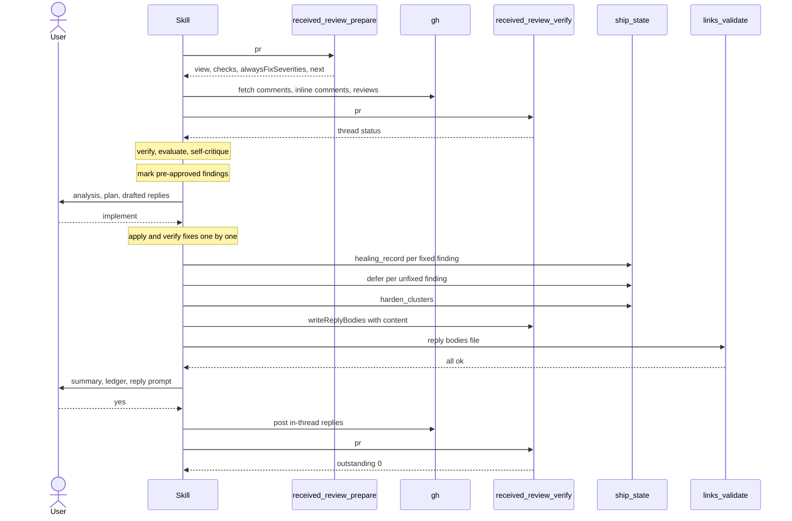
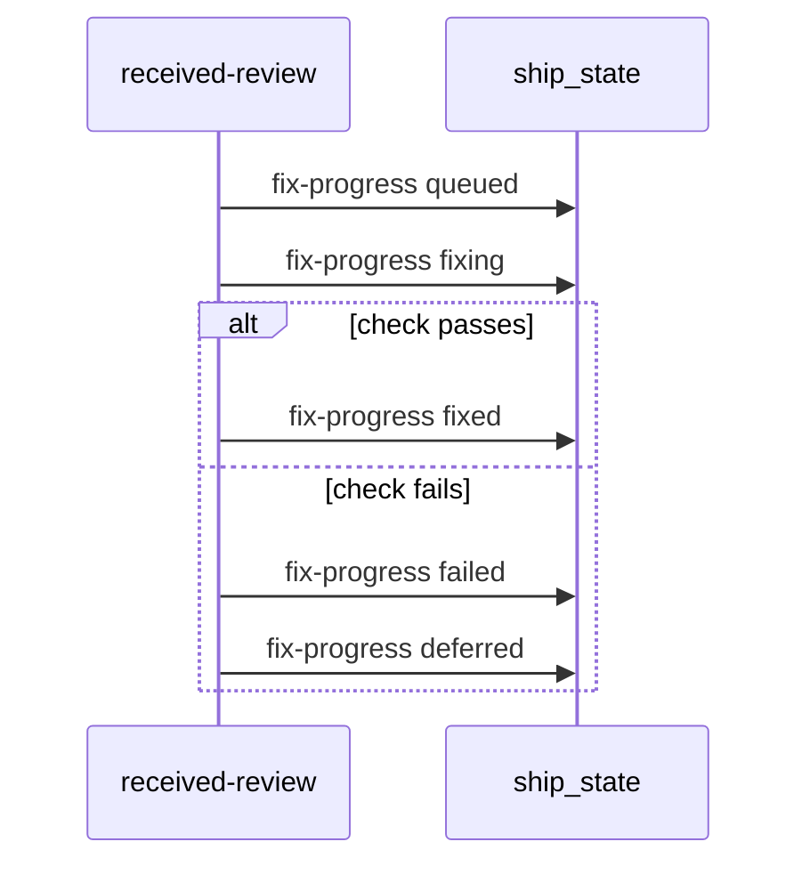

# Spec Delta

## MODIFIED Requirements

### Requirement: Arguments
The skill SHALL accept the flags `--pr <number>`, `--auto`, and `--no-harden`, and SHALL parse them only from its own invocation arguments.

| Flag | Effect |
|---|---|
| `--pr <number>` | PR whose feedback is processed. Enables the PR overview of `received_review_prepare`, `received_review_verify`, and PR replies. |
| `--auto` | Skips the Step 10 and Step 12 consent prompts and the harden cluster prompt. Only `agree-will-fix` items are auto-implemented. |
| `--no-harden` | Skips the harden meta-analysis step entirely. |

- `--auto` has one meaning: no confirmation prompt for "agree, will fix" items. Under `--auto`, the `alwaysFixSeverities` setting adds nothing.
- Without `--auto`, the only partial auto-apply is the Step 10 pre-approval by `receivedReview.alwaysFixSeverities` (see "Severity pre-approval").
- Pipeline context, conversation history, or inference never replaces the `--auto` flag.

#### Scenario: Dispatched by ship without --auto
- **WHEN** `/ship` dispatches the skill without passing `--auto`
- **THEN** the Step 10 consent gate still runs for every finding that is not pre-approved

### Requirement: Main flow order
The skill SHALL run in this order: gather feedback, handle unclear items, verify, evaluate, present and get consent, implement, record findings, harden, verify links, reply, verify replies, log learnings.

- Last step: `learnings_log({action: "append", entry: "## YYYY-MM-DD — received-review: <brief summary>\n<details>"})`.

Main flow with a PR number in manual mode.



#### Scenario: No change before consent
- **WHEN** the skill has evaluated all items
- **AND** the Step 10 prompt has not been answered
- **THEN** no file has been edited and no reply has been posted

#### Scenario: Every finding pre-approved
- **WHEN** the run is in manual mode
- **AND** every finding is a pre-approved "agree, will fix" finding
- **THEN** the skill asks no Step 10 prompt
- **AND** the skill starts the Step 11 fix pass

#### Scenario: Run finishes
- **WHEN** the replies are posted and verified
- **THEN** the skill appends one entry with `learnings_log` action `append`

### Requirement: Feedback gathering
The skill SHALL collect feedback items into a list with columns `# | File | Line | Reviewer | Comment | Type | Comment ID`, where Type is one of `bug`, `style`, `architecture`, `feature-request`, `question`, `unclear`.

| Source | When | How |
|---|---|---|
| `received_review_prepare({pr})`, or `received_review_prepare({})` with no PR number | Every run | `alwaysFixSeverities` and `next` on every run; with a PR number also the PR overview (`view`) and CI status (`checks`); failing checks are reported in Step 10 |
| `gh pr view <pr> --comments` | PR number available | Top-level comments |
| `gh api repos/{owner}/{repo}/pulls/{pr}/comments` | PR number available | Inline comments with REST `id`, kept for replies |
| `gh api repos/{owner}/{repo}/pulls/{pr}/reviews` | PR number available | Submitted reviews |
| Dispatch prompt, conversation context, or user paste | No PR number | Findings from `/ship` or `/review` |

- `{owner}/{repo}` comes from `pr.owner`/`pr.repo` of `received_review_prepare`, or from `git remote get-url origin`.
- Without a PR number, the skill says that the PR overview was skipped.
- A `received_review_prepare` error is shown to the user. The skill then uses an empty severity list, so every "agree, will fix" finding asks at Step 10, and continues with the other sources.
- A persistent `gh` failure while fetching comments (auth error, repo not found) stops the skill after it asks the user to check `gh auth status` and the PR number; `error-report` is not invoked.

#### Scenario: Not authenticated
- **WHEN** `gh api repos/{owner}/{repo}/pulls/42/comments` fails with an auth error
- **THEN** the skill shows the error, asks the user to verify `gh auth status`, and stops

#### Scenario: PR number given
- **WHEN** the user runs `/received-review --pr 42`
- **THEN** the skill calls `received_review_prepare({pr: 42})`
- **AND** fetches comments with `gh api repos/{owner}/{repo}/pulls/42/comments`

#### Scenario: Findings from review
- **WHEN** no PR number is given and `/review` findings are in conversation context
- **THEN** the skill uses those findings as the items
- **AND** calls `received_review_prepare` with no `pr` field

#### Scenario: Prepare tool error
- **WHEN** `received_review_prepare` returns an `InfraError` for an unreadable `.sdlc-v2/local.toml`
- **THEN** the skill shows the error
- **AND** no finding is pre-approved at Step 10

### Requirement: Plan consent gate
The skill SHALL present an analysis table (`# | File | Line | Type | Verdict | Reasoning`), an action plan (will fix, will push back, needs direction), and all drafted responses before any change, and SHALL NOT implement without consent, except for the findings that Step 10 pre-approves.

| Mode | Gate |
|---|---|
| Manual, a finding is not pre-approved | AskUserQuestion "No changes have been made yet. Pre-approved findings: <A>. How to proceed with the other <O> findings?" with `implement`, `edit`, `skip`. The prompt covers only the findings that are not pre-approved. `edit` loops until `implement` or `skip`. |
| Manual, every finding pre-approved | No prompt. Step 11 runs for the pre-approved findings. |
| `--auto` | No prompt. Plan is still shown. Proceeds as `implement` for `agree-will-fix` items only. |

Routes of Step 10, by mode, pre-approved count, other-finding count and answer:

| Mode | Pre-approved | Other findings | Answer | Next |
|---|---|---|---|---|
| `--auto` | any | any | none | Step 11 for every "agree, will fix" finding |
| manual | 0 | 1 or more | `implement` | Step 11 for every prompted finding |
| manual | 0 | 1 or more | `skip` | end of the run |
| manual | 1 or more | 1 or more | `implement` | Step 11 for the pre-approved and the prompted findings |
| manual | 1 or more | 1 or more | `skip` | Step 11 for the pre-approved findings only |
| manual | 1 or more | 0 | none (no prompt) | Step 11 for the pre-approved findings only |
| manual | any | 1 or more | `edit` | show the plan again and compute the pre-approved findings again |
| manual | 0 | 0 | none | Step 12 summary only |

- `skip` discards the prompted findings: no fixes, no replies, no deferred records for them. With no pre-approved finding, Step 11 never runs and the skill tells the user the findings exist only in the conversation. With pre-approved findings, Step 11 runs for them only.
- `needs-direction` items are never auto-actioned in either mode.

#### Scenario: User skips
- **WHEN** the user answers `skip`
- **AND** no finding is pre-approved
- **THEN** no file is changed, no reply is posted, and no `ship_state` record is written

#### Scenario: Skip with pre-approved findings
- **WHEN** one finding is pre-approved and two findings are prompted
- **AND** the user answers `skip`
- **THEN** Step 11 fixes only the pre-approved finding
- **AND** the two prompted findings get no fix, no reply and no record

#### Scenario: Split prompt text
- **WHEN** two findings are pre-approved and three findings are not
- **THEN** the prompt is `No changes have been made yet. Pre-approved findings: 2. How to proceed with the other 3 findings?`

#### Scenario: Auto mode
- **WHEN** `--auto` was passed
- **THEN** the plan is displayed and fixes start without a prompt

### Requirement: Finding records
After the fix pass, the skill SHALL record every finding that Step 11 acts on once: `healing_record` for each fixed and verified finding, `defer` for each unfixed finding.

- No `defer` record is written before this point, except the Step 2 `--auto` unclear-item record.
- A finding skipped at the Step 10 prompt gets no record.

Fixed finding:

```text
ship_state({action:"healing_record", step:"received-review", detail:{
  kind: "fixed", origin: "<local-review|pr-comment>",
  severity: "<critical|high|medium|low|info>", file, line, title }})
```

Unfixed finding:

```text
ship_state({action:"defer", step:"received-review", detail:{
  severity: "<critical|high|medium|low>", file, title, line,
  reason: "<wont-fix|disagree|needs-direction>",
  description: "<approach A vs approach B, then trade-off>",
  source: "received-review" }})
```

- `origin` is `pr-comment` for GitHub comments and `local-review` for everything else.
- Severity is `medium` when a human comment carries none.
- A `healing_record` failure prints `WARNING: could not record healing for <file>:<line> — <error>` and the run continues.

#### Scenario: Two fixed, one deferred
- **WHEN** two findings are fixed and one ends `disagree`
- **THEN** the skill makes two `healing_record` calls and one `defer` call with `reason: "disagree"`

#### Scenario: Skipped finding not recorded
- **WHEN** a `disagree` finding was skipped at the Step 10 prompt
- **THEN** the skill makes no `defer` call for it

### Requirement: Fix progress records
In Step 11, the skill SHALL write the status of each will-fix finding that Step 11 acts on (approved at the prompt, pre-approved, or under `--auto`) with `ship_state` `healing_record` kind `fix-progress`, in the order of the diagram below.



#### Scenario: Fix passes its check
- **WHEN** the fix for `internal/auth/token.go:42` passes its check
- **THEN** the skill makes a `fix-progress` call with status `fixed` before the next fix starts
- **AND** the `fixed` kind call stays in the recording part of Step 11

#### Scenario: Fix fails its check
- **WHEN** the fix for `internal/api/errors.go:17` fails its check
- **THEN** the skill reverts the files of that fix
- **AND** the skill makes a `fix-progress` call with status `failed`

#### Scenario: Same key in each call
- **WHEN** the skill writes the statuses of one finding
- **THEN** each call has the same `origin`, `file`, `line`, and `title`

#### Scenario: Finding with no queued call
- **WHEN** a finding ends unfixed and got no `queued` call
- **THEN** the skill makes no `deferred` call for that finding

#### Scenario: Standalone run
- **WHEN** no ship run is live on the branch
- **THEN** each `fix-progress` call returns `written:false` and the fix pass continues

#### Scenario: Skipped will-fix finding
- **WHEN** a will-fix finding was skipped at the Step 10 prompt
- **THEN** the skill makes no `fix-progress` call for it

### Requirement: Summary and findings ledger
The skill SHALL print a summary and a ledger line that accounts for every finding the run touched, grouped by deferred `reason`.

```text
Review findings: 14 total = 9 fixed + 5 deferred
  needs-direction  2
  disagree         2
  wont-fix         1
Run /sdlc:deferred to act on the 5 deferred findings.
```

- A finding counts as deferred only when its record reached `.sdlc-v2/history/deferred.json` (`defer` without a persist warning, or `deferred_add` returning `{ok, id}`).
- The ledger adds the term `+ <S> skipped at Step 10` when S findings were skipped at the Step 10 prompt; the term shows only when S is not 0.
- When fixed + deferred + skipped at Step 10 is not the total: `... — <n> UNACCOUNTED. Names: <file:line>, ...`. The total is never adjusted.
- The `/sdlc:deferred` line appears only when the deferred count is not zero.
- The summary also lists comments skipped as already addressed, when any, and the line `S findings skipped at the Step 10 prompt (no fix, no reply, no record)` when S is not 0.
- The summary counts fixed, pushed-back and intentionally skipped comments only among the findings that Step 11 acted on.

#### Scenario: Nothing deferred
- **WHEN** all findings were fixed
- **THEN** there is no `Run /sdlc:deferred` line

#### Scenario: Partial skip
- **WHEN** 14 findings exist, 3 pre-approved findings are fixed, and 11 findings are skipped at the Step 10 prompt
- **THEN** the ledger line is `Review findings: 14 total = 3 fixed + 0 deferred + 11 skipped at Step 10`

### Requirement: PR thread replies
After the summary, the skill SHALL post in-thread replies for the action-plan items when consent is given, and SHALL post no reply for a finding skipped at the Step 10 prompt.

| Mode | Gate |
|---|---|
| No PR number | Print `no PR — thread replies skipped; ledger only`; skip replies and Step 12.5 |
| Manual | AskUserQuestion "Should I reply to all addressed review comments on the PR?" with `yes`, `skip`, `selective` |
| `--auto` | No prompt; reply to every action-plan item |

| Item | Reply body |
|---|---|
| agree, will fix | `Fixed — <what changed>` |
| disagree | The pushback response |
| agree, won't fix | `Acknowledged — not fixing in this PR because: <reason>` |
| needs direction, record succeeded | `Recorded for a decision — <approach A> or <approach B>; trade-off: <one line>. Tracked as a deferred follow-up (/sdlc:deferred).` |
| needs direction, record failed | Same text without the `Tracked as a deferred follow-up` sentence |

- The skill never resolves threads (no GraphQL `resolveReviewThread`); it tells the user which threads to resolve in the GitHub UI.
- A `gh api` 5xx on posting is retried once; after a second failure the drafted reply is shown for manual posting.
- The Step 12 reply prompt does not change for pre-approved findings.

#### Scenario: Record failed
- **WHEN** a `needs-direction` finding is UNACCOUNTED
- **THEN** its reply does not claim it is tracked in `/sdlc:deferred`

#### Scenario: No PR
- **WHEN** no PR number is available
- **THEN** the skill prints `no PR — thread replies skipped; ledger only` and still prints the ledger

#### Scenario: Skipped finding gets no reply
- **WHEN** the user answers `yes` at the reply prompt
- **AND** one finding was skipped at the Step 10 prompt
- **THEN** the skill posts no reply on the thread of that finding

### Requirement: Post-reply verification
With a PR number, after posting replies, the skill SHALL call `received_review_verify({pr})` and, while `outstanding` is greater than 0, reply to each outstanding thread and verify again, for at most 2 rounds.

- Threads still outstanding after 2 rounds are reported to the user for manual handling.
- A `received_review_verify` failure is noted and the skill proceeds to its report.
- A thread whose finding was skipped at the Step 10 prompt gets no reply. The skill lists it as `skipped at Step 10 — no reply`.

#### Scenario: One thread missed
- **WHEN** `received_review_verify` returns `outstanding: 1`
- **THEN** the skill drafts and posts a reply for that thread and verifies again

#### Scenario: Outstanding thread of a skipped finding
- **WHEN** `received_review_verify` returns `outstanding: 1`
- **AND** that thread belongs to a finding skipped at the Step 10 prompt
- **THEN** the skill posts no reply for it
- **AND** lists it as `skipped at Step 10 — no reply`

### Requirement: Error reporting scope
The skill SHALL invoke `error-report` only when posting a reply with `gh api` fails twice with a 5xx or unexpected server error.

| Error | Invoke `error-report`? |
|---|---|
| `received_review_prepare` fails (bad PR, no remote, gh not authed, unreadable local.toml) | No |
| `gh pr view` / `gh api` comment fetch fails | No |
| Comment refers to a file or line that no longer exists | No |
| Claim cannot be verified | No |
| `defer` warns `could not persist this item` | No |
| `links_validate` reports a violation | No |
| `gh api` reply post fails with 5xx twice | Yes |

- The report names Skill `received-review`, the step, the `gh api` operation, and the HTTP status and message.

#### Scenario: Reply post fails twice
- **WHEN** posting a reply returns HTTP 502 twice
- **THEN** the skill shows the drafted reply for manual posting
- **AND** invokes `error-report`

## ADDED Requirements

### Requirement: Severity pre-approval
In manual mode, the skill SHALL mark each "agree, will fix" finding as pre-approved when its severity, in lowercase, is in `alwaysFixSeverities`, and SHALL apply each pre-approved finding in Step 11 with no consent prompt.

- A human comment with no severity counts as `medium`.
- Each pre-approved finding shows one line in the action plan: `pre-approved (<severity> in alwaysFixSeverities): <file>:<line> — <title>`.

#### Scenario: Listed severity
- **WHEN** `alwaysFixSeverities` is `["high"]`
- **AND** a `high` finding has the verdict "agree, will fix"
- **THEN** the action plan shows `pre-approved (high in alwaysFixSeverities): <file>:<line> — <title>` for it
- **AND** the Step 10 prompt does not cover it

#### Scenario: Severity not listed
- **WHEN** `alwaysFixSeverities` is `["high"]`
- **AND** a `low` finding has the verdict "agree, will fix"
- **THEN** the Step 10 prompt covers it

#### Scenario: Human comment with no severity
- **WHEN** `alwaysFixSeverities` is `["medium"]`
- **AND** a human comment with no severity has the verdict "agree, will fix"
- **THEN** the finding is pre-approved

#### Scenario: Severity word in reviewer text only
- **WHEN** `alwaysFixSeverities` is `["critical"]`
- **AND** a reviewer comment calls itself critical and the skill verdict is `disagree`
- **THEN** the finding is not pre-approved

#### Scenario: Auto mode computes no set
- **WHEN** `--auto` was passed
- **AND** `alwaysFixSeverities` is `["high"]`
- **THEN** the skill shows no `pre-approved` line
- **AND** every "agree, will fix" finding gets its fix

### Requirement: Findings skipped at the Step 10 prompt
A finding skipped at the Step 10 prompt SHALL get no `fix-progress` call, no fix, no `defer` record and no reply.

- Step 12.5 lists its thread as `skipped at Step 10 — no reply`.
- The Step 12 ledger counts it in the term `skipped at Step 10`.

#### Scenario: Partial skip leaves no trace
- **WHEN** the user answers `skip` while one finding is pre-approved
- **THEN** each prompted finding gets no fix, no `fix-progress` call, no `defer` record and no reply
- **AND** the ledger counts each prompted finding in `skipped at Step 10`
