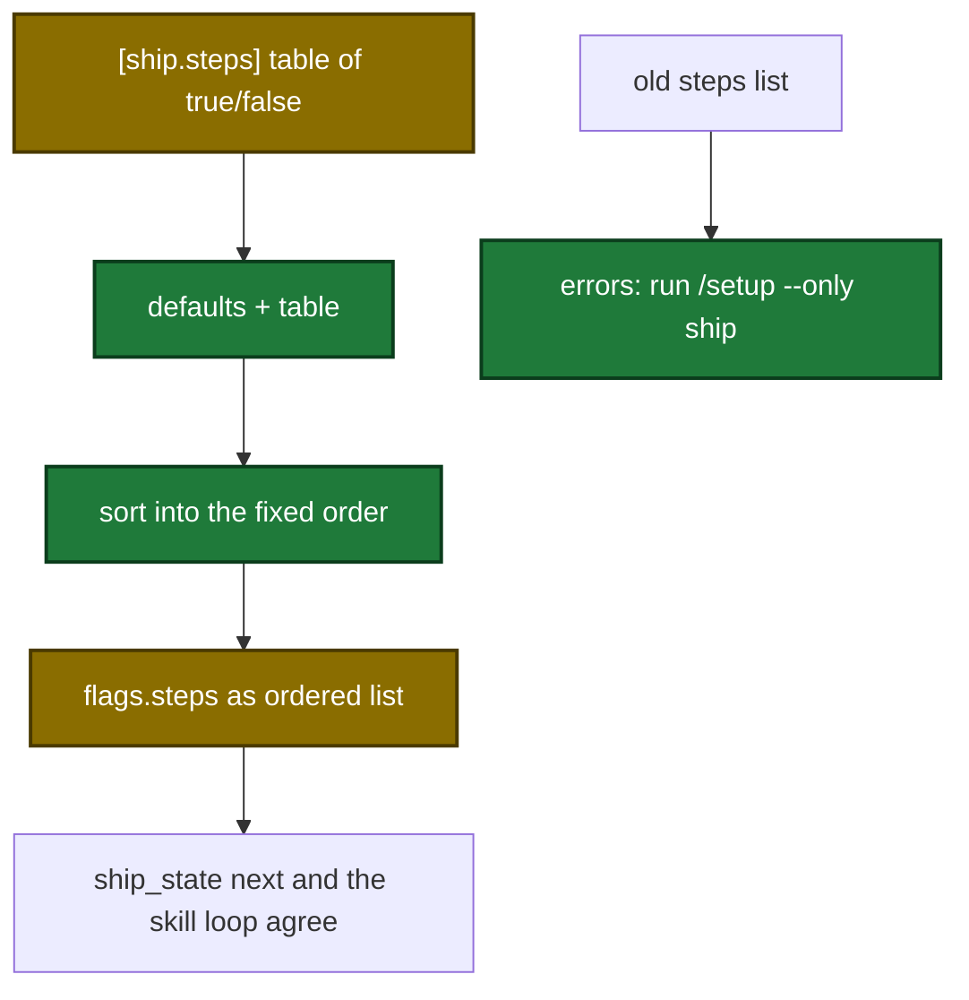

# Spec Delta

## MODIFIED Requirements

### Requirement: Flag merge precedence
The tool SHALL resolve each flag from input, then the `[ship]` section of the local files, then the built-in default, and SHALL record the winning tier per key in `sources`.

| Flag key | Precedence | Default |
|---|---|---|
| `steps` | non-empty `steps` input (`cli`) > `quick:true` → the `[ship.quick]` table (`quick`) > the `[ship.steps]` table (`local`) > default | `["execute","commit","review","archive-openspec","pr","learnings-commit"]` |
| `auto`, `draft` | input `true` (`cli`) > config bool (`local`) > default | `false` |
| `quality` | input only; key omitted when not given | none |
| `bump` | see the bump requirement | `"patch"` |
| `reviewThreshold` | config string (`local`) > default | `"info"` |
| `rebase` | input string > config (`true`→`"auto"`, `false`→`"skip"`, string verbatim, any other type passed through) (`local`) > default | `"auto"` |
| `verifyPipelineTimeout` | config number (`local`) > default | `1200` |
| `verifyPipelineInterval` | config number (`local`) > default | `60` |
| `verifyPipelineMaxIterations` | config number (`local`) > default | `3` |
| `awaitRemoteReviewTimeout` | config number (`local`) > default | `600` |
| `awaitRemoteReviewInterval` | config number (`local`) > default | `60` |
| `awaitRemoteReviewers` | non-empty config array (`local`) > default | `["copilot"]` |
| `executeWaveTimeout` | config number (`local`) > default | `1800` |
| `executeWaveInterval` | config number (`local`) > default | `60` |
| `executeCommitWaves` | `[ship]` `execute.commitWaves` bool (`local`) > default | `true` |

- `sources` values: `cli`, `quick`, `local`, `default`, plus the three bump-policy values below.
- `local` marks a value from the `[ship]` section of `~/.sdlc/local.toml` merged with `.sdlc-v2/local.toml` (the project file wins per key). `sources` cannot tell which of the two files set it.
- A non-boolean `execute.commitWaves` sets `flags.commitWavesInvalidType:true` and keeps the default.
- `[ship.steps]` and `[ship.quick]` are tables of step name → `true` or `false`. The table can also be an inline table under `[ship]`, for example `steps = { harden = true }`.
- In the `[ship.steps]` table, a step that the table does not name uses its default. In the `[ship.quick]` table, a step that the table does not name is off.
- The tool reads each table once per call and reads the keys in sorted order.
- `flags.steps` is always a JSON array of step names in the fixed order: `execute, commit, review, verify-openspec, archive-openspec, harden, pr, verify-pipeline, await-remote-review, learnings-commit`.

Step resolution from config to `flags.steps`:



#### Scenario: Steps from config
- **WHEN** config has `[ship.steps]` with `commit = true`, `review = true`, `execute = false`, `archive-openspec = false`, `pr = false`, `learnings-commit = false`, and the input has no `steps`
- **THEN** `flags.steps` is `["commit","review"]`
- **AND** `sources.steps` is `"local"`

#### Scenario: Defaults with no config
- **WHEN** no `[ship]` section exists and the input sets no flags
- **THEN** `flags.bump` is `"patch"` and `sources.steps` is `"default"`

#### Scenario: Malformed rebase config passes through
- **WHEN** config `[ship]` sets `rebase` to a number
- **THEN** `flags.rebase` holds that number
- **AND** `sources.rebase` is `"local"`

#### Scenario: reviewThreshold from config
- **WHEN** config `[ship]` sets `reviewThreshold = "low"`
- **THEN** `flags.reviewThreshold` is `"low"` and `sources.reviewThreshold` is `"local"`

#### Scenario: Draft from the local file
- **WHEN** `.sdlc-v2/local.toml` `[ship]` sets `draft = true`
- **AND** the input has no `draft`
- **THEN** `flags.draft` is `true` and `sources.draft` is `"local"`

#### Scenario: Step table fills defaults
- **WHEN** config has `[ship.steps]` with only `harden = true`
- **THEN** `flags.steps` is `["execute","commit","review","archive-openspec","harden","pr","learnings-commit"]`

#### Scenario: Quick table
- **WHEN** config has `[ship.quick]` with `execute = true` and `review = true`, and the call passes `quick:true`
- **THEN** `flags.steps` is `["execute","review"]`
- **AND** `sources.steps` is `"quick"`

### Requirement: Bump resolution with release policy
The tool SHALL resolve `bump` as input > config `ship.bump` > `"patch"`, then apply config `version.preRelease` and `version.preReleasePolicy` in that order.

| Step | Rule | `sources.bump` |
|---|---|---|
| 1 | `bump` input wins; else config `ship.bump`; else `"patch"` | `cli` / `local` / `default` |
| 2 | `version.preRelease` matching `^[a-z][a-z0-9]*$` replaces a non-`cli` bump | `config (version.preRelease)` |
| 3 | `preReleasePolicy: "always-rc"` replaces any non-RC bump with `"rc"`, CLI included | `config (version.preReleasePolicy)`, or `config (version.preReleasePolicy enforced over cli)` when it replaced a CLI value |
| 3 | `preReleasePolicy: "default-rc"` replaces a non-RC bump with `"rc"` only when the bump did not come from input | `config (version.preReleasePolicy)` |

- A bump counts as RC when it is `rc` or any label matching `^[a-z][a-z0-9]*$` other than `major`, `minor`, `patch`.
- `flags.bump` is never empty.
- `ship.bump` comes from the `[ship]` section of the local files. `version.*` comes from `.sdlc-v2/config.toml`, so its labels keep the `config (version.…)` form.

#### Scenario: always-rc overrides CLI bump
- **WHEN** the call passes `bump:"minor"` and config sets `version.preReleasePolicy = "always-rc"`
- **THEN** `flags.bump` is `"rc"`
- **AND** `sources.bump` is `"config (version.preReleasePolicy enforced over cli)"`
- **AND** `warnings` contains `preReleasePolicy "always-rc" overrode explicit CLI --bump "minor" to "rc"`

#### Scenario: default-rc yields to CLI bump
- **WHEN** the call passes `bump:"minor"` and config sets `version.preReleasePolicy = "default-rc"`
- **THEN** `flags.bump` is `"minor"` and `sources.bump` is `"cli"`

#### Scenario: default-rc without CLI bump
- **WHEN** the input has no `bump` and config sets `version.preReleasePolicy = "default-rc"`
- **THEN** `flags.bump` is `"rc"`

#### Scenario: preRelease wins over policy
- **WHEN** config sets `version.preRelease = "rc"` and `preReleasePolicy = "always-rc"`, and the input has no `bump`
- **THEN** `flags.bump` is `"rc"`
- **AND** `sources.bump` is `"config (version.preRelease)"`

#### Scenario: Other policy values do nothing
- **WHEN** config sets `version.preReleasePolicy = "continue-rc"` and nothing else
- **THEN** `flags.bump` is `"patch"` and `sources.bump` is `"default"`

#### Scenario: Bump from the local file
- **WHEN** `.sdlc-v2/local.toml` `[ship]` sets `bump = "minor"`
- **AND** the input has no `bump` and no `version.preRelease` or `version.preReleasePolicy` is set
- **THEN** `flags.bump` is `"minor"` and `sources.bump` is `"local"`

#### Scenario: preRelease wins over a local bump
- **WHEN** `.sdlc-v2/local.toml` `[ship]` sets `bump = "minor"`
- **AND** `.sdlc-v2/config.toml` sets `version.preRelease = "rc"`
- **THEN** `flags.bump` is `"rc"`
- **AND** `sources.bump` is `"config (version.preRelease)"`

### Requirement: Execute dispatch arguments
The tool SHALL compute `flags.executeDispatchArgs` as the argument string for the `execute` sub-skill.

```text
[--quality <q>] --wave-timeout <executeWaveTimeout> --wave-interval <executeWaveInterval> [--commit-waves <bool>]
```

- `--quality` appears only when `quality` was given.
- `--commit-waves` appears only when `sources.executeCommitWaves` is `"local"`.

#### Scenario: Quality absent
- **WHEN** config sets `executeWaveTimeout = 900` and `executeWaveInterval = 30`, and the input has no `quality`
- **THEN** `flags.executeDispatchArgs` is `"--wave-timeout 900 --wave-interval 30"`

#### Scenario: Quality present
- **WHEN** the same config applies and the input has `quality:"full"`
- **THEN** `flags.executeDispatchArgs` is `"--quality full --wave-timeout 900 --wave-interval 30"`

#### Scenario: commitWaves configured
- **WHEN** config `[ship]` sets `execute.commitWaves = false` and nothing else
- **THEN** `flags.executeDispatchArgs` is `"--wave-timeout 1800 --wave-interval 60 --commit-waves false"`
- **AND** `sources.executeCommitWaves` is `"local"`

#### Scenario: commitWaves not configured
- **WHEN** config `[ship]` has no `execute.commitWaves`
- **THEN** `flags.executeDispatchArgs` has no `--commit-waves`
