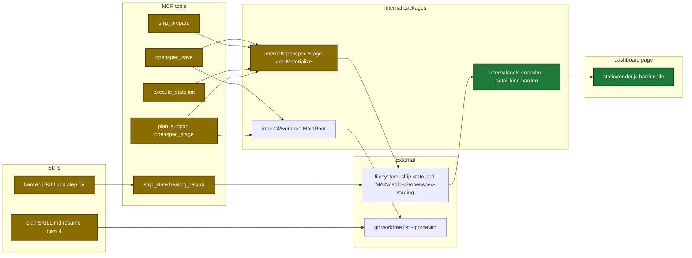
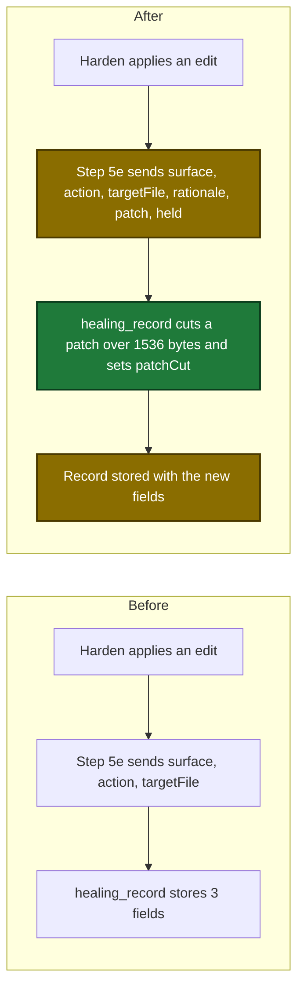
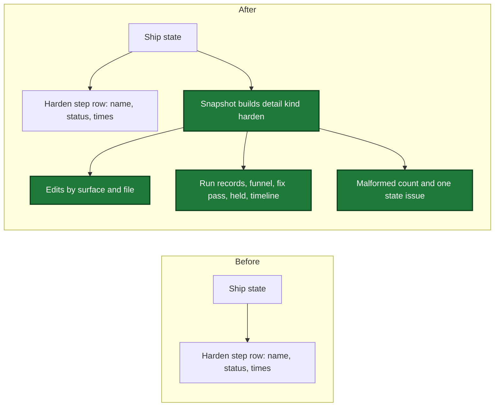
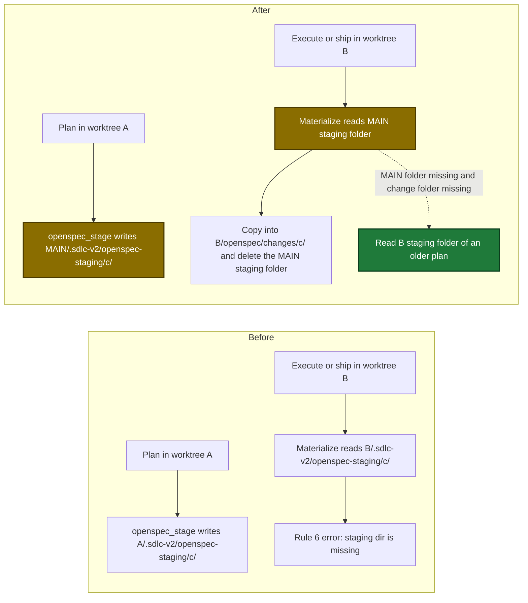
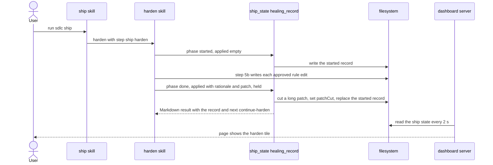
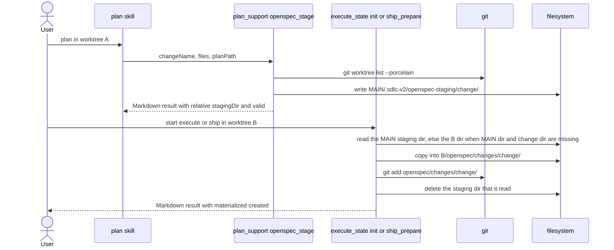
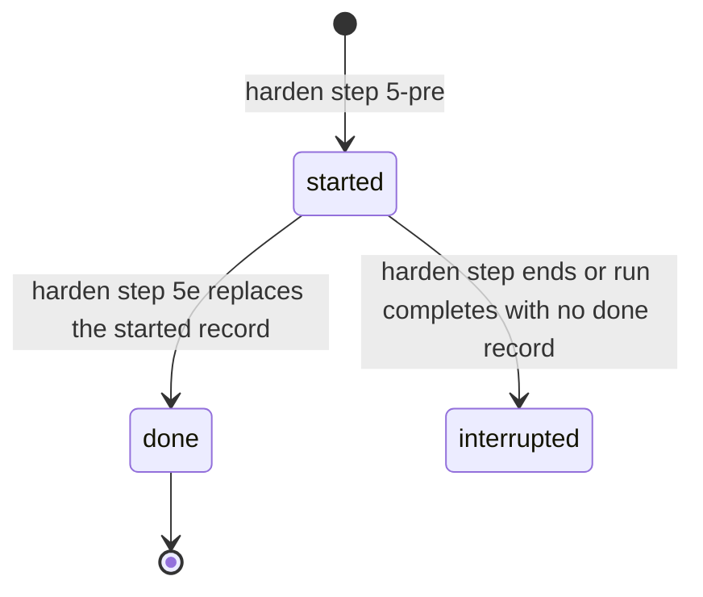
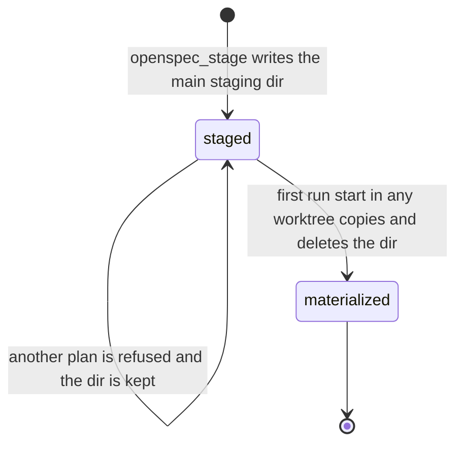

# Design

## Context

- Motivation: see proposal.md, Why.
- `healing_record` kind `hardened` builds each `applied` entry from `surface`, `action` and `targetFile` only and drops other keys with no error (`internal/tools/ship_state.go:2765-2846`).
- Harden step 5e copies `{surface, action, targetFile}` from each applied proposal; the proposal also has `rationale` and `patch` (`plugins/sdlc/skills/harden/SKILL.md:1289-1346`).
- Step 5a and `consolidate` repair a guardrail candidate before the write, so the written text can differ from the proposal patch (`plugins/sdlc/skills/harden/SKILL.md:26-35`).
- No state stores the finding funnel; `hardenBuildClusters` and `hardenSplitFindings` are pure (`internal/tools/ship_harden_clusters.go:305`, `:454`).
- The dashboard server builds the snapshot every 2 s and listens only on 127.0.0.1 (`internal/dashboard/web/server.go:58-60`, `:204`).
- `Stage` and `Materialize` use the active worktree for the staging dir (`internal/openspec/stage.go:231-232`, `internal/openspec/materialize.go:115-116`). Execute init and ship prepare already know the main root (`internal/tools/execute_state.go:605-616`, `internal/tools/ship.go:1629-1641`).
- The approved tile draft is in the gitignored `design/dashboard/static/` of this worktree only (`.gitignore:51`).

## Goals / Non-Goals

**Goals:**

- Store what harden wrote: the rationale, the text written to disk, and the proposals left for a person.
- Build the harden detail in Go with fixed limits, so a bad or large state file cannot slow or break the events stream.
- Keep one staging dir for each change name in the repo, readable from every worktree.
- Keep every old run file and every old staged change readable.

**Non-Goals:**

- A harden view in the PR description.
- An escape test for rule text from PR comments: every page string goes through `el()`, which sets `textContent` (`design/dashboard/static/render.js:36-41`).
- A `clusterKey` field on each edit.
- A record for a standalone harden run.
- Rule counts before and after the harden edits.
- Trends across runs.

## Architecture

Touched parts: skills, MCP tools, internal packages, the dashboard page and the external filesystem and git.

## Data contracts

Ship state `healing.hardened[]` record, new fields:

| Field | Type | Encoding | Example |
|---|---|---|---|
| `applied[].rationale` | string, optional | plain text; `""` stores no key | `Two reviews found the same gap.` |
| `applied[].patch` | string, optional | plain text, at most 1536 bytes after the tool cut; `""` stores no key | `- [ ] Check token expiry` |
| `applied[].patchCut` | boolean, optional | `true` only when the tool cut the patch; a caller value is rejected | `true` |
| `held` | array, optional | at most 100 entries; absent stays absent; `[]` is stored as `[]` | `[]` |
| `held[].surface` | string | one of the `applied[].surface` values | `review-dimensions` |
| `held[].action`, `held[].targetFile` | string | non-empty plain text | `strengthen` |
| `held[].reason` | string | `pending-stored`, `pending-not-stored` or `not-processed` | `pending-stored` |
| `held[].deferredId` | string | required for `pending-stored`, absent otherwise; can repeat | `harden-pending-dimensions` |

Snapshot `steps[].detail.harden` (`internal/tools/dashboard_harden.go`):

| Field | Type | Encoding | Example |
|---|---|---|---|
| `edits` | array, never null | `{surface, action, targetFile, rationale?, patch?, patchCut?}`, at most 100 | `[{surface: plan-guardrails, action: add, ...}]` |
| `clusters` | array, never null | `{trigger, phase, interrupted, classification, applied, skipped}`, at most 50 | `[{trigger: cluster:src/auth.ts, phase: done, ...}]` |
| `funnel` | object, optional | `{fixNow, staysDeferred, evidenceOnly, suppressed, loneDisagree}`; absent when a source list is bad | `{fixNow: 2, staysDeferred: 1, ...}` |
| `fixPass` | object, optional | `{fixed, total}`; absent with no fix pass | `{fixed: 2, total: 2}` |
| `held` | array, never null | `{surface, action, targetFile, reason, label, deferredId?}`, at most 100 | `[{reason: pending-stored, label: stored as a deferred item, ...}]` |
| `timeline` | array, never null | `{at, decision}`, at most 100; `at` is RFC 3339 or `""` | `[{at: 2026-10-27T07:31:00Z, decision: fix pass started: 2 finding(s)}]` |
| `malformed` | integer | count of skipped records | `0` |

Config: no config key changes, so no TOML diff.

## Flows before and after

### Flow 1: harden records an edit

Before and after of the 5e record write; new and changed steps are marked.

| Step | Before | After |
|---|---|---|
| 5-pre | Stores the `started` record | No change |
| 5b loop | Writes each approved proposal | Also keeps `writtenPatch` for a repaired candidate |
| 5c, 5d | 5d prints the pending and not-processed lists | No change |
| 5e | Builds `applied` from `{surface, action, targetFile}`, one `healing_record` call | Builds `applied` with `rationale` and `patch`, and builds `held`, one `healing_record` call |
| Next step | Step 6 or Step 7, or stop after a halt | No change |

### Flow 2: the dashboard shows the harden step

Before and after of the snapshot for the ship `harden` step.

### Flow 3: a run in a second worktree finds the staged change

Before and after of staging in worktree A and a run start in worktree B.

| Moment | Before | After |
|---|---|---|
| `openspec_stage` | Writes `A/.sdlc-v2/openspec-staging/<change>/` | Writes `MAIN/.sdlc-v2/openspec-staging/<change>/` |
| Execute init or ship in B | Rule 6 error | Copies the change into `B/openspec/changes/<change>/` and deletes the main staging folder |
| Plan staged by an old plugin in B | Works | Works (fallback read) |

Materialize resolution:

| Change dir in the active worktree | Main staging dir | Active-worktree staging dir | Result |
|---|---|---|---|
| missing | present | any | Rules 7 and 8 with the main dir |
| missing | missing | present | Rules 7 and 8 with the active-worktree dir (fallback) |
| missing | missing | missing | Rule 6 error that names both paths |
| present | present | any | Rules 4 and 5 with the main dir |
| present | missing | any | Rule 3, already |

Resume with an old staging dir:

| Moment | Before | After |
|---|---|---|
| A plan resumes and stages again | Replaces `<active>/.sdlc-v2/openspec-staging/<change>/` | Writes `<main>/.sdlc-v2/openspec-staging/<change>/`; the old active-worktree dir stays |
| Execute starts | Reads the active-worktree dir | Reads the main dir, copies the change, deletes the main dir |
| A later run starts | Not applicable | The change dir exists, so rule 3 applies and the old dir is not read |
| Plan skill resume item 4, both dirs missing | The stage call sends no file | Prints the not-found line and stops |

## Runtime sequences

Harden record to dashboard tile during a ship run.

Staging in worktree A and a run start in worktree B.

## State transitions

States of one `healing.hardened` record as the dashboard shows it.

States of the main staging dir of one change.

## Decisions

| Decision | Chosen | Rejected alternatives | Reason |
|---|---|---|---|
| OpenSpec change (D1) | Create flow: the plan writes and stages `harden-visualization` at the end of Step 6 | No change | User choice D1 |
| Patch cut | The tool cuts a patch at 1536 bytes on a UTF-8 boundary and sets `patchCut: true`; no setting changes the limit | Reject the record | Harden treats a state-write error as a warning; a rejected record loses the whole run record |
| Caller `patchCut` | DomainError | Ignore it | An ignored field hides a caller bug; the tool alone sets `patchCut` |
| Cut helper | New `healingCutPatch`; `execute_state.go` keeps its inline cut | One shared helper | The `execute_state.go` cut adds a note and works on two fields; a shared helper changes a second tool for no gain |
| Held list (D2) | Optional `held[]`, filled at step 5e | No stored held list | User choice D2; no stored record links a held proposal to its run and file |
| Held reason | Enum `pending-stored`, `pending-not-stored`, `not-processed`; the page maps each value to a fixed label | Free text | The tool checks an enum; the label carries no untrusted text |
| Held scope | The 5d groups Pending stored, Pending NOT stored and Not processed; skips, reverts and `cancel` give no entry | All skipped proposals | A person decided each interactive skip and `cancel`; an `--auto` skip or revert is a check result that the 5d summary lists |
| Held invariants | At most 100 entries; `deferredId` can repeat; no coverage check | Unique `deferredId` | Harden writes one deferred item for each section; the tool cannot see the 5d summary |
| Rationale size | No writer limit; the dashboard cuts it to 600 characters on read | A writer limit | Only the dashboard shows the rationale |
| Written patch (D3) | 5b keeps the written TOML entry as `writtenPatch`; 5e sends it | 5e reads the entry back from `config.toml` | User choice D3; the read-back needs a TOML parse in the skill |
| Funnel source | A Go mapper turns ship state into cluster findings for the existing cluster functions | Copy the cluster rules; store the counts | No new cluster rule; a test pins the mapper to the Ship mapping table |
| Funnel moment | Every mapped finding has `fixedInRun: false` | Use the stored `fixedInRun` | The funnel shows what harden saw; the fix-pass block shows the result |
| Funnel input limit | At most 500 findings, with a cut flag | No limit | The writer sets no limit; the snapshot is built every 2 s |
| Bad source lists | One medium `state` issue for the first bad field; `funnel` and `fixPass` absent; a bad `decisions` gives its own issue | An empty result with no issue | An empty funnel with no issue hides a damaged state file |
| Ledger walk not shared | The mapper has its own walk; one test checks it against `shipBuildReviewLedger` for empty reasons | One shared helper | The ledger counts entries for the ship report; a shared helper changes the report code for no gain |
| Fix-pass counts | `fixed = K`, `total = K + M`; shown only after a `fix pass started` decision | New stored counts | The terms of `plugins/sdlc/skills/ship/SKILL.md:261`; no writer change |
| Interrupted flag | The snapshot sets `interrupted` | The page reads `phase` | Only the snapshot knows whether the run is live |
| Text limits on read | `trigger` and `decision` 120 characters; `rationale` redacted, 600 characters; `patch` redacted, 1536 bytes | One limit for all | A 120-character patch has no use; an old or edited record can hold a long patch |
| List limits | 50 records; 100 rows for each of edits, held, timeline; one `info` issue for each cut list | No limit | Mirrors `dashboardQueueCut` (`internal/tools/dashboard_review_queue.go:179-186`) |
| Malformed record | Skip it, count it in `malformed`, add one medium `state` issue | Fail the snapshot; use `repo.Warnings` | Mirrors `dashboardReceivedReviewStep` (`internal/tools/dashboard_join.go:163-221`) |
| When the detail attaches | A `harden` step plus `healing.hardened` or a harden decision | Every harden step | The fixture keeps a harden step without detail (`internal/tools/dashboard_fixture_test.go:290`) |
| Staging root (D5) | `<main-worktree>/.sdlc-v2/openspec-staging/<change>/`; the header stays relative | An absolute header path; a link from each worktree | User choice D5; old plan headers still parse |
| Fallback read | Read the active-worktree dir only when the change dir and the main dir are both missing | Always read both dirs | A read of an old dir next to a change dir gives the rule 5 differs error |
| Same change name | The owner check of the main dir refuses a second plan | One staging dir for each worktree | One change name gives one `openspec/changes/<change>/` after the merge |
| Spec reads | `Stage` reads `openspec/config.yaml` and the current specs from the active worktree | Read them from the main worktree | The delta specs apply to the specs of the plan's branch |
| Main root error | Active root plus one `openspec_save` warning; execute init keeps its working-folder default | Fail the call; no warning | The error occurs only outside a git repo, where no linked worktree exists |
| Skill finds the main root | Plan skill resume reads the first non-bare entry of `git worktree list --porcelain`, else the active worktree | A new tool output field | Resume item 4 reads the files before its `openspec_stage` call; no earlier call returns the path |
| Spec delta | Deltas for six capabilities | Edit `openspec/specs/` directly | Archive applies the delta |
| Browser test | Keep the browser test | Drop it | It is the only test of the real snapshot, server and page together |

## Guardrail notes

| Guardrail | Severity | Note |
|---|---|---|
| dry | warning | Departure: two near copies stay (the patch cut and the ledger walk). Reason: rows Cut helper and Ledger walk not shared. A test pins the shared empty-reason rule, and a test checks the repeated surface enum against the Go set. |
| mcp-deterministic-work-split, prefer-mcp-over-cli | warning | Departure: the plan skill reads `git worktree list --porcelain` on a resume. Reason: row Skill finds the main root. |
| mcp-output-llm-contract | error | Descriptions and Suggestions state values (1536 bytes, 100 entries) and field names, never Go names. |
| handler-input-semantic-invariants | error | The tool description, the `Detail` description and the schema state the `held` limit, that `[]` is valid, the `deferredId` rule, shared ids and that no coverage check runs. |
| persisted-io-failure-fallback | error | Each damaged main staging dir state has its error class and blocks the fallback; each bad ship state list gives a visible issue. |
| mcp-error-actionable | error | Each new DomainError has a Suggestion that names the field; the held limit error names the count and the limit; the staging Suggestion names an absolute path. |

## Risks / Trade-offs

| Risk | Impact | Mitigation |
|---|---|---|
| The fallback copies an old active-worktree dir | When the main dir is gone and an old active-worktree dir stays, the old change is created | The fallback runs only when the change dir and the main dir are both missing; a later run returns rule 3 |
| The first worktree that materializes deletes the main dir | A run in another worktree with no change dir gets the rule 6 error | The rule 6 error names the main and the active-worktree paths |
| An abandoned main staging dir | It blocks the same change name in every worktree | The staged-by-another-plan route; its Suggestion names the absolute dir; the skill asks the user before the delete |
| Large or untrusted rule text in the snapshot | A slow events stream or unsafe page text | Redaction, fixed text and list limits, `textContent` only, and the HTML-sink test `internal/dashboard/web/server_test.go:2711-2970` |
| A bad state value in a read path | A panic stops the events stream for every repo | Comma-ok reads only; a bad record is counted, not fatal |
| A bad new field at step 5e | The `done` call fails, harden prints a warning, and the `started` record shows as interrupted | The tool rejects bad input before any write, with one test for each rule |
| `held` misses a 5d item | The tile hides a proposal left for a person | The ship decisions log keeps each 5d item as text |
| The patch toggle closes on each snapshot | The reader opens the patch again | Kept from the approved draft (`design/dashboard/requirements.md`, Port notes) |
| The timeline uses the browser zone | Times show with no zone | The other tiles show no zone either |

## Migration Plan

- No data migration: old `hardened` records stay valid and show action, surface and file.
- Old staged changes under the active worktree materialize through the fallback read. This change was staged by the old plugin under its own worktree, and the fallback finds it.
- Rollback: revert the commits of this change.
