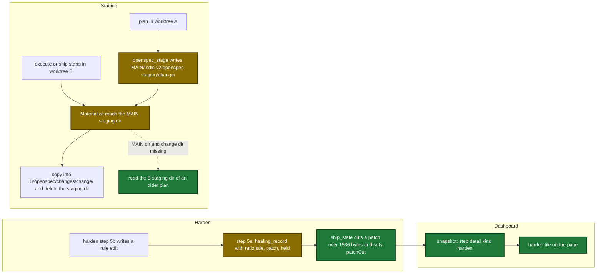

# Proposal

## Why

- Problem: a bad rule edit from the ship `harden` step reaches the PR with no review. The edit and its reason are visible only in git and in the raw run file.
- Evidence: `healing_record` kind `hardened` keeps only `surface`, `action` and `targetFile` of each edit (`internal/tools/ship_state.go:2765-2846`), and no dashboard code reads `healing.hardened`. A plan staged in worktree A fails in worktree B with `staging dir … is missing` (`internal/openspec/materialize.go:132-133`).
- Why now: the user approved the harden tile design (`design/dashboard/requirements.md`). User decisions D4 and D5 add the staging fix to this change.

## What Changes

| Area | Before | After |
|---|---|---|
| `ship_state` `healing_record` kind `hardened` | Each `applied[]` entry keeps `{surface, action, targetFile}`; other keys are dropped | Each entry also keeps optional `rationale` and `patch`; a patch over 1536 bytes is cut and gets `patchCut: true`; optional `held[]` (at most 100) with `reason` `pending-stored`, `pending-not-stored` or `not-processed` |
| `harden` skill step 5e | Sends `{surface, action, targetFile}` | Sends `rationale`, the written patch (the repaired entry for a repaired guardrail) and `held[]` |
| Dashboard snapshot | The ship `harden` step has no `detail` | New detail kind `harden`: edits, run records, funnel, fix pass, held rows, timeline and malformed count, with fixed text and list limits |
| Dashboard page | No harden tile | Harden tile: edits by surface and file with a patch toggle, run rows, funnel, fix pass, held rows, timeline, malformed marker |
| `plan_support` `openspec_stage` | Writes `<active-worktree>/.sdlc-v2/openspec-staging/<change>/` | Writes `<main-worktree>/.sdlc-v2/openspec-staging/<change>/`; `stagingDir` and the plan header stay relative |
| Materialize in `execute_state` `init`, `ship_prepare` and `openspec_save` | Reads the active-worktree staging dir only | Reads the main staging dir; reads the active-worktree dir only when the main dir and the change dir are both missing |

No row is breaking: old harden records stay valid, and a change that an older plugin staged under the active worktree still materializes.

## Capabilities

### New Capabilities

- None.

### Modified Capabilities

- `openspec-staging`: the staging dir moves to the main worktree; materialize finds it from any worktree, with a fallback to the active-worktree dir.
- `tool-plan-support`: `openspec_stage` writes under the main worktree; the staged-by-another-plan Suggestion names the absolute dir.
- `worktree-state-links`: the reason why `openspec-staging/` is never linked changes.
- `tool-ship-state`: `healing_record` kind `hardened` stores `rationale`, `patch`, `patchCut` and `held`.
- `skill-harden`: the `done` record carries `rationale`, the written patch and `held`.
- `pipeline-dashboard`: new step detail kind `harden` and the harden tile.

## Flow after the change

Pipeline flow after the change: a harden edit reaches the dashboard tile, and a change staged in one worktree starts in another.

## Impact

| Path | Kind | Change |
|---|---|---|
| `internal/tools/ship_state.go` | MCP tool | `healing_record` kind `hardened` stores `rationale`, `patch`, `patchCut`, `held`; tool and `Detail` descriptions and Suggestions |
| `plugins/sdlc/schemas/ship-state.schema.json` | schema | Optional properties on `applied` items and the `held` list |
| `plugins/sdlc/skills/ship/state-format.md` | doc | `hardened` example and table row |
| `plugins/sdlc/skills/harden/SKILL.md` | skill | Rule 3 exception, 5b `writtenPatch`, 5e `rationale`, `patch`, `held` |
| `docs/skills/harden.md` | doc | New section Ship state record |
| `internal/tools/ship_harden_clusters.go` | MCP tool | Mapper from ship state to cluster findings |
| `internal/tools/dashboard_harden.go`, `internal/tools/dashboard_snapshot.go`, `internal/tools/dashboard_join.go` | MCP tool | Snapshot detail kind `harden` |
| `internal/dashboard/web/static/render.js`, `view.js`, `app.css` | page | Harden tile ported from the approved draft |
| `internal/dashboard/web/testdata/snapshot.fixture.json`, `view.test.cjs`, `internal/dashboard/web/browser_e2e_test.go` | test | Fixture sample, page tests, browser test |
| `docs/dashboard.md` | doc | Harden tile, `steps[].detail.harden` row, issues, old-state note |
| `internal/openspec/stage.go`, `internal/openspec/materialize.go` | MCP tool | Staging root parameter and the fallback read |
| `internal/tools/plan_support.go`, `execute_state.go`, `ship.go`, `openspec.go`, `openspec_save.go` | MCP tool | Pass the main root; `openspec_save` warning; descriptions and Suggestion |
| `plugins/sdlc/skills/plan/SKILL.md`, `plugins/sdlc/skills/plan/state-format.md`, `plugins/sdlc/skills/openspec-save/SKILL.md` | skill | Main-worktree staging dir text |
| `docs/plan-architecture.md`, `docs/mcp-tool-annotations.md`, `docs/skills/openspec-save.md`, `docs/smoke-test.md` | doc | Main-worktree staging dir text |
| `internal/paths/paths.go` | MCP tool | Comment on the unlinked `openspec-staging` entry |
| `.github/workflows/test.yml` | CI | No change; it already runs `go test -tags integration ./...` and `node --test internal/dashboard/web/testdata/view.test.cjs` |
