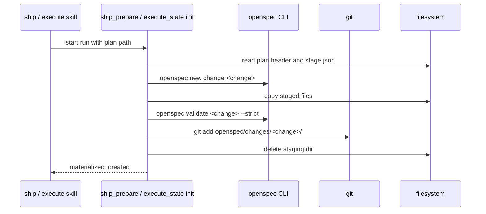

# Spec Delta

## MODIFIED Requirements

### Requirement: Staging location and layout
The system SHALL stage OpenSpec artifacts only in `<main-worktree>/.sdlc-v2/openspec-staging/<change>/`, also when the active worktree is a linked one, and never under `openspec/`.

Staging layout for the `spec-driven` schema (artifact paths follow the CLI's `outputPath` values):

```text
<main-worktree>/.sdlc-v2/openspec-staging/<change>/
  proposal.md
  design.md          (optional)
  specs/**/*.md
  tasks.md
  stage.json         { change, schema, planPath, files: [{ path, sha256 }], validatedAt }
```

- `<main-worktree>` is the path of the first `worktree` entry of `git worktree list --porcelain` that has no `bare` line.
- `stage.json` lists every staged artifact file with its SHA-256.
- `.openspec.yaml` is never staged; `openspec new change` creates it.
- Every staged path is gitignored; `git status --porcelain` stays empty after staging.
- Staging still reads `openspec/config.yaml` and the current specs from the active worktree, because the delta specs apply to the specs of the plan's branch.
- One staging dir exists for each change name in the repo. The ownership check reads the `stage.json` under the main worktree, so a second plan that stages the same change name from any worktree is refused.

#### Scenario: Stage in a linked worktree
- **WHEN** plan stages change `add-widget` while the active worktree is a linked worktree at `/repo-wt` and the main worktree is `/repo`
- **THEN** the files exist under `/repo/.sdlc-v2/openspec-staging/add-widget/`
- **AND** nothing is written under `/repo-wt/.sdlc-v2/openspec-staging/`

#### Scenario: Git stays clean
- **WHEN** staging completes
- **THEN** `git status --porcelain` in the active worktree prints nothing

#### Scenario: Same change name from two worktrees
- **WHEN** the plan `/plans/a.md` staged change `add-widget` from linked worktree A
- **AND** the plan `/plans/b.md` stages `add-widget` from linked worktree B
- **THEN** the call fails with a DomainError that names `/plans/a.md`
- **AND** `<main-worktree>/.sdlc-v2/openspec-staging/add-widget/` keeps its files

### Requirement: Materialize when a run starts
When ship starts (`ship_prepare`) or standalone execute starts (`execute_state` `init`) with a plan that has an `**OpenSpec-Staging:**` header, the system SHALL materialize the staged change into `openspec/changes/<change>/` of the active worktree before any other run work, by the first matching rule below.

The staging dir is `<main-worktree>/.sdlc-v2/openspec-staging/<change>/`. Only when that dir does not exist and `openspec/changes/<change>/` does not exist in the active worktree, the staging dir is `<active-worktree>/.sdlc-v2/openspec-staging/<change>/` (a change that an older plugin staged). When the main and the active worktree are the same, the two paths are one dir.

| # | Condition | Result |
|---|---|---|
| 1 | No `**OpenSpec-Staging:**` header | Nothing happens |
| 2 | Change name fails the name check | DomainError; nothing written |
| 3 | `openspec/changes/<change>/` exists and the staging dir is missing | Already materialized by an earlier start; no compare; result `materialized: "already"` |
| 4 | `openspec/changes/<change>/` exists, staging dir present, every `stage.json` file matches the target by SHA-256 | Already materialized: staging dir deleted; result `materialized: "already"` |
| 5 | `openspec/changes/<change>/` exists, staging dir present, any file differs | DomainError `openspec change <change> already exists and differs from staging`; nothing overwritten |
| 6 | Target and staging dir both missing | DomainError naming the expected staging path; when the main and the active worktree differ, it names both staging paths |
| 7 | A staged file's SHA-256 differs from `stage.json` | DomainError `staged file <path> changed after validation`; nothing written |
| 8 | Otherwise | Run `openspec new change <change>`, copy each `stage.json` file to the same relative path, run `openspec validate <change> --strict` |

- When rule 8 validation fails, the system deletes `openspec/changes/<change>/`, keeps the staging dir, and returns a DomainError with the CLI output.
- When rule 8 succeeds, the system runs `git add openspec/changes/<change>/` in the active worktree, deletes the staging dir, and returns `materialized: "created"`.
- Every rule reads and deletes only the staging dir that was chosen. An older active-worktree staging dir next to a main staging dir is not read and stays.
- The fallback read happens only when the main staging dir does not exist. When the check of the main staging dir fails for another reason, when its path is a file, or when its `stage.json` is missing, unreadable or not valid JSON, the call fails with an InfraError and does not read the active-worktree dir.
- A failed check of the active-worktree staging dir in the fallback fails the call with an InfraError.
- `openspec_save` materializes by the same rules.
- `.openspec.yaml` created by `openspec new change` is never overwritten.
- Under `ship_prepare` `dryRun: true`, nothing is materialized.

Materialize flow at run start:



#### Scenario: First start materializes
- **WHEN** `/sdlc:ship --plan <file>` starts and the plan stages `add-widget`
- **THEN** `openspec/changes/add-widget/` holds the staged files and `.openspec.yaml`
- **AND** `git diff --cached --name-only` lists the new files
- **AND** `<main-worktree>/.sdlc-v2/openspec-staging/add-widget/` no longer exists

#### Scenario: Second start is a no-op
- **WHEN** ship materialized `add-widget` and then execute `init` runs for the same plan
- **THEN** the result is `materialized: "already"`
- **AND** no file under `openspec/changes/add-widget/` changes

#### Scenario: Validation fails at materialize
- **WHEN** `openspec validate add-widget --strict` fails after the copy
- **THEN** `openspec/changes/add-widget/` does not exist
- **AND** the staging dir is unchanged
- **AND** the run does not start

#### Scenario: Staging from another worktree
- **WHEN** the plan was staged in worktree A and ship starts in worktree B of the same repo
- **THEN** the result is `materialized: "created"`
- **AND** `<B>/openspec/changes/<change>/` holds the staged files
- **AND** `<main-worktree>/.sdlc-v2/openspec-staging/<change>/` no longer exists

#### Scenario: Dry run
- **WHEN** `ship_prepare` is called with `dryRun: true` for a staged plan
- **THEN** `openspec/changes/<change>/` is not created

#### Scenario: Change staged by an older plugin
- **WHEN** `<main-worktree>/.sdlc-v2/openspec-staging/add-widget/` does not exist
- **AND** `openspec/changes/add-widget/` does not exist in the active worktree
- **AND** `<active-worktree>/.sdlc-v2/openspec-staging/add-widget/` holds a staged change
- **THEN** the result is `materialized: "created"`
- **AND** `<active-worktree>/.sdlc-v2/openspec-staging/add-widget/` no longer exists

#### Scenario: Every staging dir missing
- **WHEN** the active worktree is a linked worktree
- **AND** the target, the main staging dir and the active-worktree staging dir of `add-widget` are all missing
- **THEN** the call fails with a DomainError that names `<main-worktree>/.sdlc-v2/openspec-staging/add-widget/`
- **AND** the message also names `<active-worktree>/.sdlc-v2/openspec-staging/add-widget/`

#### Scenario: Damaged main staging dir
- **WHEN** the `stage.json` in `<main-worktree>/.sdlc-v2/openspec-staging/add-widget/` is not valid JSON
- **AND** `<active-worktree>/.sdlc-v2/openspec-staging/add-widget/` holds a valid staged change
- **THEN** the call fails with an InfraError
- **AND** the active-worktree staging dir is not read and keeps its files

#### Scenario: Change dir exists next to an old active-worktree dir
- **WHEN** `openspec/changes/add-widget/` exists and the main staging dir is missing
- **AND** `<active-worktree>/.sdlc-v2/openspec-staging/add-widget/` exists
- **THEN** the result is `materialized: "already"`
- **AND** the active-worktree staging dir is not read and stays

## ADDED Requirements

### Requirement: Staging root when the main worktree is unknown
The system SHALL use the active worktree as the staging root when the main worktree cannot be resolved, and `openspec_save` SHALL then add one warning to a successful result.

- The main worktree cannot be resolved only outside a git repo, where no linked worktree exists.
- `openspec_stage` and execute `init` use the working directory with no warning, as before.

#### Scenario: openspec_save with no main worktree
- **WHEN** `openspec_save` runs and the main worktree cannot be resolved, with cause `<cause>`
- **THEN** the call reads only `<active-worktree>/.sdlc-v2/openspec-staging/<change>/`
- **AND** `warnings` holds `Main worktree not found (<cause>). Read only the staging folder of the active worktree.`

#### Scenario: openspec_save in a linked worktree
- **WHEN** `openspec_save` runs in a linked worktree and the main worktree resolves
- **THEN** the call reads `<main-worktree>/.sdlc-v2/openspec-staging/<change>/`
- **AND** the result has no main-worktree warning
