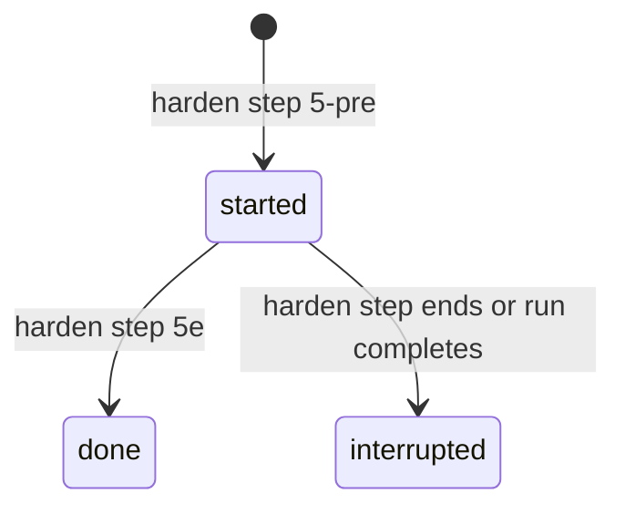

# Spec Delta

## MODIFIED Requirements

### Requirement: Step detail kind
Each step `detail` SHALL carry `kind`: `waves`, `dimensions`, `explorers`, `rounds`, `findings`, `guardrails`, `result`, `fixes`, or `harden`. A step with no detail SHALL have no `detail` key. An empty list SHALL be absent, and the `kind` SHALL stay, except in the `harden` object of kind `harden`, whose `edits`, `clusters`, `held` and `timeline` lists SHALL be `[]` when empty.

#### Scenario: Plan station with no explorers
- **WHEN** a ship state has `planExploreSummary: []`
- **THEN** the `plan` step has `detail` `{kind:"explorers"}` and no `explorers` key

#### Scenario: Harden step
- **WHEN** a ship run has the step `harden`
- **AND** the ship state has no `healing.hardened` key and no decision of step `harden`
- **THEN** the step has no `detail` key

#### Scenario: Clean commit step
- **WHEN** the ship step `commit` is `completed` with result `nothing to commit: execute committed 5 wave commit(s)`
- **THEN** the step has `detail` `{kind:"result", result:"nothing to commit: execute committed 5 wave commit(s)"}`

#### Scenario: Normal commit step
- **WHEN** the ship step `commit` is `completed` with result `committed 3f2a9c1`
- **THEN** the step has no `detail` key

#### Scenario: Received-review step with fixes
- **WHEN** a ship state holds 2 valid records in `healing.fixProgress`
- **THEN** the `received-review` step has `detail` with `kind:"fixes"` and 2 rows in `fixes`

#### Scenario: Harden step with a record
- **WHEN** a ship run has the step `harden` and `healing.hardened` holds one valid record
- **THEN** the step has `detail` with `kind:"harden"` and a `harden` object

## ADDED Requirements

### Requirement: Harden step detail
The snapshot SHALL attach a `detail` of kind `harden` to the `harden` step of a ship run when the ship state holds `healing.hardened` or a decision of step `harden`. The `harden` object SHALL hold `edits`, `clusters`, `held`, `timeline` and `malformed`, plus `funnel` and `fixPass` when they apply. A run with no `harden` step SHALL get no harden detail and no harden issue.

#### Scenario: Old-form record
- **WHEN** `healing.hardened` holds a valid record whose `applied` entries have only `surface`, `action` and `targetFile`
- **AND** the record has no `held` key
- **THEN** each row of `edits` has no `rationale`, `patch` or `patchCut` key
- **AND** `held` is `[]`

#### Scenario: New-form record
- **WHEN** a valid record has an `applied` entry with `rationale` `Two reviews found the same gap.`
- **THEN** the matching row of `edits` has `rationale` `Two reviews found the same gap.`

#### Scenario: Run record row
- **WHEN** a valid `done` record has `trigger` `cluster:src/auth.ts`, `classification` `user-code`, 1 `applied` entry and `skipped` 0
- **THEN** `clusters` holds `{trigger:"cluster:src/auth.ts", phase:"done", interrupted:false, classification:"user-code", applied:1, skipped:0}`

#### Scenario: Harden decision only
- **WHEN** the ship state has no `healing.hardened` key and one decision of step `harden`
- **THEN** the `harden` step has `detail` with `kind:"harden"`
- **AND** `edits`, `clusters` and `held` are `[]`

### Requirement: Harden held labels
The snapshot SHALL keep the stored held `reason` and SHALL set the row `label` only from this fixed table.

| `reason` | `label` |
|---|---|
| `pending-stored` | `stored as a deferred item` |
| `pending-not-stored` | `not stored — copy it by hand` |
| `not-processed` | `not processed — harden stopped` |

#### Scenario: Stored pending row
- **WHEN** a held entry has reason `pending-stored` and `deferredId` `harden-pending-dimensions`
- **THEN** the row has `label` `stored as a deferred item`
- **AND** the row has `deferredId` `harden-pending-dimensions`

#### Scenario: Not stored row
- **WHEN** a held entry has reason `pending-not-stored`
- **THEN** the row has `label` `not stored — copy it by hand` and no `deferredId` key

#### Scenario: Halted row
- **WHEN** a held entry has reason `not-processed`
- **THEN** the row has `label` `not processed — harden stopped`

### Requirement: Harden run interruption
The snapshot SHALL set `interrupted` on each run record: `false` on a `done` record, `false` on a `started` record while the harden step is `in_progress` and the run has no `pipelineCompletedAt`, and `true` on every other `started` record.

#### Scenario: Live harden step
- **WHEN** a `started` record exists, the harden step is `in_progress`, and `pipelineCompletedAt` is empty
- **THEN** the run record has `interrupted: false`

#### Scenario: Harden step ended with a started record
- **WHEN** a `started` record exists and the harden step is `completed`
- **THEN** the run record has `interrupted: true`

#### Scenario: Run completed with a started record
- **WHEN** a `started` record exists and `pipelineCompletedAt` is set
- **THEN** the run record has `interrupted: true`

### Requirement: Harden text limits
The snapshot SHALL redact tokens, cookies and email addresses in each `rationale` and `patch`, then cut `rationale` to 600 characters and `patch` to 1536 bytes on a UTF-8 boundary, with `patchCut: true` on a cut patch. It SHALL cut each `trigger` and each timeline `decision` to 120 characters.

#### Scenario: Rationale at the limit
- **WHEN** a `rationale` has 600 characters
- **THEN** the edit row has the whole `rationale`

#### Scenario: Rationale over the limit
- **WHEN** a `rationale` has 601 characters
- **THEN** the edit row has a cut `rationale`

#### Scenario: Long patch in an edited record
- **WHEN** a hand-edited record has a `patch` of 1537 bytes
- **THEN** the edit row has a `patch` of 1536 bytes and `patchCut: true`

#### Scenario: Token in a rationale
- **WHEN** a `rationale` holds an API token
- **THEN** the edit row does not hold the token text

### Requirement: Harden list limits
The snapshot SHALL read at most 50 run records of one run and SHALL keep at most 100 rows in each of `edits`, `held` and `timeline`. Each cut list SHALL add one `info` issue `<N> harden <list> rows not shown: the harden step shows the first <limit> of <total>`. A list at its limit SHALL add no issue.

#### Scenario: Edits at the limit
- **WHEN** the valid records hold 100 applied entries
- **THEN** `edits` has 100 rows and the pipeline has no harden `info` issue

#### Scenario: Edits over the limit
- **WHEN** the valid records hold 101 applied entries
- **THEN** `edits` has 100 rows
- **AND** the pipeline has one `info` issue that names the first 100 of 101

#### Scenario: Run records over the limit
- **WHEN** `healing.hardened` holds 51 valid records
- **THEN** `clusters` has 50 rows
- **AND** the pipeline has one `info` issue for the cut run records

### Requirement: Malformed harden records
The snapshot SHALL skip each run record that cannot be read, count it in `malformed`, and add one medium `state` issue `healing.hardened of the ship state holds <N> record(s) that cannot be read — they are not shown in the harden step` to that pipeline. A `healing.hardened` value that is not a list SHALL count as 1. Other pipelines and repos SHALL not change.

#### Scenario: Entry that is not an object
- **WHEN** `healing.hardened` holds one valid record and the string `not an object`
- **THEN** `malformed` is 1 and `clusters` has 1 row
- **AND** the pipeline has exactly one medium `state` issue for the harden records

#### Scenario: Record with a bad field
- **WHEN** a record has `phase` `paused`, or an empty `trigger`, or a held `reason` that is not one of `pending-stored`, `pending-not-stored`, `not-processed`
- **THEN** the record is skipped and counted in `malformed`

#### Scenario: Wrong field type
- **WHEN** a record has an `applied` entry whose `patch` is the number 5
- **THEN** the record is skipped and counted in `malformed`

#### Scenario: Hardened value that is not a list
- **WHEN** `healing.hardened` is the string `oops`
- **THEN** `malformed` is 1 and `clusters` is `[]`

#### Scenario: Other pipelines unchanged
- **WHEN** one ship pipeline has a malformed harden record
- **THEN** a second pipeline and a second repo in the same snapshot have no harden issue

### Requirement: Bad harden source lists
When `healing.fixed` or `deferredFindings` is present and not a list, the snapshot SHALL omit `funnel` and `fixPass` and add one medium `state` issue for the first bad field. When `decisions` is not a list, `timeline` SHALL be `[]`, `fixPass` SHALL be absent, and one medium `state` issue SHALL name `decisions`. The text is `<field> of the ship state is not a list — the harden <part> is not shown`.

#### Scenario: Bad fixed list
- **WHEN** `healing.fixed` is a string
- **THEN** `funnel` and `fixPass` are absent
- **AND** one medium `state` issue starts with `healing.fixed of the ship state is not a list`

#### Scenario: Two bad lists
- **WHEN** `healing.fixed` and `deferredFindings` are both strings
- **THEN** exactly one medium `state` issue names `healing.fixed`

#### Scenario: Bad decisions list
- **WHEN** `decisions` is a string
- **THEN** `timeline` is `[]` and `fixPass` is absent
- **AND** one medium `state` issue starts with `decisions of the ship state is not a list`

### Requirement: Harden finding funnel
The snapshot SHALL build `funnel` `{fixNow, staysDeferred, evidenceOnly, suppressed, loneDisagree}` with the harden cluster rules from `healing.fixed` and `deferredFindings`, as harden saw them before the fix pass. The first three count findings and the last two count files. It SHALL read at most 500 findings and add one `info` issue when the input holds more.

#### Scenario: Fixed in the run
- **WHEN** a `deferredFindings` entry has `fixedInRun: true`
- **THEN** the funnel counts it as a finding that was not fixed in the run

#### Scenario: Fixed record with a deferred id
- **WHEN** a `healing.fixed` record has a `deferredId`
- **THEN** the record adds no finding to the funnel

#### Scenario: Empty deferral reason
- **WHEN** a `deferredFindings` entry has an empty reason
- **THEN** the funnel counts it as a `below-threshold` finding

#### Scenario: Findings over the limit
- **WHEN** the two lists hold 501 findings
- **THEN** the funnel counts the first 500 findings
- **AND** the pipeline has one `info` issue

### Requirement: Harden fix pass
The snapshot SHALL set `fixPass` `{fixed, total}` only when a decision of step `harden` starts with `fix pass started`. `fixed` is the count of `deferredFindings` entries with `fixedInRun: true`. `total` is `fixed` plus the below-threshold entries with a `deferredId` and no `fixedInRun: true`; an empty reason counts as below-threshold.

#### Scenario: Fix pass ran
- **WHEN** a harden decision is `fix pass started: 2 finding(s)` and 2 `deferredFindings` entries have `fixedInRun: true`
- **THEN** `fixPass` is `{fixed: 2, total: 2}`

#### Scenario: No fix pass
- **WHEN** no harden decision starts with `fix pass started`
- **THEN** the `harden` object has no `fixPass` key

### Requirement: Harden timeline
The snapshot SHALL list each decision of step `harden` in stored order as a `timeline` row `{at, decision}`. The row SHALL keep `at` only when it parses as RFC 3339, else `at` SHALL be the empty string.

#### Scenario: Valid time
- **WHEN** a harden decision has `at` `2026-10-27T07:31:00Z`
- **THEN** its timeline row has `at` `2026-10-27T07:31:00Z`

#### Scenario: Bad time
- **WHEN** a harden decision has `at` `yesterday`
- **THEN** its timeline row has `at` `""`

### Requirement: Harden tile
The page SHALL show a wide tile for a step with `detail.kind` `harden`, with the edits grouped by surface and then by `targetFile`, the run rows, the funnel, the fix pass, the held rows and the timeline. The tile summary SHALL be the edit count, plus ` · <m> held back` when `held` is not empty.

#### Scenario: One edit
- **WHEN** the detail has 1 edit and an empty `held`
- **THEN** the tile summary is `1 edit`

#### Scenario: Edits and held rows
- **WHEN** the detail has 2 edits and 1 held row
- **THEN** the tile summary is `2 edits · 1 held back`

#### Scenario: No harden object
- **WHEN** the detail has kind `harden` and no `harden` key
- **THEN** the tile summary is `0 edits`

#### Scenario: Old-form edit
- **WHEN** an edit has no `rationale`
- **THEN** the edit shows `No rationale recorded.`

#### Scenario: Cut patch
- **WHEN** an edit has `patchCut: true`
- **THEN** the edit shows a patch toggle and the flag `cut at 1536 bytes`

#### Scenario: Interrupted run row
- **WHEN** a run record has `phase` `started` and `interrupted: false`
- **THEN** the run row shows no `interrupted` flag
- **AND** a run record with `interrupted: true` shows `interrupted`

#### Scenario: Fix pass text
- **WHEN** `fixPass` is `{fixed: 2, total: 2}`
- **THEN** the tile shows `2 of 2 fixed` and no failed count
- **AND** with no `fixPass` the tile shows `No fix pass.`

#### Scenario: Held rows
- **WHEN** `held` has a row with `label` `stored as a deferred item`
- **THEN** the held row shows `stored as a deferred item`
- **AND** an empty `held` shows `Nothing held back.`

#### Scenario: Malformed marker
- **WHEN** `malformed` is 2
- **THEN** the tile shows `2 harden records could not be read. The other records show below.`
