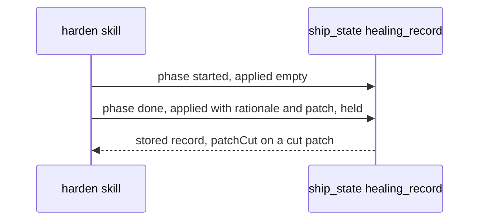

# Spec Delta

## MODIFIED Requirements

### Requirement: Ship healing records
When its own `--step` argument is exactly `ship harden`, the skill SHALL call `ship_state` `healing_record` with `step: "harden"` and `detail.kind: "hardened"`: with `phase: "started"` before the proposal loop handles its first proposal, and with `phase: "done"` once at the run's exit.

- Both calls pass the same `trigger` (first 200 characters of the failure text), so `done` replaces `started`.
- `started` carries `applied: []` and no `held`.
- On the empty-proposals exit and the plugin-defect route only `done` is sent, with `applied: []` and `held: []`.
- `done` carries `classification`, `applied[]`, `held[]` and `skipped` count.
- Each `applied[]` entry is `{surface, action, targetFile, rationale, patch}` for a proposal that reached the 5b `Applied {action} on {surface} → {targetFile}` line. `rationale` is sent only when the proposal rationale is a non-empty string; otherwise the key is left out.
- `patch` is the text that the write added: the repaired guardrail entry when 5a or `consolidate` repaired the candidate before the write, else the proposal patch, else `""`. The skill never sends `patchCut`.
- `held[]` holds one `{surface, action, targetFile, reason, deferredId}` entry for each proposal that the run left for a person, by the table below. `deferredId` is sent only with reason `pending-stored`.
- A skipped, reverted or cancelled proposal gives no `held` entry.
- A tool error prints one warning line and the run continues.
- With any other `--step` value neither call is made.

| Mode | Exit into the `done` call | `held` |
|---|---|---|
| `--auto` | normal path | `pending-stored` with its `deferredId` for each `Pending (needs a person — stored …)` item; `pending-not-stored` for each `Pending (NOT stored …)` item |
| `--auto` | 5a write-back halt or 5b halt | the entries of the row above, plus `not-processed` for each `Not processed (halt)` item |
| interactive | normal path | `[]` |
| interactive | 5a write-back halt or 5b halt | `not-processed` for each proposal after the halted proposal |
| interactive | `cancel` at the approval gate | `[]` |
| any | Step 4 route (b) or route (d) | `[]` |

Order of the two record calls:

#### Scenario: Standalone run
- **WHEN** the skill runs with `--step "Step 5"`
- **THEN** it does not call `ship_state`

#### Scenario: Repaired guardrail patch
- **WHEN** step 5a split guardrail `dry` into `dry-1` and `dry-2` before the write
- **THEN** the `patch` of the `done` entry is the TOML text that the write added
- **AND** it is not the proposal patch

#### Scenario: Blank rationale
- **WHEN** an applied proposal has `rationale` `""`
- **THEN** its `applied` entry has no `rationale` key

#### Scenario: Stored pending item under auto mode
- **WHEN** `--auto` is set and a `merge` proposal on `plan-guardrails` is stored as deferred item `harden-pending-plan`
- **THEN** `held` has an entry with reason `pending-stored` and `deferredId` `harden-pending-plan`

#### Scenario: Pending item not stored
- **WHEN** `--auto` is set and `deferred_add` returns an error for a pending proposal
- **THEN** `held` has an entry with reason `pending-not-stored` and no `deferredId`

#### Scenario: Interactive run on the normal path
- **WHEN** an interactive run ends on the normal path
- **THEN** the `done` call has `held: []`

#### Scenario: Interactive halt
- **WHEN** an interactive run halts at step 5b on proposal 2 of 4
- **THEN** `held` has `not-processed` entries for proposals 3 and 4
