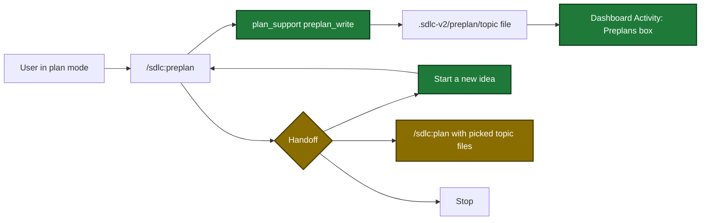

# Proposal

## Why

- Problem: `/sdlc:preplan` does not work while plan mode is active. Plan mode refuses each file edit except the plan file, and the skill edits the topic file with file edits.
- Evidence: the stop hook warns `Plan presented but plan was not invoked` for a preplan session (`internal/hooks/stop_hooks.go:212`). The dashboard shows only topic, status, path and times of a topic file (`docs/dashboard.md:872`). The handoff offers only start plan or stop (`plugins/sdlc/skills/preplan/SKILL.md:238-243`).
- Why now: users draft several topic files in plan mode before one plan, and must leave plan mode for each one.

## What Changes

| Area | Before | After |
|---|---|---|
| `plan_support` | 11 actions. No action writes a section body or the Status line | New action `preplan_write` checks and writes one section body and/or the Status line, and returns the ready topic files |
| Stop hook | Warns in plan mode when no plan ran, also for a preplan session | No warning when the transcript, up to 64 MiB, holds a preplan invocation record |
| Preplan skill | Edits the topic file with file edits. Handoff: start plan or stop | Writes only through `plan_support`. Handoff: start plan with picked ready files, start a new idea, or stop |
| Dashboard snapshot | `preplans[]` rows hold topic, status, path and times | Rows also hold a checked summary and `unread` markers |
| Dashboard Activity tab | Two boxes: deferred and learnings | A third, full-width Preplans box |
| `/sdlc:plan` | One requirements file | Two or more preplan topic files in one run |

Flow after the change (draft, compare, hand off):

## Capabilities

### New Capabilities

- None.

### Modified Capabilities

- `tool-plan-support`: new action `preplan_write`, its format rules, errors and ready list.
- `skill-preplan`: writes through the tool, works in plan mode, three-option handoff.
- `pipeline-dashboard`: topic-file summary fields in the snapshot and the Activity tab Preplans box.
- `skill-plan`: accepts two or more preplan topic files.

## Impact

| Path | Kind | Change |
|---|---|---|
| `internal/tools/preplan_format.go` | MCP tool | new format checker P1-P11 and summary parsers |
| `internal/tools/preplan_write.go` | MCP tool | new `preplan_write` handler |
| `internal/tools/plan_support.go` | MCP tool | action enum, fields, description, retry texts |
| `internal/hooks/stop_hooks.go` | hook | whole-transcript preplan scan before the warning |
| `internal/tools/dashboard_preplans.go`, `internal/tools/dashboard_snapshot.go` | MCP tool | summary pass and 9 new row fields |
| `internal/dashboard/web/static/view.js`, `render.js`, `app.css` | doc | Activity tab Preplans box (page code) |
| `plugins/sdlc/skills/preplan/SKILL.md` | skill | tool writes and new handoff |
| `plugins/sdlc/skills/plan/SKILL.md` | skill | several topic-file paths |
| `docs/skills/preplan.md`, `docs/skills/plan.md`, `docs/dashboard.md`, `docs/skills/dashboard.md`, `docs/plan-architecture.md`, `docs/mcp-tool-annotations.md` | doc | follow the behavior changes |
