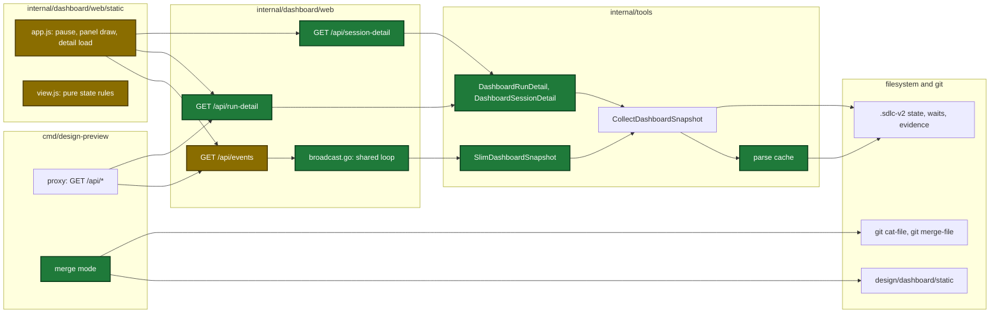
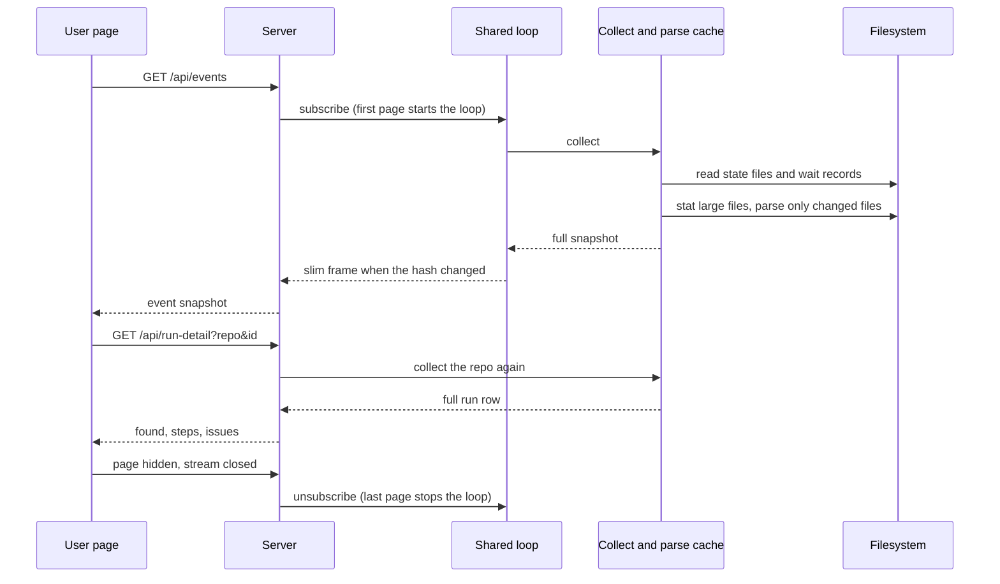
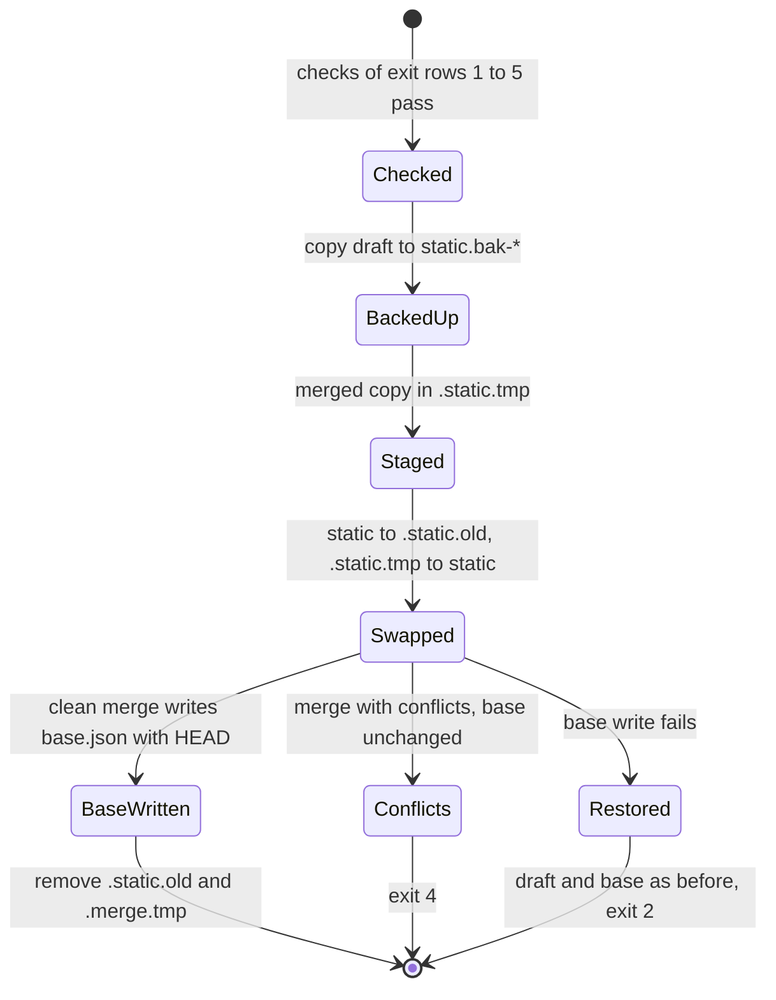

# Design

## Context

- See proposal.md - Why for the motivation.
- The page, the archive and the two detail routes need different data. Only the page gets the slim snapshot. The archive and the detail routes read the full rows.
- Today the server keeps no snapshot in memory and has no cache.
- `design/` is in `.gitignore`. The draft in `design/dashboard/static/` has no copy in git.

## Goals / Non-Goals

**Goals:**

- One collect for all open pages, and no collect while no page is connected.
- A wait record never shows late: state files and wait records are never cached.
- A slim page snapshot below 500 KB.
- A design draft that gets the new page code and keeps its own work.

**Non-Goals:**

- A study of the cause of the page that stops responding before the page fix.
- A session time window.
- A new session list on the Activity tab.
- A fix of the preview case c defect.

## Architecture

Parts that the change touches (green: new, amber: changed):



## Runtime flow

Main runtime flow: stream, snapshot, and detail on open:



## Before and after

| Flow | Before | After |
|---|---|---|
| Server collect | each open page has its own 2 s timer, a full parse, 2 encodes | one shared 2 s loop while a page is connected, parse only changed large files, 1 hash encode |
| Snapshot send | full 3.9 MB snapshot to this page | slim snapshot to each page whose last hash differs |
| Page update | stream open while hidden, all four panels drawn | stream closed while hidden, active panel drawn only on change |
| Detail of a finished run | in memory from the snapshot | one GET on open |
| Case d | Override or Keep | Merge, Override or Keep |

## Data contracts

```go
// New page snapshot fields (internal/tools/dashboard_snapshot.go)
type DashboardStep struct {
    // ...
    DetailKind string `json:"detailKind,omitempty"`
}
type DashboardPipeline struct {
    // ...
    IssueCount     int  `json:"issueCount,omitempty"`
    DetailDeferred bool `json:"detailDeferred,omitempty"`
}
// Session tags change to timeline,omitempty and commandGroups,omitempty.

type DashboardRunDetailOut struct {
    Found  bool             `json:"found"`
    ID     string           `json:"id"`
    Steps  []DashboardStep  `json:"steps"`  // [] when not found
    Issues []DashboardIssue `json:"issues"` // [] when not found
}
type DashboardSessionDetailOut struct {
    Found         bool                    `json:"found"`
    ID            string                  `json:"id"`
    Timeline      []DashboardEvent        `json:"timeline"`      // [] when not found
    CommandGroups []DashboardCommandGroup `json:"commandGroups"` // [] when not found
}
```

| Parse cache key | Source files | Cached value |
|---|---|---|
| `<root>\|sessions` | cli, user-inputs, mcp evidence and each `.1` file | sessions with full timeline and groups |
| `<root>\|evidence-times` | cli and user-inputs evidence and each `.1` file | evidence times |
| `<root>\|learnings` | learnings `log.md` | split entries |
| `<root>\|deferred` | `history/deferred.json` | deferred items |
| `<root>\|history` | `history/runs.jsonl` | history rows |

## Draft state

Persisted state of the draft folder and `design/dashboard/base.json` during a merge:



## Decisions

| Decision | Chosen | Rejected alternatives | Reason |
|---|---|---|---|
| Where to slim | a separate function that only the server collect calls | slim inside the repo collect | the archive reads the joined runs of the full rows |
| Session fields in the page snapshot | `omitempty` on `timeline` and `commandGroups` | a second session type for the page | one type keeps the snapshot code and the page reader the same |
| How detail routes get data | collect the repo again, through the parse cache | keep the last full snapshot in server memory | 3.9 MB of memory, and no data when no loop runs |
| Cache key | path, size, modification time in nanoseconds | add the inode number | the inode number needs platform code |
| Cache retention | keep each key until the server stops, skip a key over 32 MiB | a time limit for each key | a time limit parses the same unchanged file again |
| Never cached | state files, wait records, review ledgers, progress folders | cache all reads | a cached wait record can be old, and the run then waits |
| Stream fan-out | one loop, each page has a channel that keeps only the newest frame and its own hash | one hash for all pages | a new page must get the current snapshot at once |
| Where to lower priority | nice 10 on the process group at start | macOS background QoS class | the QoS call needs `golang.org/x/sys/unix` as a direct dependency |
| Panel skip | compare a JSON signature of the input of each panel | draw at each snapshot event | the draw of hidden panels is the likely cause of the page that stops responding |
| Page state rules | pure functions in `view.js` | branches in `app.js` only | Node cannot load `app.js`, so the pure functions get Node tests |
| Draft merge | three-way merge with `git merge-file`, base moves only on a clean merge | copy the shipped page over the draft | git ignores the draft, so a lost change has no other copy |
| Draft swap | move the old draft aside, move the merged copy in, write the base, then remove the old draft | remove the draft, then rename | a failed write then leaves the draft and the base as they were |
| Backup folder name | `os.MkdirTemp` with prefix `static.bak-<UTC time>-` | a numbered suffix loop | no loop and no limit error |
| Conflict markers | auto, merge and continue refuse a draft with markers through one check | trust the developer | the Go check decides that the draft is clean |
| Second merge | case d still lists Merge first after a stop between fix and continue | detect the half-done merge | the skill cannot see an earlier session, and the first backup still holds the old draft |

## Risks / Trade-offs

| Risk | Impact | Mitigation |
|---|---|---|
| A cache misses a file change | the page shows an old status or no wait, and the run stalls | state files and wait records are never cached; the key holds size and modification time in nanoseconds |
| Two writes in one modification time tick with the same size | the cache keeps an old parse | only for append files, which grow in size; tests reset the cache |
| The detail of a run fails to load | the user sees an error text in the tile | the data stays on disk; a reload or a close and open sends one more GET |
| The stream does not open again after a hidden tab | the page shows old data | the light shows `Paused while the page is hidden.` or `Connecting…` |
| Toggle-all expands many finished runs | one GET for each run | accepted: at most 4 days of runs, and the parse cache serves each GET |
| A merge loses own design work | the draft has no git copy | the backup folder comes before any draft write; a failed step restores the draft |
| A killed merge between the two renames | no `static/` folder | the backup folder holds the draft; the developer copies it back |

## Migration Plan

- The change ships in one commit. No state file or config key changes.
- After the commit, the developer runs `task design`, picks Merge in case d, and reads the draft diff.
- Rollback: revert the commit. The backup folder `design/dashboard/static.bak-*` restores the draft.
