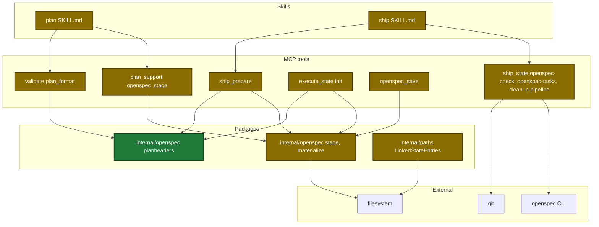
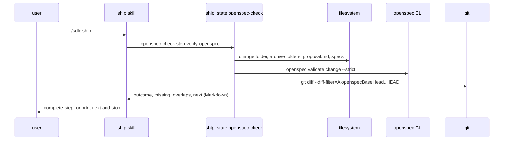
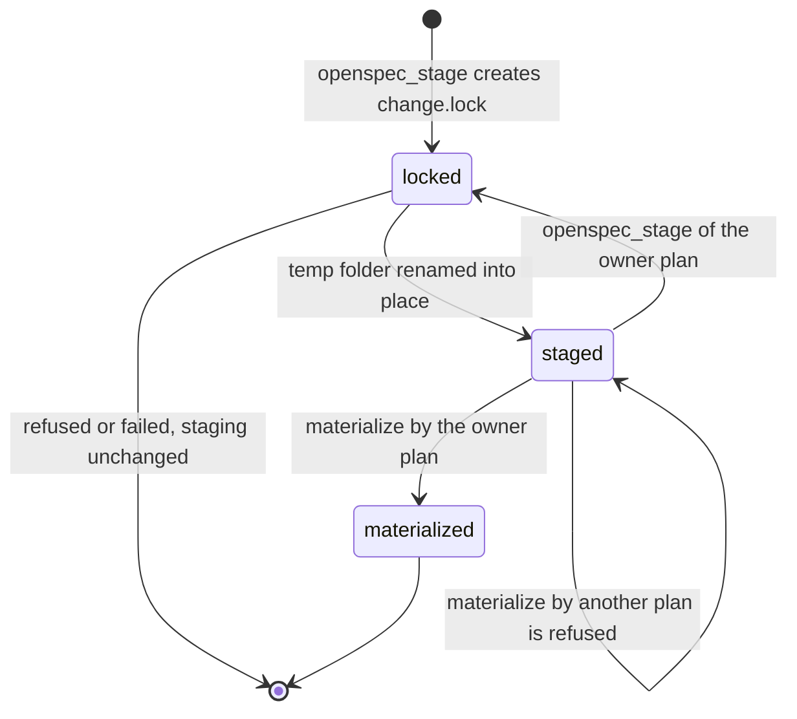

# Design

## Context

- See proposal.md - Why.
- `ship_prepare` and `execute_state` init read the plan once and return before any state write on an error (`internal/tools/ship.go:533`, `internal/tools/execute_state.go:2423`).
- Only `**OpenSpec-Staging:**` has a Go parser today (`internal/openspec/materialize.go:41`).
- The staging folder sits under the main worktree. `stage.json` holds the owner `planPath`, but materialize deletes the folder by change name only.
- The ship skill does the folder test, `openspec validate` and the checkbox sync in text (`plugins/sdlc/skills/ship/SKILL.md:178-192`).

## Goals / Non-Goals

**Goals:**

- Refuse an unauthored plan at the plan handoff, at the ship start and at the execute start.
- Give each staging folder one owner plan, and claim it atomically.
- Move every OpenSpec file check of the ship skill into tools.

**Non-Goals:**

- A stop in ship only, with no handoff check.
- A warning that lets the run continue.
- A kept copy of staging for a rerun in a second worktree. The rerun fails with an error that names the cause.

Touched parts (subgraphs: skills, MCP tools, packages, external):



Main runtime flow of the verify step:



Staging folder lifecycle (persisted state):



Data contracts:

```go
// internal/openspec
type PlanHeaderProblem struct { Kind, Change, Line string } // Kind: create-not-authored | appendix-tbd
func CheckPlanHeaders(planContent string) []PlanHeaderProblem
func Materialize(activeRoot, stagingRoot, planContent, planPath string) (MaterializeResult, error)
func ValidateStrict(dir, change string) (output string, exit int, err error)

// internal/tools: ValidateIn, new field
Handoff bool `json:"handoff,omitempty"`

// ship_state openspec-check output
type shipOpenspecCheckOut struct {
    Change, Outcome, ValidateOutput, Next string
    Missing, Warnings []string
    Overlaps []shipSpecOverlap
}
```

| State key | Type | Encoding | Example |
|---|---|---|---|
| `openspecBaseHead` (ship state) | string | 40 or 64 hex characters | `4d2e6dc...` |

## Decisions

| Decision | Chosen | Rejected alternatives | Reason |
|---|---|---|---|
| Header check place | one pure function in `internal/openspec` | a copy in each tool | `tools` imports `openspec`, so ship, execute and PF15 share one rule |
| PF15 trigger | new `handoff` input | run PF15 on every `plan_format` call | `[TBD` and the Create line are valid until Step 6 ends |
| Missing artifact | `valid: false` with a `missing artifact` line | an error | the plan skill already retries a `valid: false` stage (at most 5 calls) |
| Staging owner | owner check at materialize, lock and rename at stage | a kept staging copy | the user picked owner checks; a copy conflicts with the changed `tasks.md` |
| Ship checks | `ship_state` actions with `next` | skill text | file checks belong in tools (guardrail `mcp-deterministic-work-split`) |
| Overlap base | `openspecBaseHead` and archive folders added since it | a date filter | merged commits can carry old dates |
| Task 3 scope | completeness rule and atomic stage in one task | two tasks | both edit one function; a split adds a task on the same lines (warning guardrail `single-responsibility-tasks`) |

## Risks / Trade-offs

| Risk | Impact | Mitigation |
|---|---|---|
| A header-only check blocks a valid plan | ship and execute stop for that plan | Saved, Source-only and archived plans pass; tests cover each form |
| Short window between the two renames | a reader sees no staging folder | accepted; materialize and PF15 read without the lock |
| Two stagers take over one stale lock | one stage can replace the other | accepted; a lock is stale only after 10 minutes |
| A moved plan file gets the owner error | the run stops | the error names both paths; run with the plan at its old path |
| An older `stage.json` validated with a missing artifact | PF15 passes it | `openspec-check` still finds a missing proposal or delta spec |
