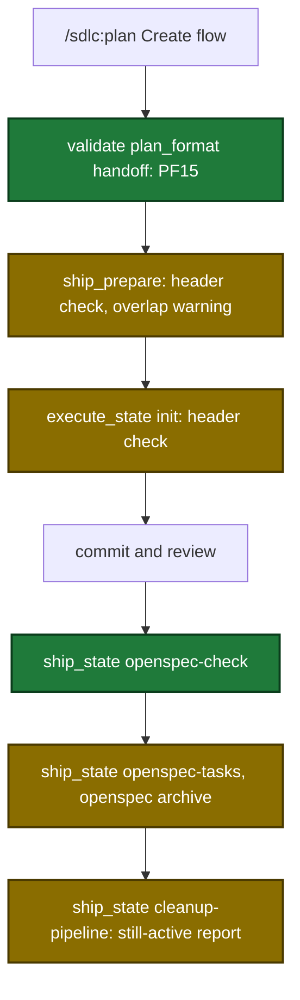

# Proposal

## Why

- Problem: ship and execute accept a plan whose OpenSpec artifacts were never authored. The run fails at `verify-openspec` after execute, commit and review (about 1.5 hours).
- Evidence: GitHub issue #108. A change folder with any file passes the folder test of `verify-openspec`. Parallel plans lose staging folders, `openspec_save` loses files, and the checkbox sync in skill text fails.
- Why now: an unattended run (`ship.auto`) loses a full pipeline run for each case, and a change can stay un-archived with no signal.

## What Changes

| Area | Before | After |
|---|---|---|
| `ship_prepare`, `execute_state` init | accept a plan with `**OpenSpec-Create:**` and no Staging or Saved line | refuse it before any write, with the fix text |
| plan handoff | `plan_format` has no OpenSpec rule | PF15 runs at the handoff and refuses unauthored or unvalidated staged artifacts |
| `openspec_stage` | accepts a partial artifact set, no lock | requires every schema artifact; lock file, temp folder and rename |
| materialize | deletes the staging folder of any plan | refuses a staging folder that another plan owns |
| `openspec_save` | no file check after the copy | checks each file on disk and in the git index |
| `verify-openspec`, `archive-openspec` | folder test, validate and checkbox sync in skill text | `ship_state` actions `openspec-check` and `openspec-tasks` |
| run end | no OpenSpec line | reports a named change that is still active |
| linked worktree | no `openspec-staging` link | `openspec-staging` is a linked entry |

Pipeline flow after the change (new and changed steps marked):

## Capabilities

### New Capabilities

- (none)

### Modified Capabilities

- `tool-ship-prepare`: header refusal, shared-spec warning, `openspecBaseHead` state key.
- `tool-execute-state`: init header refusal.
- `openspec-staging`: complete artifact set, atomic stage, owner check at materialize, rerun cause.
- `tool-validate`: PF15 handoff rule.
- `skill-plan`: handoff validation passes `handoff: true`.
- `tool-openspec-save`: disk and git index check.
- `tool-ship-state`: `openspec-check`, `openspec-tasks`, run-end report.
- `skill-ship`: OpenSpec steps use the new actions.
- `worktree-state-links`: `openspec-staging` moves to the linked entries.

## Impact

| Path | Kind | Change |
|---|---|---|
| `internal/openspec/planheaders.go` | MCP tool helper | new shared header check |
| `internal/openspec/stage.go`, `materialize.go`, `overlap.go`, `openspec.go`, `cli.go` | MCP tool helper | complete artifacts, lock, owner check, overlaps, `SyncTasks`, `ValidateStrict` |
| `internal/tools/ship.go`, `execute_state.go`, `openspec_save.go`, `validators.go`, `plan_support.go`, `openspec.go` | MCP tool | refusals, PF15, index check, descriptions |
| `internal/tools/ship_state.go`, `ship_state_openspec.go` | MCP tool | `openspec-check`, `openspec-tasks`, run-end report |
| `internal/paths/paths.go` | hook | `openspec-staging` linked |
| `plugins/sdlc/skills/plan/SKILL.md`, `plugins/sdlc/skills/ship/SKILL.md`, `plugins/sdlc/skills/ship/reference.md` | skill | handoff flag, new actions |
| `plugins/sdlc/schemas/ship-state.schema.json` | schema | `openspecBaseHead` |
| `docs/skills/*.md`, `docs/plan-architecture.md`, `docs/getting-started.md`, `docs/smoke-test.md` | doc | sync |
