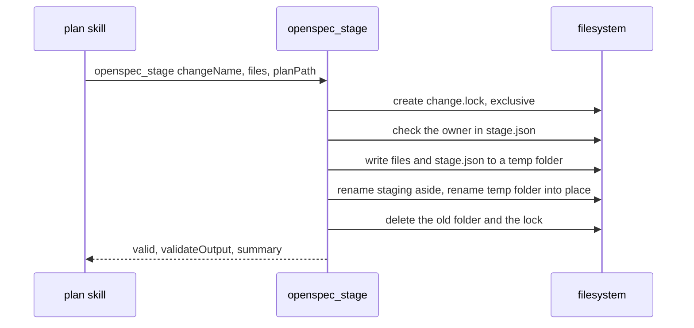

# Spec Delta

## ADDED Requirements

### Requirement: Stage requires every schema artifact
`openspec_stage` SHALL return `valid: false` when a file that `openspec status` lists as an artifact output of the schema is not in `files`. `validateOutput` holds one `missing artifact <outputPath>` line for each gap, and `stage.json` holds no `validatedAt`.

#### Scenario: design.md missing
- **WHEN** `openspec_stage` gets `proposal.md`, `specs/x/spec.md` and `tasks.md`, and the schema lists `design.md`
- **THEN** the result has `valid: false`
- **AND** `validateOutput` holds `missing artifact design.md`
- **AND** `stage.json` has no `validatedAt`

### Requirement: Stage claims the staging folder atomically
`openspec_stage` SHALL take the lock file `<change>.lock` next to the staging folders before it changes a staging folder, write the new files into a temp folder, and rename the temp folder into place. A lock younger than 10 minutes SHALL refuse the call with DomainError `staging is locked by another stage`, and no file changes.

Order of one stage call:

#### Scenario: Concurrent stage
- **WHEN** two `openspec_stage` calls for change `a` with two plan paths run at the same time
- **THEN** one call succeeds
- **AND** the other returns `staged by another plan` or `staging is locked by another stage`

#### Scenario: Stale lock
- **WHEN** `a.lock` is 10 minutes old
- **THEN** the stage deletes the lock and continues

#### Scenario: Rename fails
- **WHEN** the rename of the temp folder into place fails
- **THEN** the old staging folder is moved back
- **AND** the temp folder is removed

### Requirement: Materialize refuses staging of another plan
`ship_prepare`, `execute_state` init and `openspec_save` SHALL refuse to materialize a staging folder whose `stage.json` names another `planPath`, with the error `openspec materialize: staging of "<change>" belongs to plan <owner>, not <planPath>`, and SHALL change no file. An empty plan path or a `stage.json` with no `planPath` skips the check.

#### Scenario: Other plan
- **WHEN** `stage.json` of `a` names plan `/r/p1.md` and `ship_prepare` runs with plan `/r/p2.md`
- **THEN** `errors` holds `openspec materialize: staging of "a" belongs to plan /r/p1.md, not /r/p2.md`
- **AND** the staging folder and `openspec/changes/` stay as they were

#### Scenario: No owner recorded
- **WHEN** `stage.json` has no `planPath`
- **THEN** materialize runs as before

### Requirement: Rerun after materialize names the cause
When neither `openspec/changes/<change>/` nor the staging folder exists, the materialize error SHALL end with `If this plan already ran in another worktree, the change is on the branch of that worktree.`

#### Scenario: Rerun in a second worktree
- **WHEN** plan A materialized change `a` in worktree 1 and `ship_prepare` runs plan A in worktree 2
- **THEN** the error ends with `If this plan already ran in another worktree, the change is on the branch of that worktree.`
