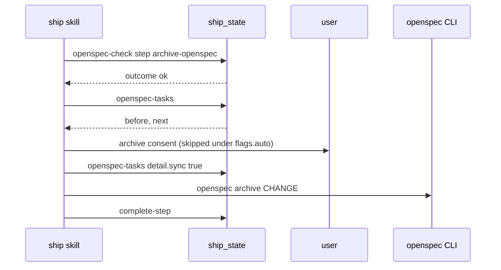

# Spec Delta

## MODIFIED Requirements

### Requirement: OpenSpec steps
The skill SHALL run `verify-openspec` and `archive-openspec` when `flags.openspecChange` is set (from `--openspec-change` or from the plan's `**Source:**` header) or an active change is auto-detected, and SHALL `skip` them with reason `"no active OpenSpec change"` only when no change is named anywhere.

- Each step calls `ship_state` action `openspec-check` and acts on `outcome` and `next`. The skill passes `detail.change` only for an auto-detected change.
- The skill runs no file check and no `openspec validate` of its own.
- `archive-openspec`: `archived` gives `complete-step` with result `already archived`. `ok` gives `openspec-tasks` (count), one consent gate (`AskUserQuestion`, skipped under `flags.auto`), `openspec-tasks` with `detail.sync: true` when boxes are open, then `openspec archive "$CHANGE"`.
- A `decide` entry records the archive consent outcome.

Call order of `archive-openspec`:

#### Scenario: No active change
- **WHEN** `verify-openspec` is configured, no change is named by flag or plan, and none is auto-detected
- **THEN** the skill calls `skip` with reason `"no active OpenSpec change"`

#### Scenario: Named change missing
- **WHEN** the plan's `**Source:**` names `add-widget` and `openspec/changes/add-widget/` does not exist
- **THEN** `openspec-check` returns `missing-on-disk` and writes the fail row `OpenSpec change "add-widget" named by the plan is missing on disk`
- **AND** the pipeline stops

#### Scenario: Validation fails
- **WHEN** `openspec-check` returns `invalid`
- **THEN** the skill prints `next`
- **AND** the pipeline stops

#### Scenario: Open boxes under auto
- **WHEN** `flags.auto` is set and `openspec-tasks` counts open boxes
- **THEN** the skill asks no question, calls `openspec-tasks` with `detail.sync: true`, then runs `openspec archive`
