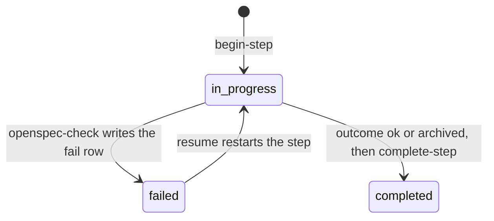

# Spec Delta

## ADDED Requirements

### Requirement: openspec-check action
`ship_state` action `openspec-check` SHALL check the named change for step `verify-openspec` or `archive-openspec` at status `in_progress`, and return one `outcome` (`archived`, `missing-on-disk`, `missing-artifacts`, `invalid`, `ok`) with a `next` instruction. For `missing-on-disk`, `missing-artifacts` and `invalid`, it SHALL write the fail row of the step.

Step status after the action:

#### Scenario: Proposal missing
- **WHEN** `openspec/changes/a/` has `specs/x/spec.md` and no `proposal.md`
- **THEN** `outcome` is `missing-artifacts`
- **AND** the step is `failed` with error `OpenSpec change "a" is missing proposal.md`

#### Scenario: Archive name clash
- **WHEN** the change is `fix`, `openspec/changes/fix/` is absent, and only `openspec/changes/archive/2026-01-01-add-fix/` exists
- **THEN** `outcome` is `missing-on-disk`, not `archived`

#### Scenario: Wrong step
- **WHEN** `openspec-check` runs with step `harden`
- **THEN** it returns DomainError `openspec-check: step "harden" has no OpenSpec check`

### Requirement: Validate failure names archived overlaps
When `openspec validate <change> --strict` fails, `openspec-check` SHALL list in `overlaps` each archive folder that `git diff --name-only --diff-filter=A <openspecBaseHead>..HEAD` adds and that edits a capability of the change. `next` SHALL tell the user to rebase the deltas of the change on the new spec text.

#### Scenario: Rebase brought a change
- **WHEN** validate fails and the rebase added `openspec/changes/archive/2026-11-01-b/specs/auth/`, and the change edits `specs/auth/`
- **THEN** `overlaps` holds `{spec: openspec/specs/auth/spec.md, change: 2026-11-01-b}`
- **AND** `next` starts with `Rebase the deltas of`

### Requirement: openspec-tasks action
`ship_state` action `openspec-tasks` SHALL count the open and done boxes of `tasks.md` outside code fences for step `archive-openspec`. With `detail.sync: true` it SHALL mark each open box done through a temp file and return each changed line with its number. Without `detail.sync` it SHALL write nothing.

#### Scenario: Count only
- **WHEN** `openspec-tasks` runs without `detail.sync`
- **THEN** `written` is false and `tasks.md` stays byte for byte the same

#### Scenario: Sync
- **WHEN** `openspec-tasks` runs with `detail.sync: true` and line 4 is `- [ ] a`
- **THEN** line 4 becomes `- [x] a`
- **AND** `changed` holds line 4

#### Scenario: Open fence
- **WHEN** `tasks.md` has a code fence that opens at line 7 and never closes
- **THEN** it returns DataError `tasks.md has an open code fence at line 7`

### Requirement: Run-end report of a still-active change
When `flags.openspecChange` names a change that is still in `openspec/changes/<change>/`, `cleanup-pipeline` SHALL return `openspec {change, stillActive, path}` and add one `decisions[]` entry for step `archive-openspec`. The run SHALL NOT stop.

#### Scenario: Change still active
- **WHEN** cleanup-pipeline runs and `openspec/changes/a/` exists
- **THEN** the output holds `openspec.stillActive: true`
- **AND** `decisions[]` gets `OpenSpec change a is still active in openspec/changes/a/. Archive it with openspec archive a.`

#### Scenario: Change archived
- **WHEN** the change is archived
- **THEN** `stillActive` is false and no decision is added
