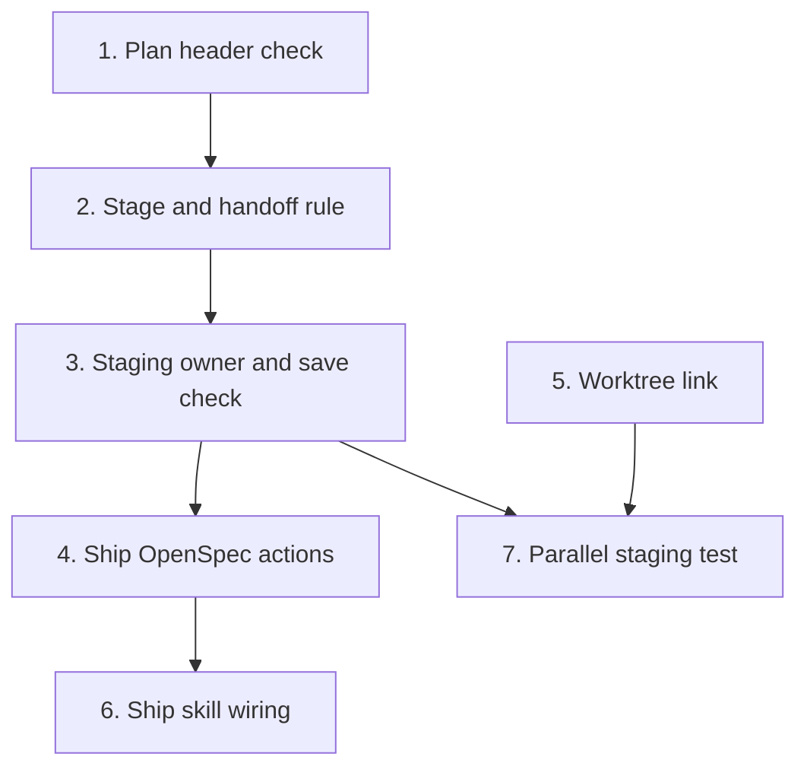

# Tasks

Group dependencies (groups with no path between them can run in parallel):

## 1. Plan header check

- [x] 1.1 Add `CheckPlanHeaders` and `SavedHeaderRe` in internal/openspec/planheaders.go — verify: go test ./internal/openspec/ -run TestCheckPlanHeaders <!-- ref:1-1-add-checkplanheaders-and-savedheader-3c7c69 -->
- [x] 1.2 Refuse unauthored plans in internal/tools/ship.go and internal/tools/execute_state.go — verify: go test ./internal/tools/ -run 'TestShipPrepareOpenspecHeaders|TestExecuteInitOpenspecHeaders' <!-- ref:1-2-refuse-unauthored-plans-in-internal-2d02ce -->

## 2. Stage and handoff rule

- [x] 2.1 Require every artifact and add the lock, temp folder and rename in internal/openspec/stage.go — verify: go test -race ./internal/openspec/ -run TestStage <!-- ref:2-1-require-every-artifact-and-add-the-l-e64ea9 -->
- [x] 2.2 Add PF15 and the `handoff` input in internal/tools/validators.go — verify: go test ./internal/tools/ -run TestPF15 <!-- ref:2-2-add-pf15-and-the-handoff-input-in-in-dc0542 -->
- [x] 2.3 Pass `handoff: true` at Step 6.6 and the rejected-handoff rerun in plugins/sdlc/skills/plan/SKILL.md — verify: go test ./internal/skillcheck/ <!-- ref:2-3-pass-handoff-true-at-step-6-6-and-th-1bcb77 -->

## 3. Staging owner and save check

- [x] 3.1 Add the owner check and the rerun hint in internal/openspec/materialize.go — verify: go test ./internal/openspec/ ./internal/tools/ -run 'TestMaterialize|TestOpenspecStaging' <!-- ref:3-1-add-the-owner-check-and-the-rerun-hi-955bea -->
- [x] 3.2 Check disk and git index after `git add` in internal/tools/openspec_save.go — verify: go test ./internal/tools/ -run TestOpenspecSave <!-- ref:3-2-check-disk-and-git-index-after-git-a-9d9506 -->

## 4. Ship OpenSpec actions

- [x] 4.1 Add the overlap warning and `openspecBaseHead` in internal/tools/ship.go — verify: go test ./internal/openspec/ ./internal/tools/ -run 'TestCapabilityOverlap|TestShipPrepareOverlap|TestPayloads_SchemaChecksums' <!-- ref:4-1-add-the-overlap-warning-and-openspec-e1ca0a -->
- [x] 4.2 Add the `openspec-check` action in internal/tools/ship_state_openspec.go — verify: go test ./internal/tools/ -run TestShipStateOpenspecCheck <!-- ref:4-2-add-the-openspec-check-action-in-int-6803b3 -->
- [x] 4.3 Add the `openspec-tasks` action in internal/tools/ship_state_openspec.go — verify: go test ./internal/openspec/ ./internal/tools/ -run 'TestSyncTasks|TestShipStateOpenspecTasks' <!-- ref:4-3-add-the-openspec-tasks-action-in-int-730732 -->
- [x] 4.4 Add the run-end report in internal/tools/ship_state.go — verify: go test ./internal/tools/ -run TestShipStateCleanupPipelineOpenspec <!-- ref:4-4-add-the-run-end-report-in-internal-t-a79e71 -->

## 5. Worktree link

- [x] 5.1 Move `OpenspecStagingSubdir` to the linked entries in internal/paths/paths.go — verify: go test ./internal/paths/ ./internal/hooks/ ./internal/tools/ -run 'Link|Anchor|StateEntryLists' <!-- ref:5-1-move-openspecstagingsubdir-to-the-li-47873b -->

## 6. Ship skill wiring

- [x] 6.1 Call `openspec-check` and `openspec-tasks` in plugins/sdlc/skills/ship/SKILL.md — verify: go test ./internal/skillcheck/ <!-- ref:6-1-call-openspec-check-and-openspec-tas-d8b305 -->

## 7. Parallel staging test

- [x] 7.1 Add the 3-worktree cases in internal/tools/openspec_staging_worktree_test.go — verify: go test ./internal/tools/ -run TestOpenspecStagingParallel <!-- ref:7-1-add-the-3-worktree-cases-in-internal-aa5e10 -->
