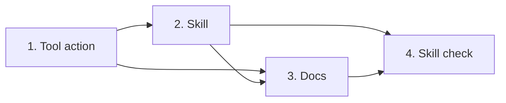

# Tasks

Group dependencies:

## 1. Tool action

- [x] 1.1 Add the six topic-file structure rules in internal/tools/preplan_format.go — verify: go test ./internal/tools/ -run 'TestPreplanStructureFindings' <!-- ref:1-1-add-the-six-topic-file-structure-rul-a7754a -->
- [x] 1.2 Add action verify_requirements_context with the topic and jira kinds in internal/tools/verify_requirements_context.go and internal/tools/plan_support.go — verify: go test -tags integration ./internal/tools/ -run 'TestVerifyRequirementsContext|TestPlanSupportActionList|TestPreplanToolDescription|TestUnknownAction_NamesBinaryAndAdvisesUpdate' <!-- ref:1-2-add-action-verify-requirements-conte-5d26af -->
- [x] 1.3 Add the file kind and the OpenSpec lists in internal/tools/verify_requirements_context.go — verify: go test -tags integration ./internal/tools/ -run 'TestVerifyRequirementsContextFile|TestVerifyRequirementsContextOpenspec' <!-- ref:1-3-add-the-file-kind-and-the-openspec-l-ff5869 -->
- [x] 1.4 Add the issue kind and set OpenWorld true in internal/tools/verify_requirements_context.go and internal/tools/annotations_test.go — verify: go test -tags integration ./internal/tools/ -run 'TestVerifyRequirementsContextIssue|TestEveryToolMatchesItsAnnotationDecision' <!-- ref:1-4-add-the-issue-kind-and-set-openworld-d3b4b2 -->

## 2. Skill

- [x] 2.1 Write the skill in plugins/sdlc/skills/verify-requirements/SKILL.md — verify: go test ./internal/skillcheck/ ./internal/discovery/ <!-- ref:2-1-write-the-skill-in-plugins-sdlc-skil-3e5f4a -->

## 3. Docs

- [x] 3.1 Write the skill page and its links in docs/skills/verify-requirements.md — verify: manual check of the outline, the Flags table and the links from README, getting-started, preplan and plan pages <!-- ref:3-1-write-the-skill-page-and-its-links-i-06b728 -->
- [x] 3.2 Update the action list and the path-input paragraph in docs/plan-architecture.md and docs/mcp-tool-annotations.md — verify: manual check that the row names thirteen actions <!-- ref:3-2-update-the-action-list-and-the-path-650187 -->

## 4. Skill check

- [x] 4.1 Add the parity and read-only lint tests in internal/skillcheck/skillcheck_verify_requirements_test.go — verify: go test -tags integration ./internal/skillcheck/ -run 'TestVerifyRequirements' <!-- ref:4-1-add-the-parity-and-read-only-lint-te-00c7f3 -->

## Workflow follow-up

- Run `task check` before the PR.
- `/sdlc:ship` archives the change after validation passes.
