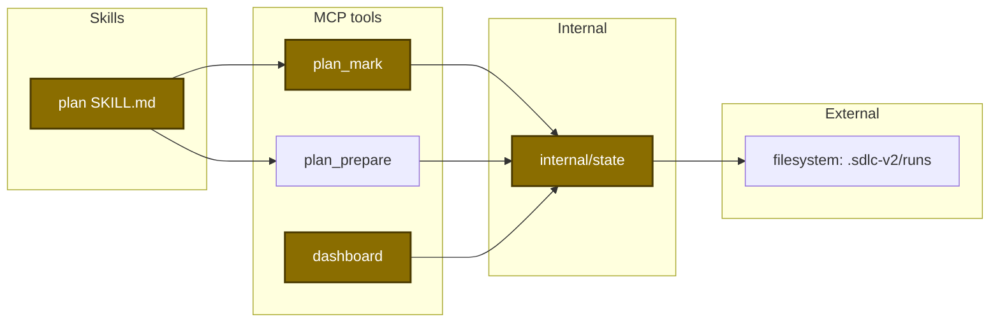
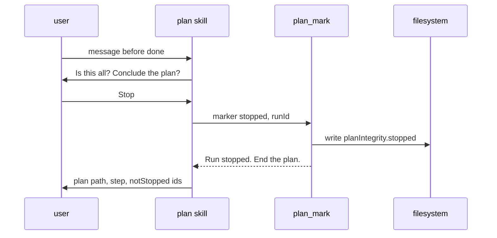
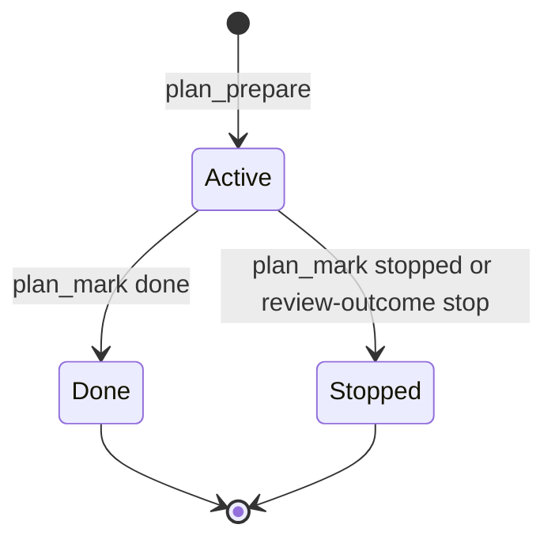

# Design

## Context

- The plan skill writes run state with `plan_mark` into `.sdlc-v2/runs/<runId>.json` under `planIntegrity`.
- `IsActivePlanRun` (`internal/state/state.go:829`) drives the post-compact banner, the session stamp hook and `plan_prepare` with no run ID.
- The dashboard maps a plan run to running or completed only (`internal/tools/dashboard_plan.go:87-94`).
- See proposal.md for the motivation.

## Goals / Non-Goals

**Goals:**
- Each plan run ends as done or as stopped.
- One question text at three points.
- A stopped run is visible on the dashboard as ended.

**Non-Goals:**
- No new dashboard status value.
- No state call after the done marker.
- No question on every skill question.

Architecture of the touched parts.

Main runtime flow of a user stop.

Run state transitions.

Data contract:

| Field | Type | Encoding | Example |
|---|---|---|---|
| `PlanMarkIn.Marker` | string enum | plain text | `stopped` |
| `planIntegrity.stopped` | string | RFC 3339 UTC | `2026-11-13T16:30:00Z` |

## Decisions

| Decision | Chosen | Rejected alternatives | Reason |
|---|---|---|---|
| Stop record | `stopped` timestamp marker | write nothing | the dashboard must tell a stopped run from a broken run |
| Dashboard status | `failed` with a stop issue | new `stopped` status | a new status changes the web page and the archive rule |
| Review-limit stop | same write as `review-outcome` | second `plan_mark` call | one write cannot fail between two calls |
| Gate retries | 3 tries, stored count | no limit | the limit must hold across a compaction |
| After handoff | no state call | write `stopped` | the run is done, and the spec forbids state calls after done |

## Risks / Trade-offs

| Risk | Impact | Mitigation |
|---|---|---|
| The question repeats too often | user friction | ask only at three points, never on the skill's own initiative at Step 0 or Step 4 |
| A stopped run hides an open run from resume | lost work | only an explicit Stop writes the marker |
| A gate fix guesses a URL | wrong link | the fix removes a broken URL and keeps the link text |
| `failed` reads as a crash | confusion | the issue text says "Stopped by the user" |
