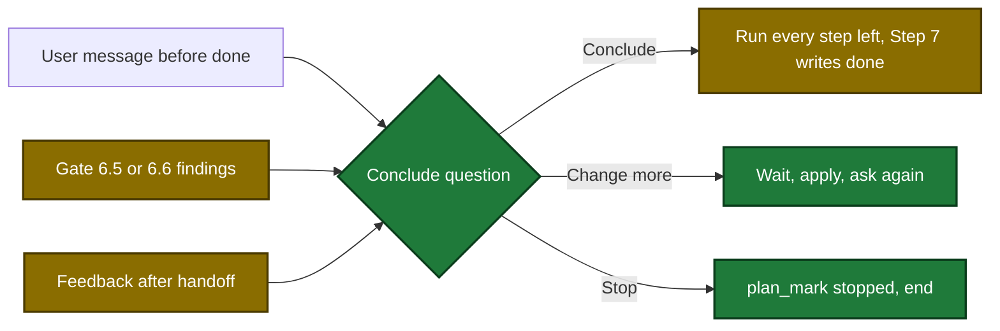

# Proposal

## Why

- Problem: many plan runs end with no result. The run never gets its done record, and the dashboard shows it as running, then stalled.
- Evidence: the gates at Step 6.5 and Step 6.6 say "Stop. Do not retry." (`plugins/sdlc/skills/plan/SKILL.md:1166`, `:1195`). A user message in the middle of a run has no rule. Feedback after the handoff has a rule for staged OpenSpec plans only (`SKILL.md:1243`).
- Why now: two runs in another repository ended open. One has only its start record. The user saw that most plans are not finalized.

## What Changes

| Area | Before | After |
|---|---|---|
| User message before done | no rule, the run can end open | apply the change, then ask "Is this all? Conclude the plan?" |
| Step 6.5 and 6.6 findings | show the findings and stop | ask the conclude question. Conclude fixes and runs the gate again, at most 3 tries |
| Feedback after the handoff | staged OpenSpec plans only | every plan, plan mode and normal mode, then the conclude question |
| Stop by the user | no record | new `plan_mark` marker `stopped` |
| Review-limit stop answer | no record | `review-outcome` with a `stop` choice stamps `stopped` |
| Reuse of a stopped run | allowed | `plan_prepare` refuses with `plan run <runId> is stopped` |
| Dashboard | a stopped run shows running, then stalled | a stopped run shows failed with `Stopped by the user at <station>` |

Flow after the change: the three points that ask the conclude question.

## Capabilities

### New Capabilities

### Modified Capabilities
- `skill-plan`: the hard gates ask the conclude question instead of a stop; feedback after the handoff covers every plan; new conclude question, message rule and stop rule.
- `tool-plan-mark`: new `stopped` timestamp marker with its combination rules; `review-outcome` with a `stop` choice stamps it.
- `tool-plan-prepare`: reuse of a stopped run is refused.
- `tool-dashboard`: a stopped plan run shows as failed with one stop issue.

## Impact

| Path | Kind | Change |
|---|---|---|
| `internal/tools/plan.go` | MCP tool | `stopped` marker, combination rules, reuse error, descriptions |
| `internal/state/state.go` | MCP tool | stopped check, active check excludes a stopped run |
| `internal/tools/dashboard_plan.go` | MCP tool | stopped run maps to failed |
| `plugins/sdlc/skills/plan/SKILL.md` | skill | conclude question, routes, stop rule, gate and handoff text |
| `internal/skillcheck/skillcheck_plan_test.go` | skill | pins of the new text |
| `docs/plan-architecture.md`, `docs/skills/plan.md` | doc | flowchart, marker table, error paths, route table |
| `plugins/sdlc/skills/plan/state-format.md` | doc | `stopped` marker and lifetime |
