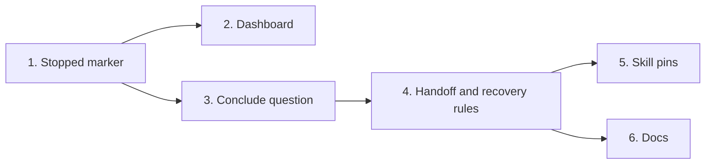

# Tasks

Group dependencies.

## 1. Stopped marker

- [x] 1.1 Add the stopped marker, its combination rules and the reuse error in internal/tools/plan.go and internal/state/state.go — verify: go test -tags integration ./internal/tools/... ./internal/state/... <!-- ref:1-1-add-the-stopped-marker-its-combinati-e523d2 -->

## 2. Dashboard

- [x] 2.1 Map a stopped plan run to failed in internal/tools/dashboard_plan.go — verify: go test -tags integration ./internal/tools/... <!-- ref:2-1-map-a-stopped-plan-run-to-failed-in-900576 -->

## 3. Conclude question

- [x] 3.1 Add the conclude question, routes, message rule and stop rule, and change the gate text in plugins/sdlc/skills/plan/SKILL.md — verify: go test -tags integration ./internal/skillcheck/... <!-- ref:3-1-add-the-conclude-question-routes-mes-24f3d6 -->

## 4. Handoff and recovery rules

- [x] 4.1 Change the handoff, review-limit, run ID and recovery rules in plugins/sdlc/skills/plan/SKILL.md — verify: go test -tags integration ./internal/skillcheck/... <!-- ref:4-1-change-the-handoff-review-limit-run-e102a7 -->

## 5. Skill pins

- [x] 5.1 Add TestPlanSkillConcludeQuestion in internal/skillcheck/skillcheck_plan_test.go — verify: go test -tags integration ./internal/skillcheck/... <!-- ref:5-1-add-testplanskillconcludequestion-in-e0e563 -->

## 6. Docs

- [x] 6.1 Update the flowchart, marker table, error paths and route table in docs/plan-architecture.md, docs/skills/plan.md and plugins/sdlc/skills/plan/state-format.md — verify: grep for the removed texts returns no line <!-- ref:6-1-update-the-flowchart-marker-table-er-dcca01 -->
