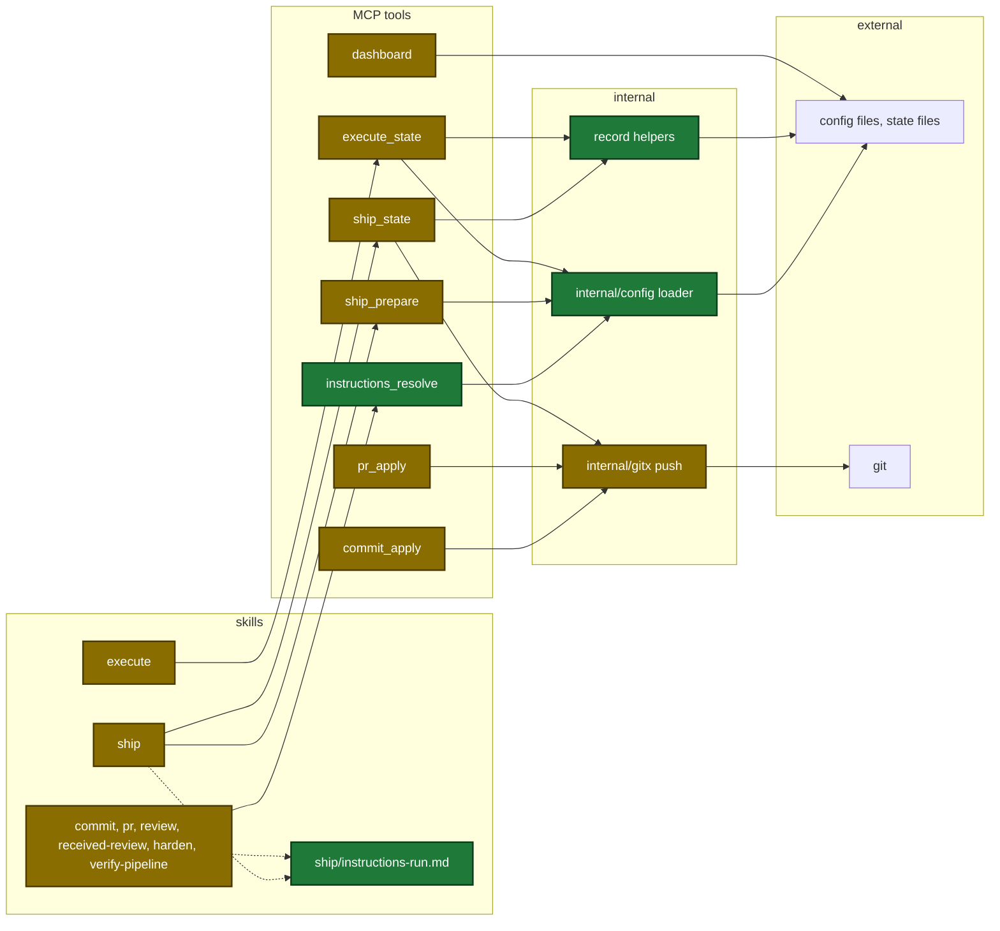
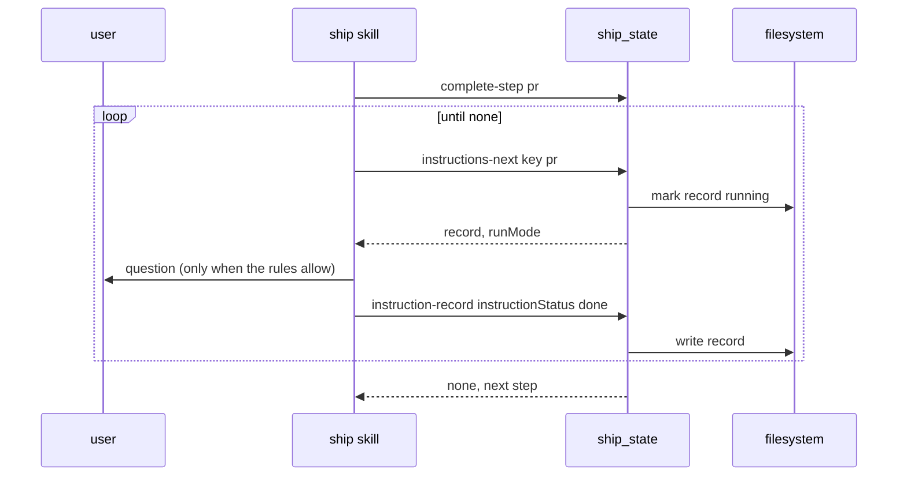
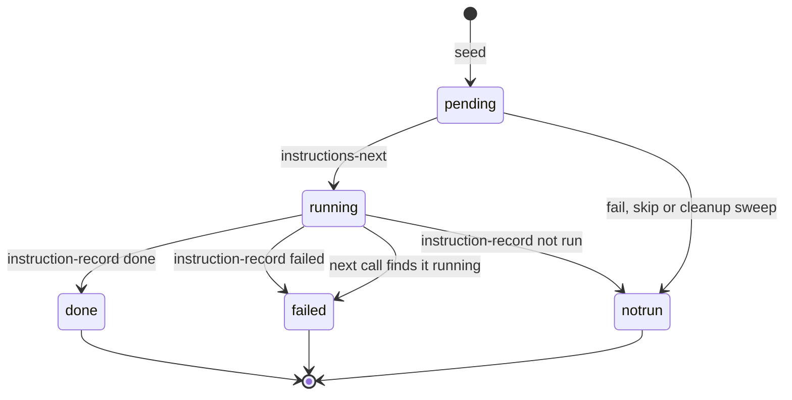

# Design

## Context

- See proposal.md - Why.
- Ship and execute keep a run state file. The other 6 skills keep none.
- A dispatched skill is a sub-agent. A sub-agent cannot ask the user.
- The team config file never merges with the local files today (`internal/config/config.go:766-790`).
- `complete-step` already reads `detail.outcome` with the values `success` and `failure`.

## Goals / Non-Goals

**Goals:**
- One loader and one record shape for ship and standalone execute.
- The tool owns the list order, so a resumed run finds the next instruction.

**Non-Goals:**
- No run state for commit, review, received-review, pr, harden or verify-pipeline.
- No setup menu entry for the section.

## Architecture

Touched parts, with new and changed parts marked:



## Main runtime flow

One step list in a ship run:



## Record states

States of one instruction record:



## Data contracts

```go
type Instruction struct {
    Key                  string `json:"key"`
    Number               int    `json:"number"`
    Source               string `json:"source"` // team | project local | user
    Text                 string `json:"text"`
    NormalQuestions      bool   `json:"normalQuestions"`
    CriticalQuestions    bool   `json:"criticalQuestions"`
    OnQuestionNotAllowed string `json:"onQuestionNotAllowed"` // skip | decide
}
```

| Field | Type | Encoding | Example |
|---|---|---|---|
| `instructions_resolve.key` | string | plain text | `pr` |
| `ship_state detail.key` | string | plain text | `pr` |
| `ship_state detail.instructionNumber` | int | JSON number | `2` |
| `ship_state detail.instructionStatus` | string | plain text | `done` |
| `ship_state detail.instructionOutcome` | string | plain text | `opened` |
| `ship_state detail.instructionAll` | bool | JSON bool | `true` |
| `commit_apply.push` | bool | JSON bool | `true` |

Config before and after:

```diff
 # .sdlc-v2/config.toml
 [ship]
 steps = ["execute", "commit", "review", "pr"]
+
+[[instructions.pr]]
+text = "Move the Jira ticket named in the branch name to 'In Review'."
+criticalQuestions = true
+onQuestionNotAllowed = "decide"
```

## Decisions

| Decision | Chosen | Rejected alternatives | Reason |
|---|---|---|---|
| Loader place | new loader in the config package | the section reader | the team file never merges with local files today |
| Record flow | seed at prepare, then next and record calls | the skill keeps the list | the tool knows the next instruction after a resume |
| Record key names | `instruction` prefix on the detail keys | plain `number`, `status`, `outcome` | `complete-step` reads `detail.outcome` with another meaning |
| Where lists run | the main session of ship | the dispatched skill | a sub-agent cannot ask the user |
| Ship signal | `--no-instructions` on each dispatch | a common dispatch signal | none exists. `--no-harden` is the precedent. |
| Push | best effort after commit and commit-fixes, lease push in pr | no push change | a pr instruction needs the branch on the remote. A plain push fails after the rebase. |
| Lease value | the remote-tracking commit | a fresh fetch | a push by another person is never overwritten |
| Running record on resume | becomes failed, not run again | run it again | a double post is worse than a missing one |
| Standalone skills | output only, no run state | a state file for each skill | the user chose output only |
| Skill page docs | Steps rows, Run facts and reference sections | a new H2 on each overview page | the site test allows only 7 fixed H2 headings on an overview page |

## Risks / Trade-offs

| Risk | Impact | Mitigation |
|---|---|---|
| A standalone run runs the list again on a new run | double post | the interrupt line names `--no-instructions` |
| A lease push is rejected | pr stops | DomainError with the fetch and integrate steps |
| A push to a shared branch | commits on the default branch reach the remote | the best-effort push skips the default branch |
| State file growth | read limit of 8 MiB | caps: 50 for each key, 4000 characters, 1000 for an outcome |
| Outside text changes a question rule | an unsafe action without a question | the flags, the run mode and the critical list come from config and fixed text only |
| A docs edit breaks the site build | the GitHub Pages deploy stops on main | each docs task runs `task site:install site:test site:build` |
