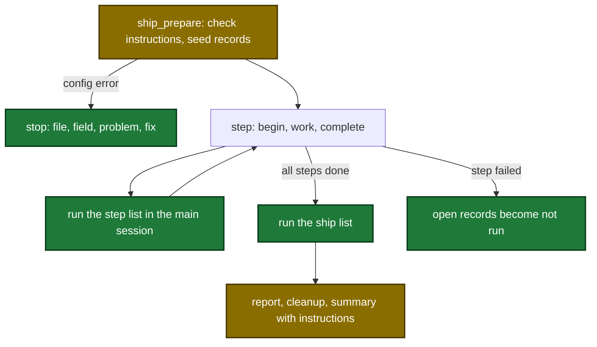

# Proposal: ship-step-instructions

## Why

- Problem: after each ship run, the user types the same follow-up instructions again (ticket moves, channel posts). No sdlc skill runs an instruction after a step or at the end of a run.
- Evidence: `.sdlc-v2/preplan/2026-11-13-extra-custom-instructions-at-ship-end.md` (9 decisions, 0 open questions). The ship step loop (`plugins/sdlc/skills/ship/SKILL.md:81-141`) has no place for a list. `commit_apply` never pushes, so a pr-step instruction cannot count on the branch on the remote.
- Why now: the topic is ready for plan, and the user asked for full docs and a correct GitHub Pages update in the same change.

## What Changes

| Area | Before | After |
|---|---|---|
| Config | no `[instructions]` section | new section in the team, project local and user-level files. The team list comes first, then the project local or the user-level list. |
| Ship run | steps, then report and summary | each step list runs after its step. The `ship` list runs after the last step. The summary names each failed instruction. |
| Standalone skills | no list | execute, commit, review, received-review, pr, harden and verify-pipeline run their own list after success. `--no-instructions` skips it. Ship passes it on each dispatch. |
| MCP tools | 33 tools | + `instructions_resolve`. `ship_state` and `execute_state` get `instructions-next` and `instruction-record`. |
| Push | commit never pushes. pr does a plain push. | commit and commit-fixes push, best effort (`commit --push`). `pr_apply` pushes with `--force-with-lease` when a remote-tracking ref exists. |
| Dashboard | one tile for each step | also one row for each instruction, and an end group |
| Docs | none for the section | `docs/instructions.md`, Steps rows and reference sections on 8 skill pages, state and dashboard pages |
| GitHub Pages site | no page and no home benefit for the section | `/docs/instructions/`, the changed skill pages, one home benefit. The site checks pass. |

## Capabilities

### New Capabilities

- `step-instructions`: the config section, the merge rule, the keys, the caps, the question rules, and when each list runs.
- `tool-instructions-resolve`: the MCP tool that returns the merged list of one standalone skill.

### Modified Capabilities

- `tool-pr-apply`: the push uses a lease when the branch has a remote-tracking ref.
- `skill-verify-pipeline`: a config instruction can run git in a standalone run. The list runs after the verdict line.
- `tool-commit-apply`: optional best-effort push.
- `tool-ship-prepare`: checks the section and seeds records.
- `tool-ship-state`: 2 instruction actions, record sweeps, the in-flight rule, the commit-check push.
- `tool-execute-state`: 2 instruction actions for standalone execute.
- `tool-dashboard`: instruction rows in the snapshot.
- `pipeline-dashboard`: the page shows the rows.
- `skill-ship`, `skill-commit`, `skill-pr`, `skill-execute`, `skill-review`, `skill-received-review`, `skill-harden`: run or skip their list.

## Flow after the change

Ship run with step lists and the end list:

## Impact

| Path | Kind | Change |
|---|---|---|
| `internal/config/instructions.go` | MCP tool support | new loader |
| `internal/tools/instructions_resolve.go` | MCP tool | new tool |
| `internal/tools/instruction_records.go` | MCP tool support | shared record helpers |
| `internal/tools/ship.go`, `ship_state.go`, `ship_report.go` | MCP tool | seed, actions, sweeps, in-flight, report |
| `internal/tools/execute_state.go` | MCP tool | 2 actions |
| `internal/tools/commit.go`, `pr.go`, `push.go`, `internal/gitx/gitx.go` | MCP tool | push, lease push |
| `internal/tools/dashboard_snapshot.go`, `dashboard_join.go`, `internal/dashboard/web/static/*` | MCP tool, UI | instruction rows |
| `plugins/sdlc/schemas/*.schema.json` | schema | section and record array |
| `plugins/sdlc/templates/config.toml`, `local.toml` | template | section examples |
| `plugins/sdlc/skills/{ship,commit,pr,execute,review,received-review,harden,verify-pipeline}/SKILL.md` | skill | run or skip the list |
| `plugins/sdlc/skills/ship/instructions-run.md` | skill | shared procedure |
| `docs/instructions.md`, `docs/skills/*.md`, `docs/skills/*/*.md`, `docs/dashboard.md`, `README.md` | doc | new page and updates |
| `site/src/data/benefits.mjs` | site | one home page benefit |
