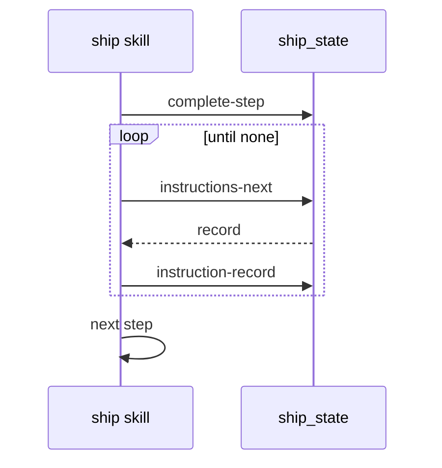

# Spec Delta

## ADDED Requirements

### Requirement: Step lists run after each step
After each completed step, ship SHALL run the list of that step in its main session with `instructions-next` and `instruction-record`, then go to the next step.

#### Scenario: Commit-check completes the step
- **WHEN** `commit-check` returns `stepCompleted: true`
- **THEN** ship prints each push warning and runs the commit list

#### Scenario: Commit-fixes did not run
- **WHEN** received-review collects no finding
- **THEN** ship marks each commit-fixes record `not run` with `step did not run`

### Requirement: End list
After the last step, ship SHALL run the `ship` list before the report, and SHALL print the instruction summary in the final summary.

#### Scenario: All steps done
- **WHEN** every step completes
- **THEN** the `ship` list runs, then the report, cleanup and summary

### Requirement: Dispatch flags
Ship SHALL pass `--no-instructions` on each skill dispatch, and SHALL pass `--push` only on the commit and commit-fixes dispatches.

#### Scenario: Verify-pipeline fix commit
- **WHEN** verify-pipeline returns `fix-applied`
- **THEN** ship dispatches commit with `--auto --no-instructions` and no `--push`

### Requirement: Resume runs open lists
On `--resume`, ship SHALL run the open records of each completed step, the commit-fixes records when received-review is completed, then continue.

#### Scenario: Stop during a list
- **WHEN** the run stopped with `pr #2` running
- **THEN** the resume marks `pr #2` failed with `result not recorded, not run again` and runs the rest
