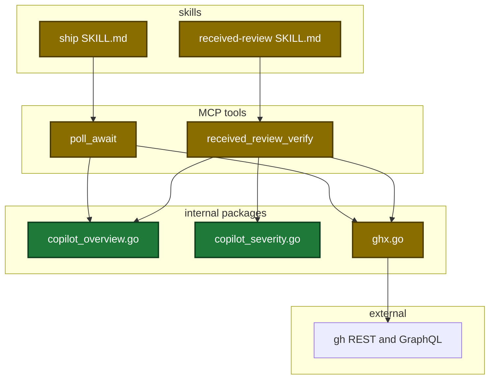
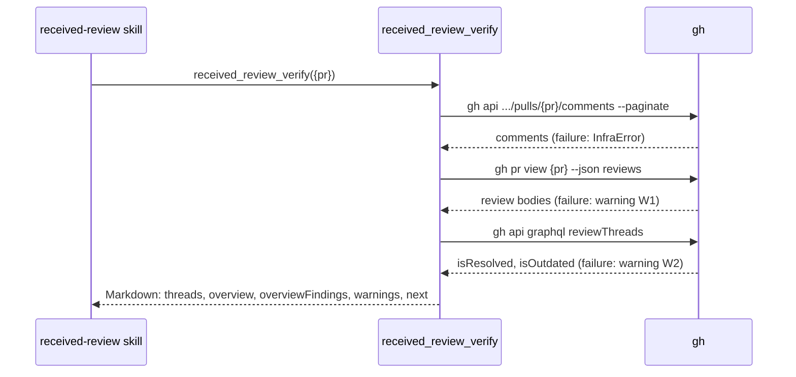

# Design

## Context

- See proposal.md - Why.
- The poll fetches reviews with `gh pr view --json reviews`, but drops the review body.
- `received_review_verify` already fetches every inline comment. The prepare tool spec forbids comments in its output, so the new data goes to the review-verify tool.
- No GraphQL helper exists. One comment id joins the REST comments, the overview links (`#discussion_r<id>`) and the GraphQL threads (first comment `databaseId`).

## Goals / Non-Goals

**Goals:**
- One overview parser serves the poll and the review-verify tool.
- The two new reads never stop the review-verify tool. A failure gives a warning.

**Non-Goals:**
- No new verdict value. 🔵 gives `actionable` plus the `overview` value.
- No `isNew` field and no `· New` parse: no step reads them.
- No support for an old Copilot body with no header: it keeps the state rule.

## Decisions

| Decision | Chosen | Rejected alternatives | Reason |
|---|---|---|---|
| Where the data goes | extend `received_review_verify` | new MCP tool; extend `received_review_prepare` | the verify tool already reads comments; the prepare spec forbids comments; fewer tools |
| Parser | Go regular expressions | an HTML library | `go.mod` has no HTML library; the repo parses text with regexps |
| Header detection | the H3 header line decides; the `<!-- ccr-overview-v2 -->` marker is optional | require the marker | 6 live reviews have the header and no marker |
| Header over state | with a header, the header rule applies to `APPROVED` and `COMMENTED` | `APPROVED` always clean | one rule for each review; no "approved-clean with a 🔵 note" case |
| 🟢 with findings | `actionable` when open + missed > 0 | always clean | no live Copilot finding stays unread (D3) |
| Prefix and icon differ | the higher value wins; both values stay | prefix wins; icon wins | no real problem gets a low rating (D4) |
| `minor` prefix | maps to `low` | add `minor` to the severity list | `ship_state` rejects `minor`; the list stays the same |
| Missed findings | findings with no comment ID and no reply | join by `discussion_r<id>` | live data shows missed items have no link (D5) |
| Thread rule order | `isResolved`, then `overviewSection: resolved`, then `isOutdated` | no order | one reason for each thread |
| Thread-state read failure | rules 1 and 3 do not apply | skip as resolved anyway | an unread state must not hide a live thread |

Architecture of the touched parts:

Main runtime flow of the review-verify tool:

No persisted state changes: the poll result is not stored, and the tool is read-only.

Data contracts:

| Field | Type | Encoding | Example |
|---|---|---|---|
| `threads[].severity` | string | plain text, omitted when empty | `medium` |
| `threads[].severityPrefix` | string | plain text, Copilot only | `medium` |
| `threads[].severityIcon` | string | plain text | `high` |
| `threads[].overviewSection` | string | `open` or `resolved` | `open` |
| `threads[].isResolved` | bool | JSON boolean | `false` |
| `threads[].isOutdated` | bool | JSON boolean | `true` |
| `overview` | string | one of 3 values or `""` | `changes-recommended` |
| `overviewFindings` | array | `[{title, path, line, severity, body}]`, `[]` when none | `[{"title":"Stale metadata key","path":"src/metadata.ts","line":646,"severity":"low","body":"..."}]` |
| `warnings` | string array | `[]` when none | `["Thread state not read (unknown): HTTP 502. ...", "This failure can be temporary. ..."]` |
| poll `ext.overview` | string | one of 3 values or `""` | `approval-recommended` |

## Risks / Trade-offs

| Risk | Impact | Mitigation |
|---|---|---|
| Copilot changes the format again | the verdict falls back to the state rule; severity cells stay empty | no header gives the old rule; empty cell counts as `medium` |
| GraphQL read fails | resolved threads are not skipped | warning W2; rules 1 and 3 do not apply; Copilot resolved block still applies |
| A test fixture loses the U+200B byte | the zero-width test passes for the wrong reason | the test asserts the fixture holds the byte |
| Header wins over `APPROVED` | an approved review with 🔵 runs received-review | intended (Deviations); recorded in the poll description |
