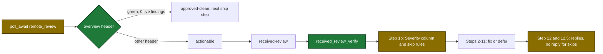

# Proposal

## Why

- Copilot changed its PR review format. The verdict and the severity are now in the review body: an H3 header (`🟢 Approval recommended`, `🟡 Changes recommended`, `🔵 Needs a closer look`) and `
` blocks with a severity icon per item.
- The plugin reads only the review state, and Copilot always sends `COMMENTED`. A review that recommends approval with no comment still starts received-review (identity-service PRs 512, 527, 533, 536).
- received-review gives each Copilot comment no severity, so `alwaysFixSeverities` pre-approves fixes on the default `medium`, a value that nobody measured.

## What Changes

| Area | Before | After |
|---|---|---|
| `poll_await` remote review verdict | from the review state only | a Copilot overview header decides for `APPROVED` and `COMMENTED`; no header keeps the state rule |
| `poll_await` `done` result | `verdict`, `reviewer`, `state`, `pr_number` | adds `overview`: `approval-recommended`, `changes-recommended`, `needs-closer-look`, or `""` |
| `received_review_verify` threads | `status`, `replyCount` | adds `severity`, `severityPrefix`, `severityIcon`, `overviewSection`, `isResolved`, `isOutdated` |
| `received_review_verify` output | threads and counts | adds `overview`, `overviewFindings` (findings with no thread), `warnings` |
| ship await-remote-review | `actionable` dispatches received-review | 🔵 also prints a closer-look note and passes it to the dispatch |
| received-review Step 1b | raw gh output, no severity | calls `received_review_verify` first, adds a Severity column, skips resolved threads with a record |
| received-review Step 12 and 12.5 | replies to each outstanding thread | no reply for a Step 1b skip or a finding with no thread |

Flow after the change (new steps green, changed steps amber):

## Capabilities

### New Capabilities

(none)

### Modified Capabilities

- `tool-poll-await`: the remote review verdict reads the Copilot overview header and returns `overview`.
- `tool-received-review-verify`: the tool reads review bodies and thread state, and returns Copilot severity, overview findings and read warnings.
- `skill-ship`: the await-remote-review step shows the closer-look note and records the overview.
- `skill-received-review`: Step 1b uses the review-verify output for severity and skips; Steps 12 and 12.5 post no reply for skipped threads and missed findings.

## Impact

| Path | Kind | Change |
|---|---|---|
| `internal/ghx/ghx.go` | MCP tool helper | review `Body`; new GraphQL thread-state read |
| `internal/tools/copilot_overview.go` | MCP tool helper | new overview parser |
| `internal/tools/copilot_severity.go` | MCP tool helper | new severity prefix and rank helpers |
| `internal/tools/polling.go` | MCP tool | verdict from the header; `overview` in the result; description |
| `internal/tools/received_review.go` | MCP tool | new output fields, warnings, description |
| `internal/tools/annotations_test.go` | MCP tool | reason names the two new reads |
| `plugins/sdlc/skills/ship/SKILL.md` | skill | closer-look note; `decide` text holds the overview |
| `plugins/sdlc/skills/received-review/SKILL.md` | skill | Step 1b, placeholders, Steps 10, 12, 12.5 |
| `docs/skills/ship.md`, `docs/skills/ship/pipeline-steps.md` | doc | verdict mapping |
| `docs/skills/received-review.md`, `docs/skills/received-review/consent-and-auto-mode.md` | doc | severity and skips |
