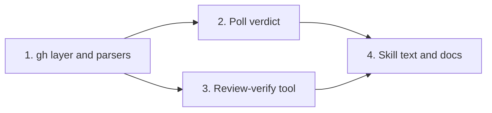

# Tasks

Task group dependencies:

## 1. gh layer and parsers

- [x] 1.1 Add review `Body` and `PRReviewThreadStates` in internal/ghx/ghx.go — verify: go test ./internal/ghx/ -run 'TestPRReviews|TestPRReviewThreadStates' <!-- ref:1-1-add-review-body-and-prreviewthreadst-f7f283 -->
- [x] 1.2 Add the Copilot overview parser and fixtures in internal/tools/copilot_overview.go — verify: go test ./internal/tools/ -run TestParseCopilotOverview <!-- ref:1-2-add-the-copilot-overview-parser-and-f3a39d -->
- [x] 1.3 Add the severity prefix and rank helpers in internal/tools/copilot_severity.go — verify: go test ./internal/tools/ -run 'TestInlineSeverityPrefix|TestHigherSeverity' <!-- ref:1-3-add-the-severity-prefix-and-rank-hel-87e7de -->

## 2. Poll verdict

- [x] 2.1 Read the overview header and return `overview` in internal/tools/polling.go — verify: go test ./internal/tools/ -run 'TestEvaluateReviews|TestAwaitRemoteReview' <!-- ref:2-1-read-the-overview-header-and-return-1b6dbb -->

## 3. Review-verify tool

- [x] 3.1 Add the overview join and severity fields in internal/tools/received_review.go — verify: go test ./internal/tools/ -run 'TestJoinCopilotOverview|TestReceivedReviewVerify' <!-- ref:3-1-add-the-overview-join-and-severity-f-e8bb23 -->
- [x] 3.2 Add thread state, warnings W1 and W2, and the new description in internal/tools/received_review.go — verify: go test ./internal/tools/ -run 'TestReceivedReviewVerify|TestJoinCopilotOverview|TestGhCause|TestEveryToolMatchesItsAnnotationDecision|TestReadOnlyToolsWriteNothingTracked' <!-- ref:3-2-add-thread-state-warnings-w1-and-w2-e5ad2c -->

## 4. Skill text and docs

- [x] 4.1 Add the closer-look note and the overview `decide` text in plugins/sdlc/skills/ship/SKILL.md and docs/skills/ship pages — verify: go test ./internal/skillcheck/ -run TestShip <!-- ref:4-1-add-the-closer-look-note-and-the-ove-55e5b1 -->
- [x] 4.2 Add the Step 1b severity and skip rules in plugins/sdlc/skills/received-review/SKILL.md and docs/skills/received-review pages — verify: go test ./internal/skillcheck/ -run TestReceivedReview <!-- ref:4-2-add-the-step-1b-severity-and-skip-ru-db03c7 -->

## Workflow follow-up

- Run `task test` and `task vet`.
- Ship archives the change after `verify-openspec` passes.
