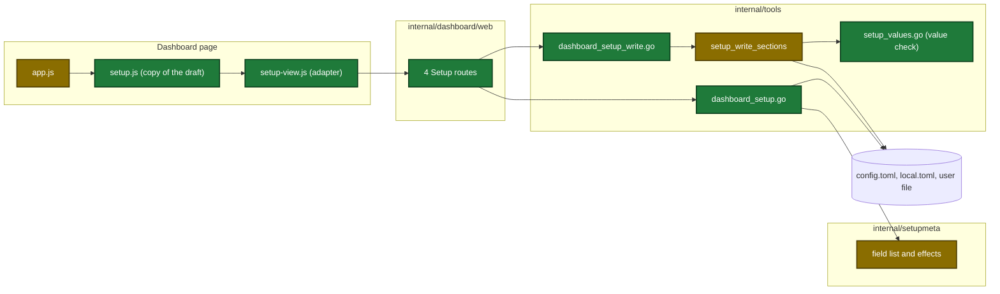
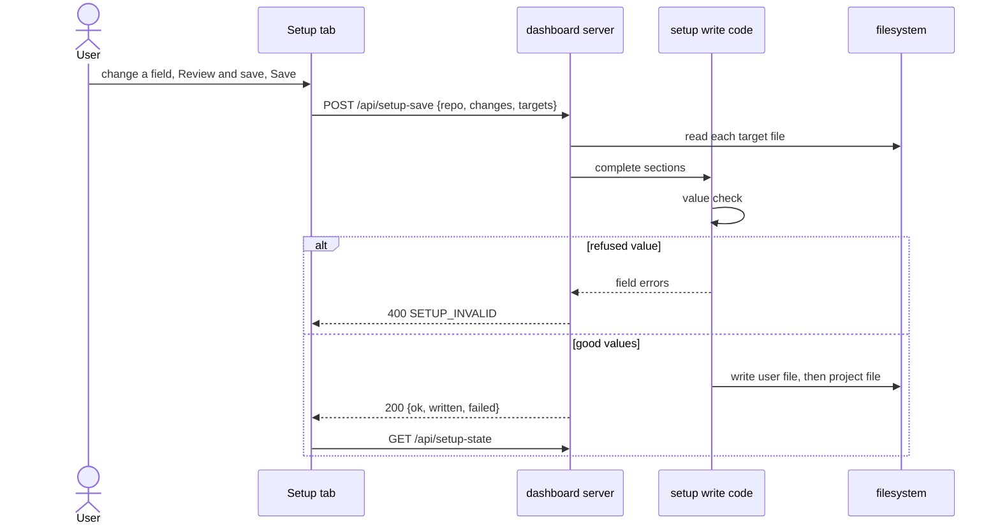
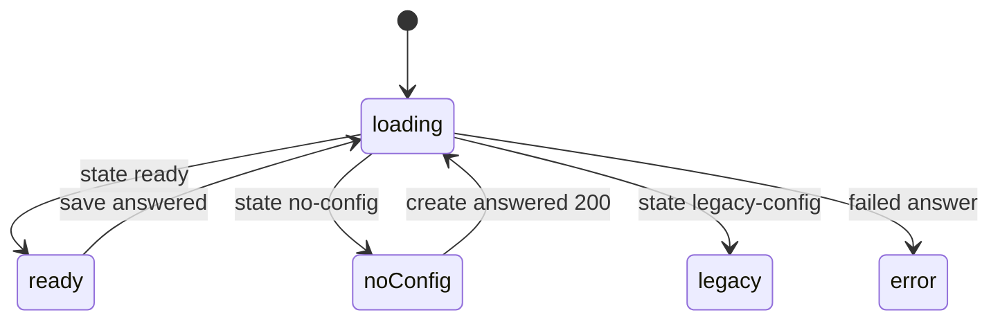

# Design

## Context

- See proposal.md - Why.
- The setup write code replaces a whole section at its key and keeps the comments of the file.
- The approved page is the draft in `design/dashboard/static/`. It reads sample data and saves nothing.
- The dashboard server reads and writes only the main worktree of each repo.

## Goals / Non-Goals

- Goal: the shipped Setup tab equals the approved draft. Only the API calls, the removed draft tools, and the listed access fixes differ.
- Goal: one value check serves `setup_write_sections` and the dashboard save.
- Non-goal: a move of a whole section between files.
- Non-goal: a lock against a running pipeline, or a rollback of a partly written save.
- Non-goal: an edit of the 9 delegated sections on the page.
- Non-goal: a write to a linked worktree.

Architecture of the touched parts:

Main runtime flow of one save:

Page state of the selected repo:

Request body of the save:

| Field | Type | Encoding | Example |
|---|---|---|---|
| `repo` | string | plain text, repo root | `/repo` |
| `changes[].section` | string | form section id | `plan-tasks` |
| `changes[].field` | string | field name, may be dotted | `tag.enabled` |
| `changes[].op` | string | `set` or `reset` | `set` |
| `changes[].value` | any | JSON value; refused with `reset` | `"minor"` |
| `targets` | object | local form section id to `project` or `user` | `{"ship":"project"}` |

## Decisions

| Decision | Chosen | Rejected alternatives | Reason |
|---|---|---|---|
| Place of the value check | In the setup write code, before any write | A second check in the page; a check only in the dashboard save | The tool and the page refuse the same values |
| Scope of the value check | New values only | Check every stored value | A repo with a hand-written accepted value can still save |
| Save to switch | Moves the changed fields only | Move all saved values of a section | The write code has no move of a section. The user chose this option |
| Page code | Copy of the draft script and styles with closed change lists, and one adapter file | A split into three new files | A split changes most draft lines. The user asked for the exact approved design |
| Order of two file writes | User file first, project file second | One write | If the second write fails, the old project value still applies |
| Routes | 2 read routes with no token, 2 change routes with the token guard | One route for all | The current routes follow the same rule |

## Risks / Trade-offs

| Risk | Impact | Mitigation |
|---|---|---|
| A save while a pipeline runs | The next steps read the new config | A notice shows above the form and in the review dialog. The save is not blocked |
| A partly written save | Some sections hold the new values | The save bar note lists each failed section with its file. The form loads the state again |
| A save over 8 KiB | The server refuses the save | The note tells the user to save fewer fields at one time |
| The draft file is not in git | The executor cannot copy it in another worktree | The plan runs in this worktree. A task stops when a draft file is absent |

## Migration Plan

- No data migration. An empty table can stay in a file after a reset, and every reader accepts it.
- Rollback: revert the change. The config files stay valid.
