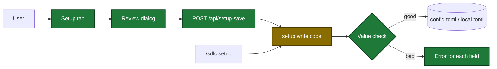

# Proposal

## Why

- A user cannot see or change all plugin config values in one place. `/sdlc:setup` asks one question at a time, and a change of one value needs a new session run.
- Evidence: the approved dashboard design `design/dashboard/requirements.md` (requests R1 to R11) and its draft `design/dashboard/static/`.
- Why now: the dashboard already shows every registered repo. The setup write code (`setup_write_sections`) already writes each config file and keeps comments.

## What Changes

| Area | Before | After |
|---|---|---|
| Dashboard tabs | Pipelines, Activity, History, Preplans | The same four, then Setup. Setup shows the count of unsaved changes |
| Setup tab | None | One form for one repo, built from the Go field list. 10 form sections, 48 fields, 9 read-only cards for the delegated sections |
| Save of a field | Only through `/sdlc:setup` | Review dialog, then `POST /api/setup-save`. The save sends the changed fields only |
| Repo with no config | Only `/sdlc:setup` | Create config button, `POST /api/setup-create` |
| Value check | `setup_write_sections` writes any value | One value check in the write code refuses a bad new value. The setup tool and the page use the same check |
| Field list output of `setup_prepare` | No `details`, no `effects` | No change. The dashboard gets `details` and `effects` from its own route |
| Dashboard routes | 6 read routes, 9 change routes | 8 read routes, 11 change routes |

Flow of one change of a config value after the change:

## Capabilities

### New Capabilities

None.

### Modified Capabilities

- `pipeline-dashboard`: the Setup tab and its 4 routes are new. The route lists, the page layout, the repo filter, and the panel draw rule change.
- `tool-setup-write-sections`: the value check before a write is new.
- `tool-setup-prepare`: the section manifest states that the field rows hold no `details` key and no `effects` key.

## Impact

| Path | Kind | Change |
|---|---|---|
| `internal/setupmeta/` | internal package | Effect text for each option, two corrected texts, schema coverage test |
| `internal/tools/setup_values.go`, `internal/tools/setup_write.go` | MCP tool | Value check of `setup_write_sections` |
| `internal/tools/dashboard_setup.go`, `internal/tools/dashboard_setup_write.go`, `internal/tools/setup.go` | MCP tool | Field list, repo state, save, and create for the dashboard |
| `internal/tools/dashboard.go` | MCP tool | Description names the two new file changes |
| `internal/dashboard/web/` | internal package | 4 routes, the Setup tab files, the page shell |
| `.github/workflows/test.yml` | CI | Runs every dashboard JavaScript test file |
| `docs/dashboard.md`, `docs/skills/dashboard.md`, `docs/skills/setup.md`, `site/src/data/features.mjs` | doc | Setup tab section and route lists |
| `plugins/sdlc/skills/dashboard/SKILL.md` | skill | Recovery table rows for save and create |
