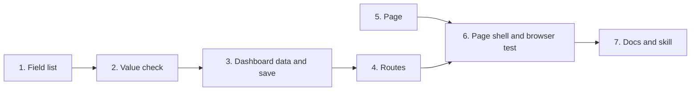

# Tasks

Group dependencies:

## 1. Field list

- [x] 1.1 Add the effect text of each option in internal/setupmeta/effects.go and correct two texts in internal/setupmeta/sections.go — verify: go test ./internal/setupmeta/ ./internal/commstyle/
- [x] 1.2 Add the schema coverage test in internal/setupmeta/schema_sync_test.go — verify: go test ./internal/setupmeta/ -run TestSchemaKeys_CoveredByFormOrDelegated

## 2. Value check

- [x] 2.1 Add the value check in internal/tools/setup_values.go and call it in internal/tools/setup_write.go — verify: go test ./internal/tools/ -run 'TestCheckSetupValues|TestSetupWrite'

## 3. Dashboard data and save

- [x] 3.1 Add the field list and repo state in internal/tools/dashboard_setup.go — verify: go test ./internal/tools/ -run 'TestDashboardSetupState|TestSetupPrepare_EmptyTable'
- [x] 3.2 Add the save and create in internal/tools/dashboard_setup_write.go and the description in internal/tools/dashboard.go — verify: go test ./internal/tools/ -run 'TestDashboardSetup|TestSetupParity_ToolAndSave|TestDashboardToolDescriptionExact'

## 4. Routes

- [x] 4.1 Add the 4 Setup routes in internal/dashboard/web/setup_routes.go and internal/dashboard/web/server.go — verify: go test -tags integration ./internal/dashboard/web/ -run 'TestHandler|TestWithToolRoutes|TestE2E'

## 5. Page

- [x] 5.1 Add the adapter in internal/dashboard/web/static/setup-view.js and widen the CI test glob in .github/workflows/test.yml — verify: node --test internal/dashboard/web/testdata/*.test.cjs
- [x] 5.2 Copy the draft styles and script to internal/dashboard/web/static/setup.css and setup.js with the closed change lists — verify: diff against design/dashboard/static shows only the listed hunks
- [x] 5.3 Connect internal/dashboard/web/static/setup.js to the API — verify: node --check internal/dashboard/web/static/setup.js and the parity check of the plan

## 6. Page shell and browser test

- [x] 6.1 Add the Setup tab to internal/dashboard/web/static/index.html, view.js, app.js and app.css — verify: go test ./internal/dashboard/web/
- [x] 6.2 Add TestBrowserE2E_Setup in internal/dashboard/web/browser_e2e_test.go — verify: go test -v -tags integration ./internal/dashboard/web/ -run TestBrowserE2E shows PASS for TestBrowserE2E_Setup

## 7. Docs and skill

- [x] 7.1 Add the Setup tab section to docs/dashboard.md, docs/skills/dashboard.md, docs/skills/setup.md and site/src/data/features.mjs — verify: task site:test && task site:build
- [x] 7.2 Add the save and create rows to the recovery table of plugins/sdlc/skills/dashboard/SKILL.md — verify: go test ./internal/skillcheck/...

## Workflow follow-up

- Archive the change through `/sdlc:ship` after the review passes.
